# 01 人生财富靠康波 康波中的价格波动

> 所属部分：第一部分 涛动周期论。

> 微信读书目录页码：18–82。这与 PDF 页脚页码是两套不同的分页。
> PDF 来源范围：物理第 10–45 页，页脚印刷页码 9–44。每页附原图，保留图表与版式。

## PDF 原页 10（页脚 9）

第 一 部 分
涛 动 周 期 论

## PDF 原页 11（页脚 10）

0 1
人 生 财 富 靠 康 波
— — 康 波 中 的 价 格 波 动
·2015年9月12日
关于康德拉季耶夫周期的研究，上一个活跃期是在20世纪70年代，事实上，那是第
四次康波的衰退和萧条阶段。而2005年之后，我们一直致力于康波理论的研究，
2008年美国次贷危机之后也有一些论述经济周期的著作出现，但大部分并不涉及对
康波的系统论述。
2014年中期之后，我们有一个切身的感受，当房地产作为一类资产的投资价值渐渐
淡去之后，中国庞大的货币面临着方向的选择，我们当时就有一个判断，随着步入
工业化后期，中国已经开始进入宏观对冲时代。但对中国的宏观对冲研究依然处于
一个懵懂阶段，自2005年以来，我们一直致力于中国的工业化和经济周期理论研
究，并且一直有一个愿望，即建立一套适用于中国的经济周期理论体系，而这套理
论体系是为了宏观对冲，并非一种学院式研究。
以我们对康波的理解，虽然康波一般在进入衰退之后才更容易引起人们对这一理论
的重视，但事实上，人生就是一场康波。康波的形成是人的集体行为的结果，而这
种集体行为取决于人的代际更迭。康波研究者福雷斯特曾指出，康波依赖于使用资
本设备的生产方法，依赖于资本设备和建筑的寿命，以及依赖于人们在经济部门中
移动的缓慢速度。长波因人们提前做计划的时间和他们对过去经济灾难记忆的时间
的长度而加深，而这两个方面又在很大程度上取决于人的寿命。在导致长波出现的
这些因素中，没有一个严重依赖于更快的通信或技术变化的细节。
所以，康波的长度其实是一个甲子。一个人出生在康波中的时点几乎就注定了其一
生的经济轨迹。从某种意义上看，人生的财富由康波决定，因为康波的本质表现是
价格的波动，而人生的财富积累根本上源于资产价格的投资或投机，人生财富靠康
波，康波就是人生的财富规划。
上述对康波的基本认识指出了康波的本质，康波在现实中的表现就是康波中的价格
波动，其价格波动规律为我们提供了宏观对冲和人生财富规划的密码。本章将对康

## PDF 原页 12（页脚 11）

波中的价格波动进行研究。而在研究了长期的价格波动规律之后，我们还对2016年
至2018年的世界大宗商品价格波动做了预测，相信这是未来三年最重要的机会了。
康 波 周 期 概 述
对康波的早期研究是在19世纪末，俄国人帕尔乌斯已经发现了经济增长中存在50～
60年的长期波动，1913年，荷兰经济学家范·盖尔德林提出经济发展中的大循环，
其周期是60年。1919—1922年，苏联经济学家康德拉季耶夫提出了长波假设，发表
在《战时和战后时期的世界经济和经济波动》一书中。1924—1925年，他发表了
《经济生活中的长周期》一文，奠定了康波研究的理论基础。从那时起到二战，是
康波研究的活跃期，研究重点是统计证明和康波原因的定性分析。而在其后的30年
里，对康波的研究一直沉寂，想来那是第四次康波的繁荣阶段。20世纪70年代之
后，对康波的研究再度活跃，而这肯定源于第四次康波进入了衰退和萧条阶段，那
时对康波的研究除了欧美经济学家福雷斯特、曼德尔、罗斯托，日本也异军突起，
最有成就的是筱原三代平。
有 关 康 波 时 期 的 各 种 划 分 方 法
表1-1是各个康波研究者对前四次康波的划分。需要注意的是，如果按照繁荣、衰
退、萧条、回升四个阶段来划分康波，康波的顶指的是衰退期的结束，也就是说，
繁荣和衰退是康波的上升期。而康波的谷指的是回升的结束，也就是说，萧条和回
升是康波的下降期。从各种划分来看，康波基本上围绕着50～60年的周期循环。
表1-1 有关康波时期的各种划分法

## PDF 原页 13（页脚 12）

注：A——根据批发物价水平，B——考虑了其他指标。学者名字后的括号为著作发
表的年份。资料来源：筱原三代平、毕志恒，《历史波动中的现代世界经济——二
十一世纪初期将出现繁荣局面》，《国际经济评论》，1984（9）。
目前受到比较广泛认可的康波划分方法是荷兰经济学家雅各布·范杜因的划分。他
的划分列出了有资本主义世界以来前四次康波的四阶段划分，以及标志性的技术创
新。从表1-2中可以看出，第五次康波自1982年起进入回升阶段，1991年之后进入
繁荣阶段，而根据我们对康波的理解，我们定位主导国美国繁荣的高点为康波繁荣
的顶点，即2000年或2004年。2004年后康波进入衰退阶段，而第五次康波的标志性
技术创新为信息技术。
表1-2 世界经济史上的五次康波（1782—2015）

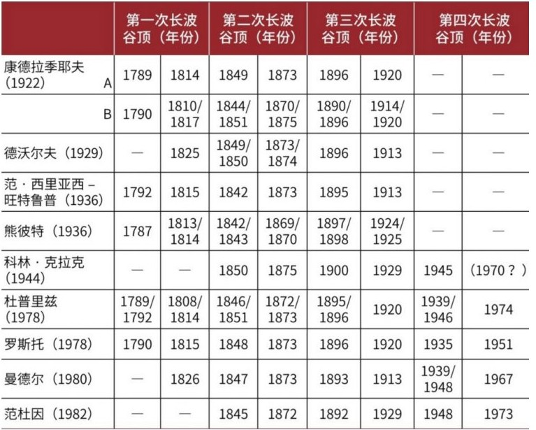

## PDF 原页 14（页脚 13）

资料来源：1973年以前参见雅各布·范杜因，《创新随时间的波动》，《现代外国
经济学论文选（第十辑）》，商务印书馆，1986年。
1973年以后为陈漓高、齐俊妍所续。陈漓高、齐俊妍，《信息技术的外溢与第五轮
经济长波的发展趋势》，《世界经济研究》，2007（7）。
第五次康波为周金涛划分。
当 前 对 康 波 的 基 本 认 识
美国的伊斯伯尔丁对康波做了简单又深刻的描述，基本上符合我们对康波的认识。
（1）每个康波是指一个相当长时期总的价格的上升或总的价格的下降。（2）价格
的长期波动不是自己产生的，而康德拉季耶夫认为是资本主义体系本质的结果。
（3）每个康波又嵌套着几个库兹涅茨周期和几个朱格拉周期。
对康波的研究最初就是一种统计现象研究，支持长波假设的最有力的经验型证据来
自价格序列。我们可以在长期利率的运动、世界能源生产和创新中发现支持性证
据，也可以在工业生产、失业和投资中见到有限的证据。所以，康波的根本问题还
是世界资源品价格的长期波动问题，资源品价格包括商品属性和金融属性两个方
面，而这也决定了康波就是国际宏观对冲的根本理论。

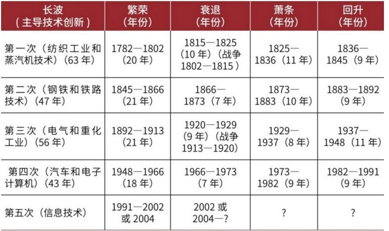

## PDF 原页 15（页脚 14）

为什么价格会呈现50～60年的周期波动？目前我们还是认为这是资本主义自身运动
的结果，但到底是什么力量推动了资本主义的长期周期运动，依然没有统一的观
点。关于康波根本推动力的理论，目前有以下几种：（1）创新说，即把长波归因
于技术革命；（2）货币说，即在金本位下黄金产量的变动带来货币量的变化，从
而带来价格变动；（3）新的国家进入世界体系，包含战争革命等因素；（4）初级
产品及能源的供给限制。在康波推动力的研究中，熊彼特的研究显然影响最深远，
他提出了三周期嵌套模型，并提出了创新导致康波的理论。
所以，康波研究的入手点就是康波中的价格波动。
康 波 中 的 增 长 与 通 胀
我们对康波表象的基本认识，实际上就是康波中增长与通胀的关系。任何周期的机
制都可以理解为价格对增长的反制，康波也不例外。但是康波中通胀对增长的抑制
是十分暴力的，基本上以冲击的形式完成。而且，这种冲击要延续10年以上，其间
将两次经历重要的危机阶段。所以，增长与通胀的关系是划定康波阶段的核心问
题。而这一点对宏观对冲的意义在于，在康波的框架下，不同阶段增长与通胀的关
系是变化的，不是不变的。10年前的经验对后10年没有任何借鉴意义，必须追溯到
50年前才更恰当。
康波的繁荣阶段往往是高增长伴随着低通胀，这可以解释为新的技术提高了效率，
高增长并没有引发资源约束。而当新的技术对生产率的提升边际递减时，康波就进
入了资源约束阶段。这种对康波进入衰退阶段的解释简单而牵强，实际上我们的理
解是，当效率降低时，资本主义体系仍然期望按照原有的增长速度运行，这就必然
会增加资本投资。与此同时，新的引入资本主义发达体系的国家开始工业化，造成
资源需求的边际上升，而以前在资源品价格处于低位时供给没有得到充分准备，这
带来供需边际变化短期内的不平衡，资源约束启动，价格迅速上升，这一点一旦与
资本收益率的下降相契合就会发生经济冲击。在每个康波的衰退阶段，衰退的前半
期都是高增长引发高通胀，而后半期都是滞胀，从衰退期到萧条期总是如此反复。
康波从萧条向回升的转换本质上就是从滞胀向通缩的转换，此时经济增速不断下
降，商品价格明显回落，通缩成为社会的共识，这个过程也有10年之久。在衰退后
半期，世界经济陷入一种无奈的状态，对康波的研究往往发生在这个阶段（可参考
图1-1）。

## PDF 原页 16（页脚 15）

图1-1 经典长波的九阶段示意图
资料来源：拉尔夫·艾略特，《艾略特波浪理论》。
从康波的形态来看，最复杂的就是衰退阶段，一般来讲，衰退阶段首先会出现一个
标志性的经济危机，比如第四次康波的1971—1973年布雷顿森林体系崩溃，2008年
美国的次贷危机，事实上都确认了康波进入衰退阶段。而在这个冲击阶段之后，世
界将迎来一个暂时的稳定阶段，即两次冲击之间的间歇期。间歇期的结束一般以发
生新的冲击为标志。我们看到，第二次冲击往往更多发生在新兴经济体或资源国
中，比如在第四次康波萧条中陷入悲惨增长的拉美。在两次冲击后，康波进入萧条
阶段，此时是一种通缩与滞胀反复的局面。从萧条向回升的过渡是缓慢且漫长的，
要经历10年以上的时间，其间我们可能会看到一些新兴经济体的复兴，比如20世纪
80年代至90年代的亚洲四小龙，它们的复兴就发生在第五次康波的回升阶段。
但是从以往的康波形态来看，衰退期和萧条期都表现出极其复杂的状态，特别是进
入美元本位制后，货币对康波形态的扰动明显增加，第四次康波的衰退起点目前定
在1966年，即美国经济增长的高点，随后出现布雷顿森林体系崩溃，属于康波衰退
的冲击，但在萧条阶段的9年中，1974年和1979年发生两次石油危机。萧条期没有
表现出明显的通缩，而是长期滞胀，这显然与货币因素、政治因素都有关系。
在第四次康波中，实际上日本在1971年后就已经出现了严重的通胀局面，在1974年
经石油危机冲击后，日本通胀与增长的反向关系达到极致，但日本经济走出了明显
的V字形反转，这也是经典的康波冲击形态（见图1-2）。

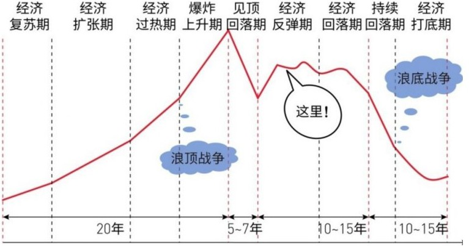

## PDF 原页 17（页脚 16）

图1-2 第四次长波衰退下的日本CPI和GDP
资料来源：CEIC数据库，中信建投证券研究发展部。
1966年之后，美国结束了高增长低通胀的局面，而在1966—1982年，美国始终处于
滞胀状态（见图1-3），这就是康波的衰退与萧条期。1982年之后，美国又进入高
增长低通胀的局面（见图1-4），直到2007年。2007年后，全球的本质是通缩，这
一点与经典的康波是一致的，但这并不等于说本次康波将在通缩的局面中结束。
▲图1-3 美国月度工业增加值产出缺口和CPI当月同比
资料来源：Wind资讯，中信建投证券研究发展部。

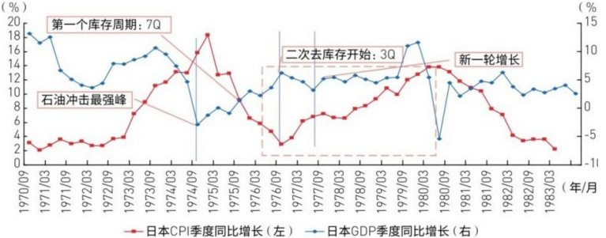

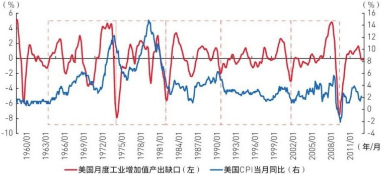

## PDF 原页 18（页脚 17）

图1-4 美国的工业产出指数和产能利用率
资料来源：CEIC数据库，中信建投证券研究发展部。
从产能利用率上可以清晰地看到，1983年是产能利用率的低点，也是康波萧条的结
束和第五次康波复苏的开始。
康 波 中 的 价 格 现 象
对康波中的价格现象认识最深刻的是罗斯托，当然，最终在判断第五次康波的时候
他也犯了错。罗斯托用价格运动来解释康波，他认为形成长期波动的基本原因是粮
食和初级产品的相对丰裕和匮乏。他认为三种力量，即增长的主导部门、粮食与原
材料的价格、国际和国内人口迁移是研究康波的关键。这一认识的分支是太阳黑子
学说，因为太阳黑子的变化导致了气候变化，从而导致初级产品价格波动。现在看
来，这个分支对研究农业和石油的价格波动具有重要意义。
罗斯托在他的《为什么穷者变富了而富者富得慢了》一书中写道：“在第一个康波
上升时期的英国，价格上涨趋势有66%发生在1799年和1801年；在第二个上升时
期，价格上涨有71%发生在1852年和1854年；在第三个上升时期，价格上涨有57%发
生在1898年和1900年；在1973—1975年，世界经济经历了这样一种痉挛式的上
升。”罗斯托注意到在周期波动的顶点，物价在三年里猛涨60%～70%乃至两倍这一
现象，并主张应当从实物而不是货币方面分析这种现象。
对康波而言，价格的剧烈波动是其有别于其他周期的重要特征，而这种价格的剧烈
波动主要集中于从衰退到萧条的阶段。罗斯托的观察描述了这种康波价格波动的基
本特征，即价格的波动在一段很短的时间内急剧变大，最终对经济造成冲击（见图
1-5）。这实际上就是所谓的康波衰退的冲击，而这种冲击一般集中于康波衰退
期，但在第四次康波中，冲击贯穿了整个衰退和萧条期。

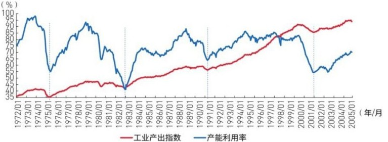

## PDF 原页 19（页脚 18）

图1-5 价格的冲击性波动
资料来源：Wind资讯。
这里的核心问题是，到底是什么造成了康波价格的突然上行，目前的解释集中于三
个原因。第一个是创新，即罗斯托说的主导部门问题，由于新的技术发明对劳动生
产率的提升作用在繁荣的高潮期开始变弱，增长更多依赖于投资，从而造成价格上
涨，这是一个常见的供需解释。第二个是关于追赶国的工业化问题，由于新的国家
的工业化加入了世界资本主义体系，对资源品的边际供需缺口突然增加，从而加剧
了价格的波动，我们认为这是核心原因。第三个是关于农业及相关初级材料的丰歉
问题，这个问题被有些康波研究者认为是康波价格波动的基本原因。但迄今为止，
我们无法以一种完美的理论来解释农业价格波动的原因，而其最有体系的是太阳黑
子学说。
在第四次康波之后，世界货币本位制彻底与黄金脱钩，初级产品价格水平呈现一个
中枢不断上移的态势，货币本位制的变化的确改变了价格波动的中枢，但没有改变
康波中价格波动的形式。价格中枢的上移是全球脱离金本位之后的结果，但康波认
为，价格的波动当以黄金的购买力来衡量。如果用黄金原油价格比率来间接解释价
格的波动，我们可以发现，黄金原油价格比率一直围绕着中枢波动（见图1-6），
这就解释了我们上面的观点。

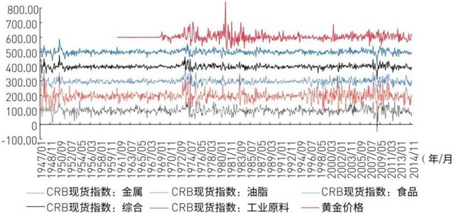

## PDF 原页 20（页脚 19）

图1-6 全球黄金-原油价格比率
资料来源：CEIC数据库。
康 波 中 商 品 价 格 牛 熊 的 原 因
关于康波中初级产品价格的解释，罗斯托认为，初级产品部门（含能源、原材料和
食品）生产能力的不足和生产能力的过剩交替过程较长，因为这些产品的需求不能
平稳发展。原因在于：（1）在获利能力出现和为开发它做出投资决策之间存在长
时间的延迟，开辟新的生产能力需要长时间的酝酿；（2）在完成投资和最有效的
利用之间存在延迟。
实际上，大宗商品价格本身也会随着经济中周期和短周期而波动，这是一个比较简
单的供需机制问题，而康波对价格研究的意义在于，价格机制会在康波繁荣到达顶
点之前突然变化，即所谓的大宗商品10年牛市，而10年牛市之后又会出现一个价格
剧烈波动的熊市，这个熊市一般贯穿于康波的衰退和萧条阶段，主要下跌阶段维持
15年。在大宗商品牛市和熊市阶段中，增长与通胀表现出异于以往的特征，过去10
年价格的波动特征不一定适用于未来10年，在大周期格局下理解短期的价格波动才
是研究康波价格的根本意义。
至于为什么供需之间的边际突然拉大，这应该被视为一个积累的结果，因为从大的
格局看，在康波回升到繁荣的过程中，总体来看价格处于稳定状态。周期研究认
为，这是由于技术创新推动效率的提升，而当效率提升放缓时，为了保持原有的增
速就需要更多地依赖投资，供需的原有平衡边际发生了变化。从图1-7中我们可以
看出，美国全要素生产率的增长在2003年达到高点，而2002年之后，正是本轮大宗
商品牛市的启动点。

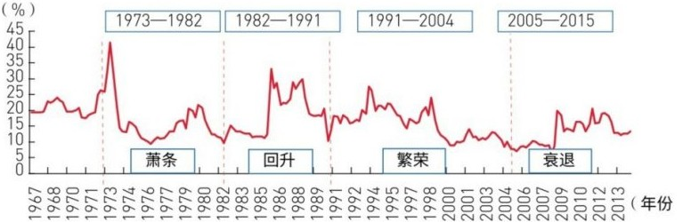

## PDF 原页 21（页脚 20）

图1-7 美国全要素生产率的增长、资本投入与劳动力投入对产出增长的贡献
资料来源：美国劳工统计局。
在第四次康波中，美国的全要素生产率在1966年附近到达高点，这正是康波繁荣的
顶点，在经历了波动之后，全要素生产率的低点出现在1982年，即第四次康波萧条
的结束点（见图1-8）。
图1-8 美国的技术进步（全要素生产率）与经济周期
资料来源：A. Steven Englander. Total Factor Productivity: Macro-economic
and Structural Aspect of the
slowdown.http://www.oecd.org/eco/outlook/35237178.pdf。

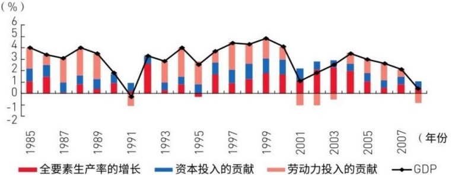

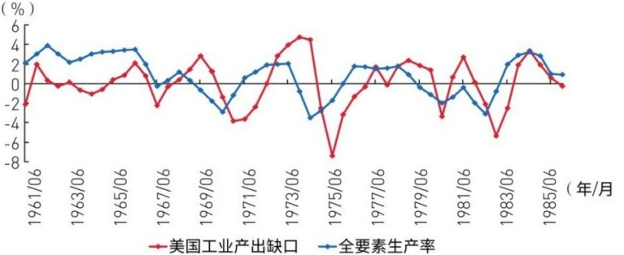

## PDF 原页 22（页脚 21）

还有一个问题，就是所谓的牛鞭效应，由于上游资源品处于供应链的最末端，其波
动性是最大的。
牛 鞭 效 应
牛鞭效应的基本含义是：当供应链上的各节点企业只根据来自其相邻的下级企业的
需求信息进行生产或者供应决策时，需求信息的不真实性会沿着供应链逆流而上，
产生逐级放大的现象。当信息到达最源头的供应商时，其所获得的需求信息和实际
消费市场中的顾客需求信息产生了很大的偏差。由于这种需求放大效应的影响，供
应方往往维持着比需求方更高的库存水平或者生产准备计划（见图1-9）。
图1-9 生产过程的价格波动
资料来源：Wind资讯。
但是20世纪70年代之后，世界变得尤其复杂，第五次康波出现了明显的全球化特征
（见图1-10），更多需要共生模式来解释。世界的低通胀主要靠共生模式中中国的
低成本来承担，这是在2010年流行的一种对低通胀的解释。但当2012年大宗商品出
现牛市头部之后，虽然全球的共生模式依然存在，但世界经济进入通缩的趋势已经
非常明显。这里的核心问题是，全球化分工并不会改变周期的秩序，自英国工业化
以来，新的国家和人口不断被纳入资本主义体系，但这并未改变周期波动的本质。
从康波意义上讲，更多的人口加入资本主义体系后，波动不是变小了，而是变大
了。

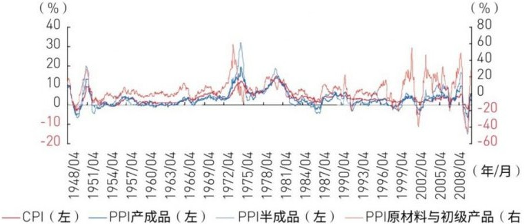

## PDF 原页 23（页脚 22）

图1-10 全球产业链及其相关性
资料来源：周金涛绘制。
康 波 衰 退 和 萧 条 期 的 滞 胀 和 通 缩
第五次康波以来，并没有出现类似第四次康波的滞胀问题，而是表现出明显的通缩
特征，这是需要讨论的。而对于这一点的解释对我们判断未来中期的价格形势非常
重要。为了研究这个问题，我们努力寻找高频的价格序列，但看来最有代表性的长
序列还是美国的CPI，美国的CPI和PPI长期来看是一致的，所以我们以康波划分美
国的CPI趋势，得到的结论很有意义。
从图1-11来看：（1）康波的繁荣期百分之百价格平稳；（2）康波的回升期三次中
有两次价格平稳；（3）康波的衰退期价格百分之百剧烈波动；（4）康波的萧条期
百分之百冲高回落。这个研究的意义在于，它说明我们处在衰退即将结束、向第五
次康波萧条过渡的阶段，而此时全球都处于货币大量释放后的通缩阶段，康波的规
律向我们展示，目前处于5年价格低点的概率非常高，未来5年，我们研究的重点不
是如何防范通缩，而是如何应对滞胀。

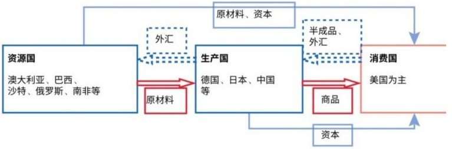

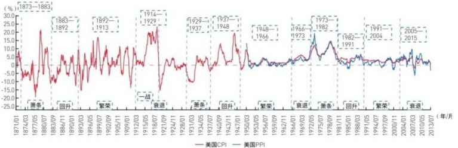

## PDF 原页 24（页脚 23）

图1-11 康波各个阶段的价格表现
资料来源：DATASTREAM数据库。
康 波 中 的 能 源 和 有 色 金 属
康 波 中 的 能 源 问 题
1983年，日本经济学家木船久雄在他的著作《经济的长期波动与能源》中研究了康
波中的能源问题，他研究了日本和美国的一次能源供给对国民生产总值的弹性值，
并得出了几个结论。
（1）从超长期来看，弹性值收敛于1。在约100年的时间内，尽管出现了重大的产
业和社会结构变革，但作为生产要素和家庭最终消费品的能源消费合计增长率基本
上与收入增长率相近。（2）从长期看，虽然弹性值收敛于1，但仍有一定的波动，
受到很大的干扰。按计测期间计算，日本从1947年到1954年，美国从1933年到1940
年，弹性值波动都很大。两国弹性值受干扰的时期均出现经济增长水平的急剧下
降。（3）经济增长率发生变化，能源消费结构并不能适应这种瞬间的变化。经济
增长率下降及其后的数年间，能源弹性值仍呈上升趋势，而在形成适应低速增长率
的能源消费结构之后的数年里，增长率开始回升，弹性值进入下降局面，从而形成
谷底。
我们观察美国的长期一次能源供给对国民生产总值的弹性值，美国两次出现弹性值
超过1，且与国民生产总值趋势产生背离的阶段，一次是1911—1922年，一次是
1972—1976年，这两次都处于长波的繁荣向衰退转换的过程。在后一次中，美国的
核心CPI直到1980年才见到最高点，因此，第二次石油危机的发生也许只能更多地
被解释为偶然因素（见图1-12）。
图1-12 美国能源消费量和消费增速

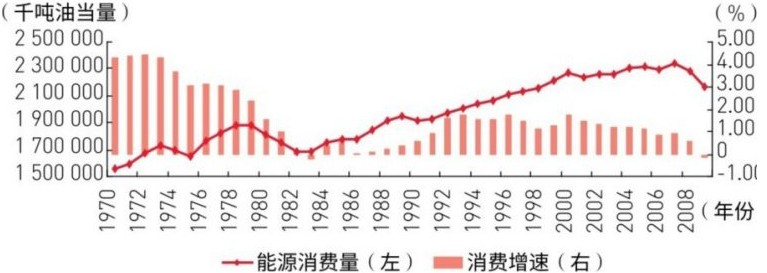

## PDF 原页 25（页脚 24）

资料来源：Wind资讯。
但是，我们需要理解为什么经济衰退后依然会出现一定时期的能源价格上涨，这就
存在能源消费的惯性规律问题。对此，木船久雄解释道，“在石油危机之后，尽管
能源价格发生了变化，但是日本战后近30年培植起来的多耗能产业和消费结构难以
因价格变化而急速转换。20世纪60年代末到1978年前后，日本弹性值超过1，正是
由于这一时期是带有前一时期影响的惯性时期。当弹性值有下降趋势时，情况亦相
同”。
2000年之后，美国的能源消费增速是下降的，而石油的价格是上涨的（见图1-
13），所以不能用当期供需来解释价格长期波动的原因，这是我们一贯的观点，能
源价格的波动是一个长期累积的结果。
图1-13 美国一次能源消费增速和产出缺口
资料来源：Wind资讯。
上面只是已经完成工业化的国家的情况，对康波资源品价格影响最大的是追赶国的
工业化，这就是所谓的当年流行的金砖四国理论的根基。追赶国在康波的繁荣后期
至衰退期进入工业化起飞阶段，这是康波中的一个重要现象，包括第四次康波中工
业化的日本和第五次康波中工业化的中国，都具有类似的情况。从工业化过程中的
能源消耗来看，我们一般认为，工业化起飞国家的能源消耗会呈现一个倒U形的结
构，其在边际爬升的时候，对资源品价格影响最大。从第四次康波中日本的工业化
可以看出，日本工业化经济增速的高点在1964年，一次能源消耗的同比增长率高点
滞后3年，在1967年出现，而彼时第四次康波资源牛市刚刚启动。4年后布雷顿森林
体系崩溃被视为第四次康波衰退的第一次冲击，1974年发生第一次石油冲击的时候

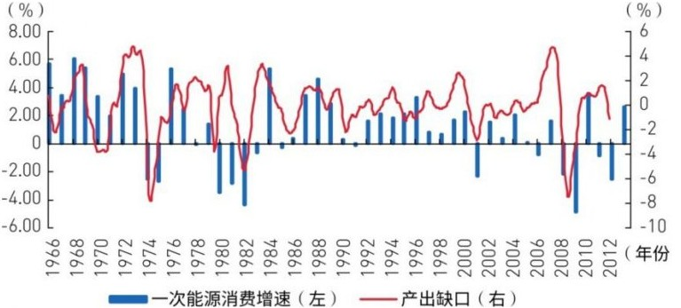

## PDF 原页 26（页脚 25）

（1974年第一次石油危机是康波衰退的第二次冲击，是衰退的结束），日本一次能
源消费的同比增速早已回落（见图1-14），所以我们一直认为，康波资源牛市是一
个累积的结果，当期供需并不是核心原因。
图1-14 日本一次能源消费增速和产出缺口
资料来源：Wind资讯。
在第五次康波中工业化起飞的中国，其一次能源消费增速从1998年开始启动，而这
正好处于中国中周期低点的附近。可以看到，中国一次能源消费增速高点是在2004
年，正好是中国固定资产投资的高点，随后增速开始回落，但资源品价格牛市的冲
击发生在2007—2008年，恰好也在4年之后（见图1-15）。由此可见，资源品价格
的冲击是一个累积的结果，正好体现了木船久雄提出的能源结构调整的滞后性问
题。巧合的是，我们在2006年发表了《色即是空》，提出了这一思想，那是我们康
波研究的开始。
从能源冲击的角度看，康波中的能源冲击是一个累积的结果，是劳动生产率下降、
牛鞭效应和追赶国工业化的共同结果，但这一框架仅适用于分析冲击阶段。在对短
期的能源波动分析后我们发现，能源消费增速遵从朱格拉周期，所以短期的能源价
格波动是与经济增长率相关的，而康波中的能源价格波动显然要遵从我们上面提出
的框架。

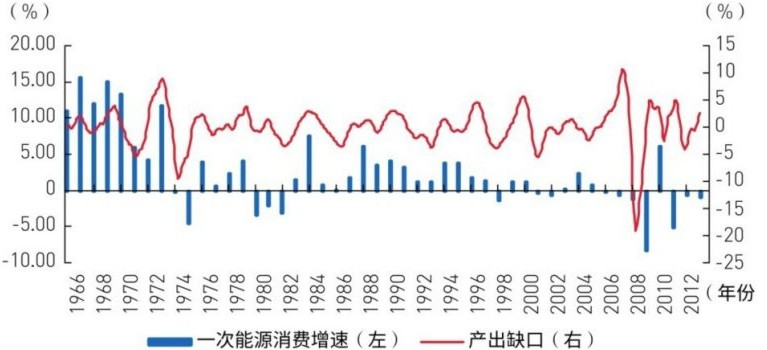

## PDF 原页 27（页脚 26）

图1-15 中国一次能源消费增速和产出缺口
资料来源：Wind资讯。
康 波 中 的 工 业 金 属
从康波中大宗商品价格波动的原理来看，能源与工业金属是一致的。所以，在阐述
能源问题后，我们只将工业金属价格与能源价格做对比，来研究工业金属价格波动
与能源价格波动的差异性。
从总体趋势来看，工业金属（铜、铅、锌）价格走势与能源（石油）价格走势呈现
较强的一致性。繁荣期（1991—2004年）是价格波动的稳定期，价格的剧烈波动主
要集中在衰退期（2005—2015年）和萧条期，符合康波中大宗商品价格波动的特
征。周期研究认为，价格的波动是效率边际变化与供需平衡重构的结果。当技术创
新刚被引入并带来效率提升时，较少的投入可以提供足额的产出，但当效率提升放
缓时，为了保持原有的增速就需要更多的投资，这势必打破原有的平衡关系，使得
供求发生较长时间的重构。这种长时间的重构进一步解释了工业金属和能源在更短
周期里的不一致性（见图1-16）。
值得注意的是，20世纪90年代之前，工业金属价格与能源价格波动的关联度较小
（见图1-17和图1-18）。从对20世纪后半期石油价格的历史梳理来看，70年代才形
成OPEC（石油输出国组织）供给侧寡头垄断，在此之前，石油的定价权完全掌握在
英美石油公司手中。直到90年代之后，期货与金融因素对油价的影响才逐渐加大，
最终产生了由OPEC、石油需求和国际石油资本共同决定的局面，国际油价至此才基
本实现市场定价。这也回答了为什么20世纪90年代之前能源价格波动幅度较小，并
且与工业金属价格波动关联度较小。

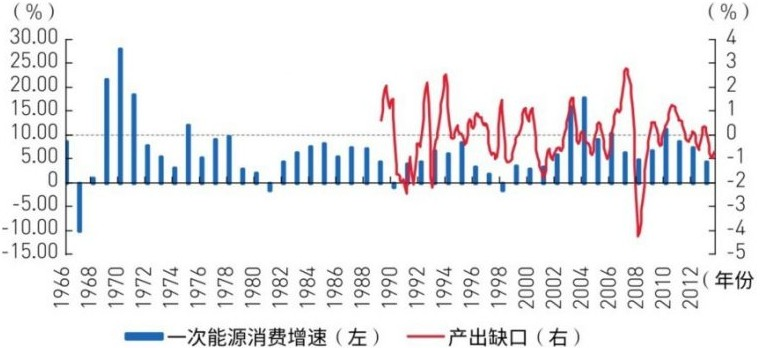

## PDF 原页 28（页脚 27）

▲图1-16 石油价格、铜价和美国产出缺口
资料来源：CEIC数据库。
▲图1-17 石油价格、锌价和美国产出缺口
资料来源：CEIC数据库。

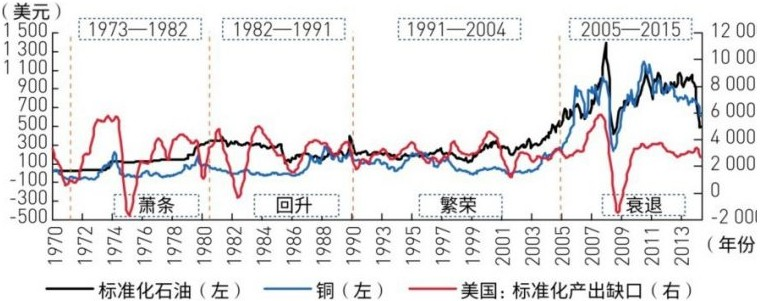

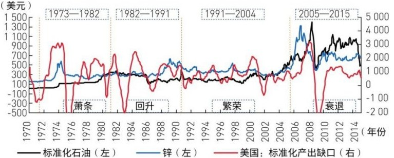

## PDF 原页 29（页脚 28）

图1-18 石油价格、铝价和美国产出缺口
资料来源：CEIC数据库。
康 波 中 的 农 业 和 太 阳 黑 子
在早期的康波研究中，农业一直是一个重要的研究对象，英国统计学家海德·克拉
克在1847年就发现了以54年为周期的欧洲饥馑的长期波动。其中最杰出的是威廉
·S.杰文斯，他在论文《商业危机和太阳黑子》中推定平均为10.45年的太阳黑子
活动周期。但到了20世纪70年代第四次康波研究高潮的时候，农业几乎成为一个十
分边缘的问题，这一定与工业化社会农业对经济影响的弱化有关。农业与其他资源
品相比，特殊性就在于它的供给受到天气的极大影响。所以，农业价格的研究逻辑
一直十分重视太阳黑子运动。我们也试图观察长期的农业价格波动序列，但从直观
的统计数据看，农业价格并未表现出明显的长周期波动特点，反而受到施瓦贝循环
的直接影响，所以，目前的证据无法证明农业价格存在与康波同步的波动。
太 阳 黑 子 周 期 与 康 波
世界是广泛联系的，与康波的三周期嵌套模式最类似的就是太阳黑子周期。太阳黑
子周期最显著的影响是通过影响气候来影响农产品的产量，这是它与康波周期最直
接的联系。但事实上，进入工业化社会之后，农产品价格对周期的中长期趋势的影
响远没有那么显著，但周期理论的一个重要分支确实对太阳黑子对三周期嵌套模式
的影响有深入的研究。研究者认为，除了农产品价格，太阳黑子以一种未知的原因
影响着人类的情绪和商业行为，从而成为决定周期的另一重要因素。
前人对太阳黑子活动的周期性研究，将太阳黑子活动划分为以下几个周期：厄尔尼
诺循环（2～7年）、黑子周期（施瓦贝循环，约11年）、太阳磁活动周期（海耳定

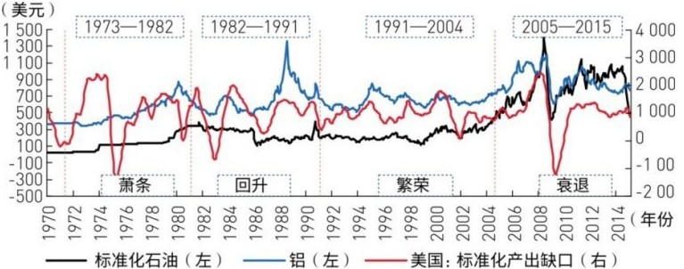

## PDF 原页 30（页脚 29）

律，约22年）、吉村循环（约55年）。国际天文学界以1755年3月为太阳黑子活动
周期元年，到2013年已经历23个完整的黑子周期和4个吉村循环（见图1-19）。
2008年3月以来的第24周，处于第五个大周期的第四小周期内，从月度太阳黑子数
据来看，最大值较历史均值偏低，说明本次黑子周期相对较弱（见表1-3）。
▲图1-19 1749年至2013年的23个施瓦贝循环和4个吉村循环
资料来源：NASA（美国国家航空航天局）。
▼表1-3 1755年至2015年的各太阳黑子活动周期（月）

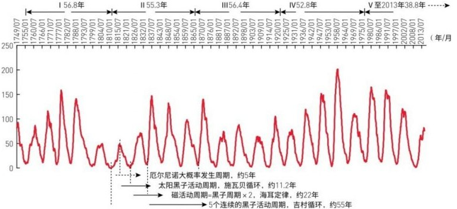

## PDF 原页 31（页脚 30）

资料来源：NASA。
太阳黑子的周期循环基本对应了四周期嵌套模式的各个周期级别（见图1-20）。厄
尔尼诺循环（2 ～ 7年）大致对应库存周期，施瓦贝循环（约11年）大致对应朱格

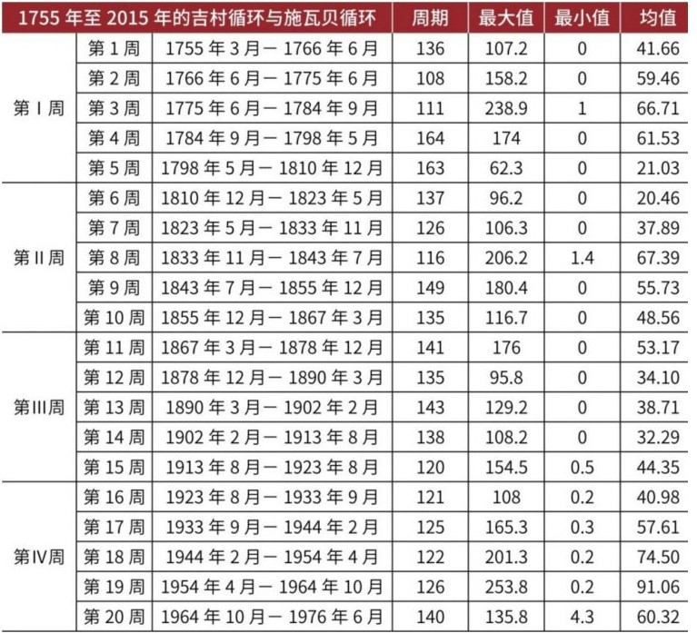

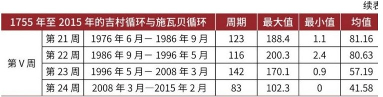

## PDF 原页 32（页脚 31）

拉周期，海耳循环（约22年）大致对应库兹涅茨周期，吉村循环（约55年）大致对
应康德拉季耶夫周期。从太阳黑子与景气的关系来看，太阳黑子的低谷期大致对应
经济周期的高潮期。
图1-20 1782年至2009年太阳黑子周期与康德拉季耶夫波动周期
资料来源：周金涛绘制。
农 产 品 价 格 的 周 期 属 性
根据我们的研究，农产品价格实际上并不显著遵循长周期波动，反而与施瓦贝循环
（约11年）有着较强的关系，这一点我们将在后面的农产品价格中谈到。当然，在
康波价格波动的高潮期，农产品价格也表现出波动放大的特点，例如在20世纪70年
代石油危机和2007年金融危机前后。但这显然不是天气造成的农产品价格波动，仍
然可以从需求角度找到原因。从这个角度看，农业并未表现出因天气影响供给从而
影响长周期价格波动的特点。也就是说，农业供给不是康波波动的原因。天气对农
产品价格波动的影响更多可能属于施瓦贝循环的级别，而在一个施瓦贝循环中，厄
尔尼诺循环带来农产品价格的短周期波动。
太阳黑子活动施瓦贝循环和厄尔尼诺循环与全球农产品价格表现出强相关性。我们
将1866年起的太阳黑子活动数据与玉米、大豆、食糖和小麦的价格波动相比，发现
了非常显著的负相关关系，即太阳黑子较多、活动频繁的时候，由于气候相对温暖
湿润，大宗农产品产量往往增长，价格加速下跌；而太阳黑子较少时，该段时间内
农产品产量往往处于低点，价格有上扬趋势（见图1-21至图1-24）。

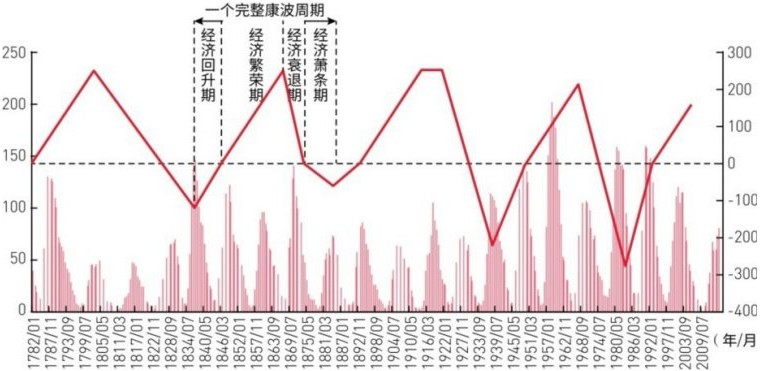

## PDF 原页 33（页脚 32）

▲图1-21 1866—2014年太阳黑子数量与玉米价格涨跌幅和玉米产量
资料来源：美国农业部（USDA）。
▲图1-22 1980—2014年太阳黑子数、大豆价格同比涨跌幅和大豆产量
资料来源：美国农业部。

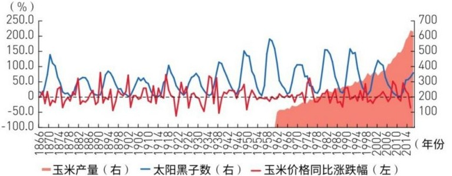

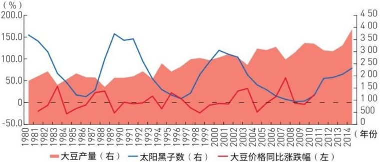

## PDF 原页 34（页脚 33）

▲图1-23 1866—2014年太阳黑子数、食糖价格同比涨跌幅和食糖产量
资料来源：美国农业部。
图1-24 1866—2014年太阳黑子数、小麦价格同比涨跌幅和小麦产量
资料来源：美国农业部。
从第四次康波来看，农产品价格的下降在1964年达到低点，从南方涛动指数来看，
1972—1973年出现了厄尔尼诺，歉收推动了农产品价格上涨，而随后发生两次石油
危机和大宗商品价格上行。1982—1983年，发生超强厄尔尼诺，农产品价格被推向
高峰。但是，在第五次康波中，1997—1998年的超强厄尔尼诺并没有带动价格上
行，反而是在2000年后没有发生超强厄尔尼诺的情况下，商品牛市出现了（见图1-
25）。从这个角度看，太阳黑子运动确实不是农产品价格的长周期推动力量，更多
是影响短周期价格波动。

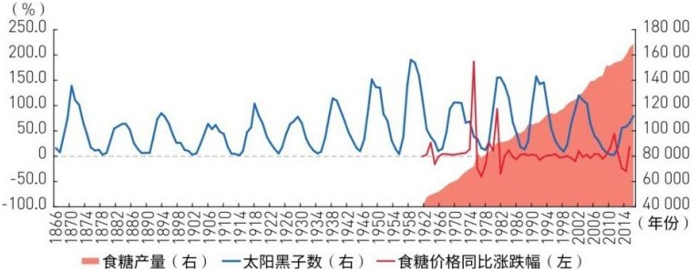

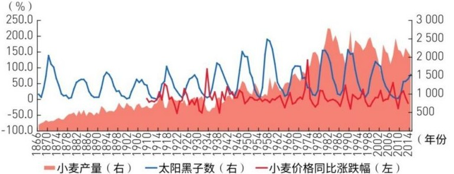

## PDF 原页 35（页脚 34）

图1-25 厄尔尼诺循环与农产品价格
资料来源：美国农业部，周金涛绘制。
康 波 中 的 黄 金
在康波中，黄金作为货币，其价格理论上与大宗商品的总体走势一致，但事实并非
如此。黄金与货币脱钩之后，这个关系变得很复杂。最核心的变化是，黄金虽然不
再是货币，但依然有货币属性，当货币体系发生动荡时，黄金的价格变化则表现出
明显的独立走势，显示出黄金的信用特征（可参考图1-26）。
图1-26 全球黄金价格的长期走势
资料来源：彭博。
1 1盎司≈28.35克。——编者注

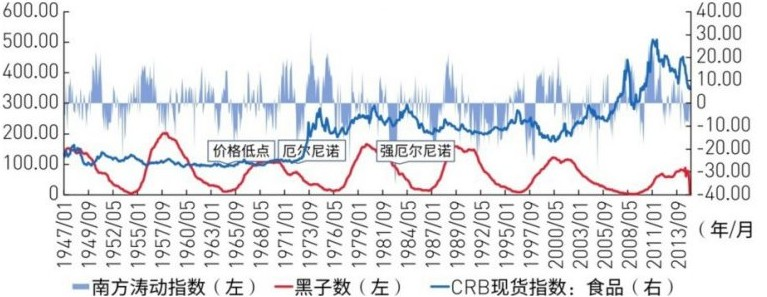

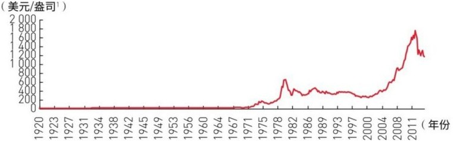

## PDF 原页 36（页脚 35）

货币体系金本位瓦解之后，黄金价格的波动开始加大，从1967年开始，黄金价格大
幅波动，这实际上都是黄金的名义价格。全球黄金的需求在很大程度上受到投资需
求变化的影响，投资需求的变化主要受通胀率、美元汇率、避险需求三个因素的影
响，所以，黄金价格最终还是由其货币属性决定。研究者发现，历史上黄金价格与
美国CPI定基指数的比率为3.2倍，这可以被视为黄金购买力的均值，被称为黄金常
数（可参考图1-28、图1-29）。剔除美国的通胀率后，可以得出黄金实际价格的长
期走势（见图1-27）。从实际价格趋势看，黄金的价格围绕这一中枢波动，而波动
的特征与康波中的价格波动一致，这就是说，黄金理论上就是大宗商品的一般等价
物。
▲图1-27 1966—2014年全球黄金实际价格的长期趋势
注：黄金实际价格等于黄金名义价格除以美国CPI指数（城市），后者的基期为
1967年。资料来源：CEIC数据库。
▲图1-28 黄金价格同比变动率与美国CPI同比增速
注：美国CPI指数为城市CPI指数。

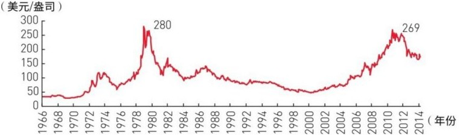

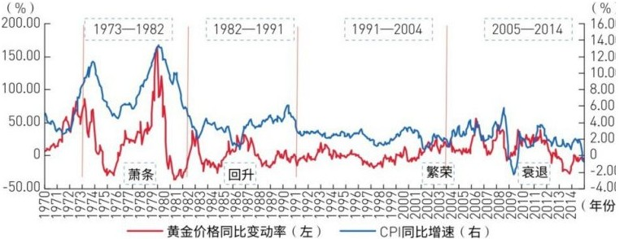

## PDF 原页 37（页脚 36）

资料来源：彭博，CEIC数据库。
图1-29 黄金价格与美国CPI指数比率
注：美国CPI指数的基期为1982—1984年，即1982—1984年的CPI指数为100。
资料来源：彭博，CEIC数据库。
除此之外，黄金作为康波中的货币，对其购买力的检验依据其相对于其他大宗商品
的价格比率。在这方面，黄金-原油价格比率是被广泛应用的指标（见图1-30）。
根据研究，自1971年美元与黄金脱钩以来，黄金的美元价格与原油的美元价格保持
着很强的相关性，在布雷顿森林体系下，黄金-原油的兑换比例大致为每盎司黄金
兑换12.3桶原油。当黄金原油的价格显著脱离这一趋势后，该比率会向这一水平回
归，而且主要是靠原油而非黄金的价格的波动来回归。同样的研究也把这一比率基
本定位于每盎司黄金兑换10～15桶原油。
图1-30 全球黄金-原油价格比率
资料来源：CEIC数据库。

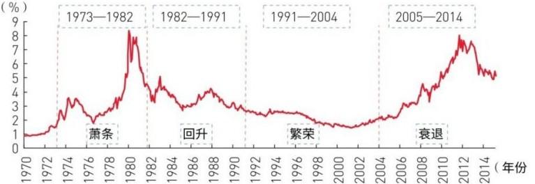

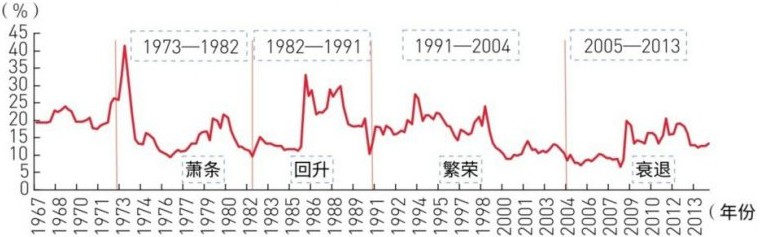

## PDF 原页 38（页脚 37）

解释完黄金的康波货币属性后，问题的关键还是要看黄金脱离其中枢的原因。黄金
对通胀率的脱离和其对黄金-原油价格比率的脱离是两个问题。黄金对通胀率的脱
离实际上就是所谓的吉布森悖论，即将扣除通胀后的实际利率当作持有黄金的机会
成本，实际利率走低则黄金价格向上。从图1-31中我们可以看出，在康波的萧条、
回升及衰退阶段，黄金价格与实际利率的负相关真实存在，但在繁荣期，这种关系
基本上不存在，甚至相反，这实际上是康波中不同阶段大宗商品的表现不同所致。
图1-31 黄金价格与美国实际利率
注：美国实际利率等于10年期国债收益率减去美国城市CPI同比增速。
资料来源：CEIC数据库。
关于黄金价格对商品购买力的波动，本质上讲不完全是康波问题，更可能是冲击因
素导致的，包括商品自身的冲击因素和黄金价格的冲击因素（见图1-32至图1-
35）。但从现有数据来看，黄金在大波段方面表现出了大宗商品的滞后性特征，比
如2004—2007年，黄金显然落后于大宗商品。我们认为这与黄金的货币属性有关，
因为康波衰退的前半期主要表现为大宗商品价格的冲击，而在此之后，黄金涨幅超
越大宗商品可能在于以下两个原因：其一，货币体系动荡，避险情绪的出现；其
二，货币政策宽松带来的实际利率的走低。可以推测的是，由于在整个萧条期实际
利率的走低可能是一个大方向，未来黄金对大宗商品的超越依然存在。

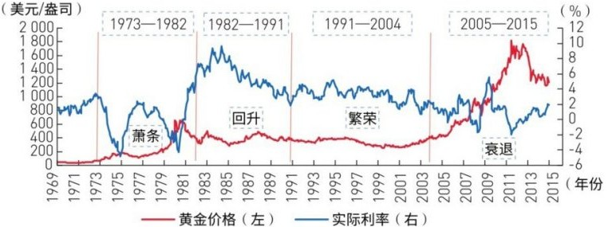

## PDF 原页 39（页脚 38）

▲图1-32 黄金价格与金属现货指数的对比
资料来源：彭博，CEIC数据库。
▲图1-33 黄金价格与工业原料现货指数的对比
资料来源：彭博，CEIC数据库。

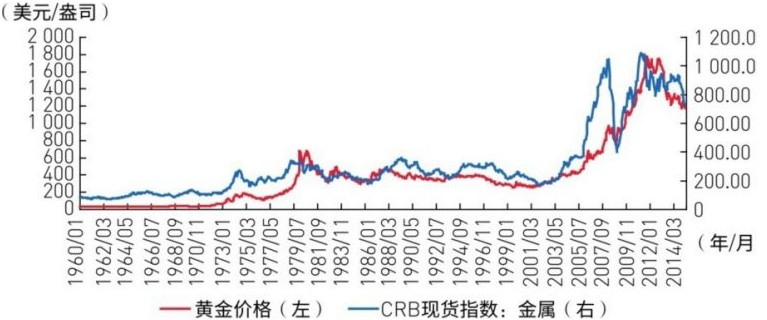

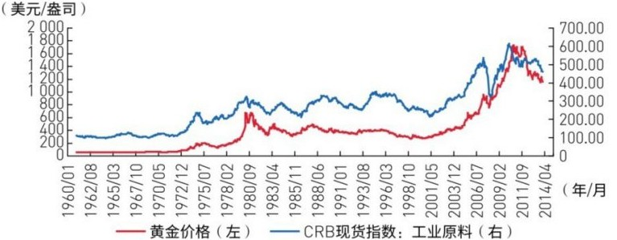

## PDF 原页 40（页脚 39）

▲图1-34 黄金价格与油脂现货指数的对比
资料来源：彭博，CEIC数据库。
图1-35 黄金价格与CRB现货指数的对比
资料来源：彭博，CEIC数据库。
第 五 次 康 波 的 价 格 波 动
关 于 第 五 次 康 波 周 期 的 研 究
关于第五次康波的研究，我们从2006年开始就一直在进行，2006年我们发表了《色
即是空》，用长周期及其嵌套理论解释当时的大宗商品牛市。2007年我们发表了

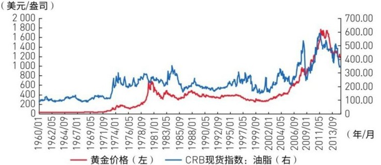

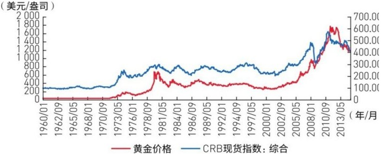

## PDF 原页 41（页脚 40）

《国际化博弈》，在摘要中指出，“当前的中国经济所面临的世界经济环境与20世
纪70年代初期的本质相似性在于，以美国经济为中心的世界经济共生模式面临着美
国信用的危机，而这种危机在次贷危机、全球通胀的推动下极有可能进一步压缩美
国货币政策的调控空间，而由此显现出的国际金融动荡趋势可能被美国经济减速的
进程左右，这一点将是2008年决定全球资本市场走势的根源”，我们成功地判断了
康波衰退的到来。
2008年我们发表了《走向成熟》，指出康波冲击最剧烈的阶段已经过去，中国经济
将出现V形反转。随后我们发表了《资源约束、信用膨胀与美元币值——长波衰退
中的增长与通胀》，对康波第一次进行了系统论述。2009年之后，我们一直专注于
研究房地产周期和库存周期。
2011年是第五次康波衰退的一个重要关口，本次康波商品牛市的第二个头部在2011
年第二季度出现（见图1-36）。而此时，根据对美国房地产周期的跟踪，我们确认
2011年第三季度美国房地产周期启动。我们认为，长波创新周期中主导国货币与其
他货币强弱关系会呈现周期波动，波长约为15年。一个长波包含3个货币周期。从
2012年开始，美国中周期力量恢复。在中、短周期力量的共同作用下，经济上行。
同时，利用周期理论可以判断出，世界经济格局美强欧弱。美元指数升值的经济基
础已经具备，欧元将在未来下跌20%以上，从而导致美元指数突破100。2014年下半
年之后，我们判断，伴随着美元指数的上行和大宗商品的暴跌，世界经济可能进入
康波衰退二次冲击阶段，世界经济将出现动荡加剧的景象。
图1-36 康波中的大宗商品牛熊
资料来源：彭博。
关 于 第 五 次 康 波 周 期 中 的 价 格 波 动

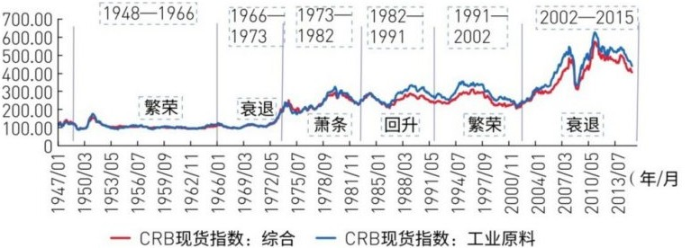

## PDF 原页 42（页脚 41）

第五次康波的大宗商品牛市始于2001年至2002年之间，而美国GDP增长的最高峰是
在2000年，按照康波的划分，2000年或2002年之后就可以被划分为第五次康波的衰
退阶段了。2002年之后，大宗商品经历了一个长达10年的牛市，其中2008年可以被
视为大宗商品牛市的第一头部，2011年可以被视为大宗商品牛市的第二头部。从康
波大宗商品牛市的形态上看，我们可以确认本次康波大宗商品牛市的终结。自2012
年之后，大宗商品一直处于熊市，至2015年中期已有4年半的时间，这就是对当前
大宗商品价格运行的基本定位。但是，问题的复杂性在于，大宗商品的熊市会表现
出什么样的走势，这是当前和未来商品价格研究中长期的核心问题。
图1-37中的周期定位以康波划分为萧条、回升、繁荣、衰退四个阶段，可以看出，
2002年牛市启动，2008年和2011年分别出现头部，随后步入熊市。
2002年或2004年之后，康波已经确认了从繁荣向衰退的转换，而经历了2008年的康
波一次冲击之后，2015年之后康波应进入二次冲击阶段并向萧条转换。有一个结论
是可以肯定的，即衰退和萧条的连接点一定是一个康波大宗商品价格的最低点，这
一点为前五次康波的价格形态所证明（见图1-38）。前三次康波的价格形态表现出
了很明显的古典周期的波动形态，而第四次康波之后表现出了增长型周期的波动形
态，这与世界经济的历史趋势相吻合。所以，可以肯定的是，第五次康波衰退向萧
条转换的位置，应是一个大宗商品价格的长期低点，而对本次康波来讲，这必然是
一个增长型周期，所以我们不必期望商品价格可以回到2001年的低点，而是要根据
供需边际及货币环境对低点的价格进行评估，这是我们未来需要继续深入研究的问
题。
▲图1-37 第五次康波周期中大宗商品的牛熊转换
资料来源：彭博，CEIC数据库。

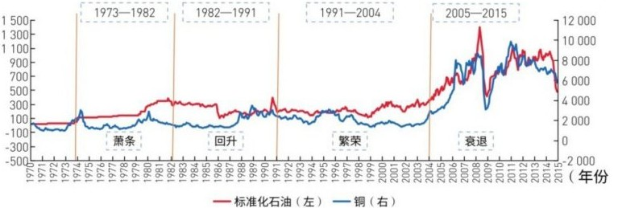

## PDF 原页 43（页脚 42）

图1-38 每一次康波衰退向萧条的转换都是一个价格低点
注：前三次康波的价格波动都是古典型周期，第四次康波是增长型周期，除了第四
次，前三次衰退与萧条的转换点都是价格低点。我们推测，第五次康波衰退与萧条
的转换时点大致在2016—2018年。资料来源：中信建投证券研究发展部。
关 于 大 宗 商 品 的 中 级 反 弹
从历史的康波价格运行来看，萧条期的开始必然是一个价格反弹的过程，所以，一
个非常重要的问题就是，我们这次康波衰退向萧条的转换点在哪里，这也是对商品
价格最终低点的确认过程。关于这个问题，我们有如下推测。从一般的康波划分机
制来看，衰退与萧条的转换点应划分在中周期的低点上。对本次康波衰退而言，衰
退与萧条的转换点应在2018年。但是，以周期的双底结构来看，终极低点之前应该
会出现一个一次探底的过程，这个过程以现在的世界经济周期运动状态来看，应该
在2015年第四季度至2016年上半年之间，这个位置恰好出现了商品价格的下跌。那
么在2016—2018年，理论上会出现一次超跌反弹的过程，对于这个过程我们可以进
一步探寻其理由。
康波中大宗商品熊市的形态是非常复杂的，由于数据的可得性，我们最多可以研究
第四次康波衰退后的大宗商品价格，而第三次康波衰退后的大宗商品熊市形态只能
用美国的部分长数据系列替代研究。从严格意义上说，第四次康波大宗商品熊市是
从1980年第二次石油危机之后开始的，这一过程一直持续到2002年结束，历时22
年。这22年间，我们可以清晰地发现，虽然大宗商品并未出现康波意义上的牛市行
情，但是从中周期的意义上看，每轮中周期大宗商品都会出现一次波段行情，而就
这几个样本看，这个行情大概率会出现在中周期的末尾阶段，基本上位于第三库存
周期位置。这个问题也不难理解，是周期嵌套模式使然。
虽然大宗商品处于康波意义上的熊市，但其价格依然会跟随中周期波动，而中周期
第三库存周期往往是滞胀阶段，所以出现大宗商品中周期反弹顺理成章。

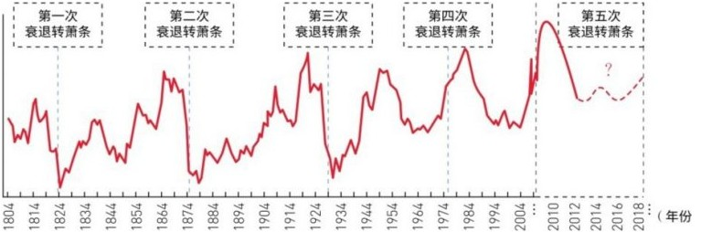

## PDF 原页 44（页脚 43）

关 于 第 五 次 康 波 周 期 中 价 格 研 究 的 后 续 问 题
我们已经说明，大宗商品价格处于一个长期的低点附近，当然从短期的角度看，这
个低点需要被反复确认，不是一下就能被确认的。以我们对世界经济周期运动的理
解，这个长期低点的确认需要3年以上的时间。但以我们对世界库存周期的研究
（见表1-4至表1-6），我们认为，2016年即将启动本次中周期第三库存周期，这个
库存周期源于中国房地产周期的B浪反弹，以及美国房地产周期的高位延续，周期
复苏和货币乘数上升将给全球带来一次小的滞胀过程，我们认为这可以被视为商品
的一次触底。而2018年的三期共振低点也许才是商品价格的真正长期低点。所以，
我们后面就要在这一框架下紧跟美国、欧洲、中国的经济周期运行，判断美元指
数、经济复苏的基本趋势，把握商品的长期低点反复震荡的机会。
表1-4 第一库存周期上行期：美国大类资产收益率表现
▲资料来源：中信建投证券研究发展部整理。
▼表1-5 第二库存周期上行期：美国大类资产收益率表现

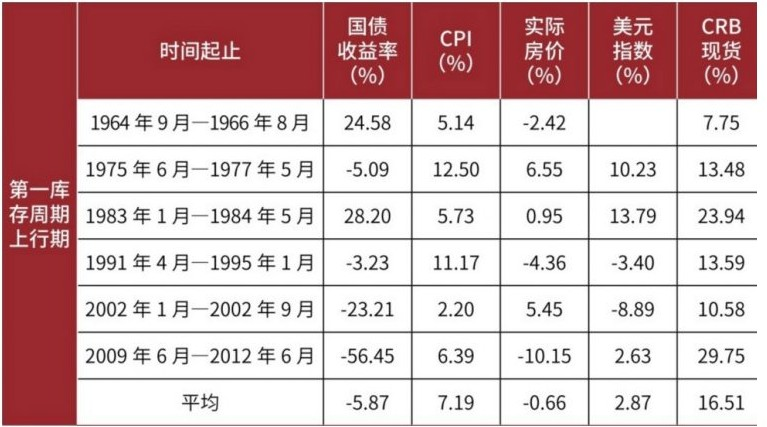

## PDF 原页 45（页脚 44）

▲资料来源：中信建投证券研究发展部整理。
▼表1-6 第三库存周期上行期：美国大类资产收益率表现
资料来源：中信建投证券研究发展部整理。

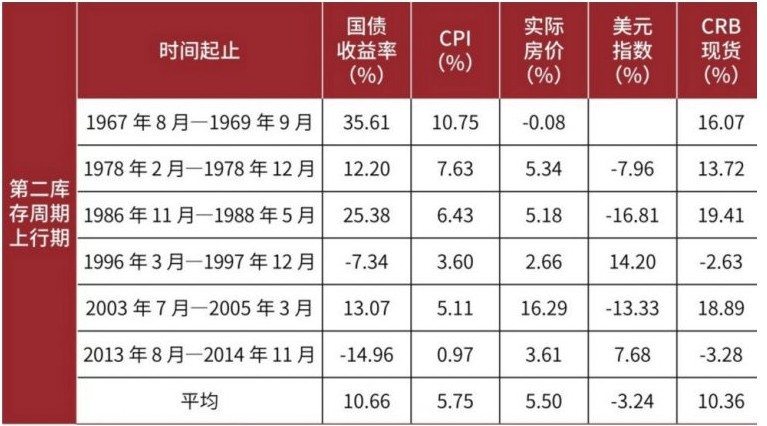

