# 09 改造“美林投资时钟” 全球大类资产配置框架研究

> 所属部分：第二部分 大类资产配置。

> 微信读书目录页码：455–537。这与 PDF 页脚页码是两套不同的分页。
> PDF 来源范围：物理第 251–310 页，页脚印刷页码 250–309。每页附原图，保留图表与版式。

## PDF 原页 251（页脚 250）

第 二 部 分
大 类 资 产 配 置

## PDF 原页 252（页脚 251）

0 9
改 造 “ 美 林 投 资 时 钟 ”
— — 全 球 大 类 资 产 配 置 框 架 研 究
·2015年6月9日
全 球 投 资 时 代 美 林 投 资 时 钟 亟 须 升 级 改 造
美 林 投 资 时 钟 — — 实 用 的 投 资 周 期 指 导 工 具
美林投资时钟理论是一种将“资产”“行业轮动”“债券收益率曲线”“经济周期
四个阶段”联系起来的方法，是一种非常实用的指导投资周期的工具。为验证投资
时钟理论，美林采用1973年至2004年间30年左右的美国经济和各资产类回报的历史
数据进行了检验，结果发现美林投资时钟很好地描述了美国经济周期和资产配置轮
动的准确性。
美林投资时钟理论按照经济增长与通胀的不同搭配，将经济周期划分为四个阶段
（见图9-1）。
（1）“经济上行，通胀下行”构成复苏阶段。此阶段由于股票对经济的弹性更
大，其相对债券和现金具备明显超额收益。
（2）“经济上行，通胀上行”构成过热阶段。在此阶段，通胀上升增加了持有现
金的机会成本，可能出台的加息政策降低了债券的吸引力，股票的配置价值相对较
强，而商品将明显走牛。
（3）“经济下行，通胀上行”构成滞胀阶段。在滞胀阶段，现金收益率提高，持
有现金最明智，经济下行对企业盈利的冲击将对股票构成负面影响，债券相对股票
的收益率提高。
（4）“经济下行，通胀下行”构成衰退阶段。在衰退阶段，通胀压力下降，货币
政策趋松，债券表现最突出，随着经济即将见底的预期逐步形成，股票的吸引力逐
步增强。

## PDF 原页 253（页脚 252）

图9-1 传统美林投资时钟示意图
资料来源：Wind资讯，中信建投证券研究发展部。
外 汇 与 跨 国 投 资 乃 美 林 投 资 时 钟 固 有 盲 区
美林投资时钟的价值已经得到投资界的公认，此处不再赘言。然而，投资界尤其是
跨国投资界非常关注的汇率问题，美林投资时钟却未曾涉及，这不能不说是个重大

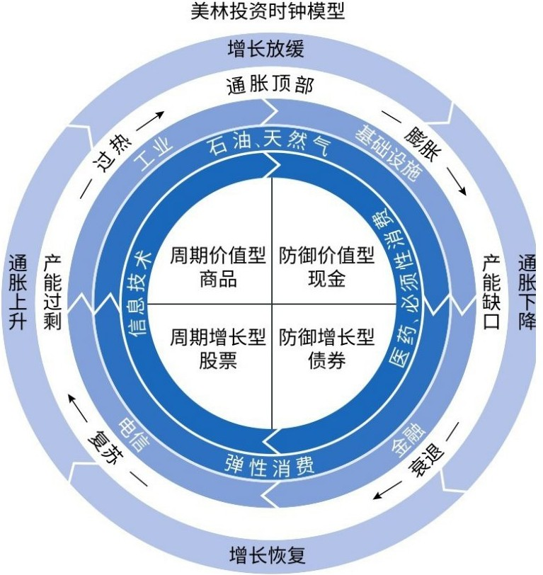

## PDF 原页 254（页脚 253）

遗憾。在金融投资全球化的时代，如果不考虑汇率问题而直接照搬美林投资时钟，
就好比用一个没有经过时区校准的进口表来直接指导自己的工作作息，必然会导致
节奏错乱。
比如，全球经济在经历了金融风暴冲击并于2009年初出现触底回升之后到2011年，
全球股票市场均出现了大幅攀升。那么，在这轮股票牛市行情中，是更多地配置亚
洲新兴经济体市场还是欧美市场，还是有明显差别的。因为其间美元指数从2009年
第一季度的高点89回落到了2011年中的低点73，降幅达18%，而且亚洲市场的涨幅
比美国道琼斯指数的涨幅还大。而对于从2011年中以来的投资，是更多配置新兴市
场还是美国市场，则会产生截然相反的结果，因为除了美元汇率已经从当初的低点
73蹿升到了2017年的95，涨幅超过30%，且本阶段美国市场的涨幅也远超新兴市
场。
同一类资产在同一个全球周期中因为汇率问题（因为国家之间的周期不同步问题）
而出现如此巨大的收益分化，显然是美林投资时钟无法解释的。而对全球资产配置
来讲，美林投资时钟就成了一块中看不中用的废表，毫无指导意义。因此，在金融
投资全球化高度发达的今天，仅仅根据发达经济体（主要是美国）经济周期所总结
出来的美林投资时钟进行投资已经跟不上时代的步伐，构建一个包含汇率因素的国
际大类资产投资分析框架已十分必要。
黄 金 与 大 宗 投 资 研 判 中 美 元 因 素 不 可 忽 视
商品价格既取决于全球周期趋势，也取决于主要经济体周期节奏之差。
根据美林投资时钟理论，在经济的衰退期与复苏期大宗商品表现较差，在经济走向
过热与滞胀的阶段商品有超额收益。从图9-2、图9-3中可以看出，全球经济增速、
通胀变化与商品价格之间确实存在较为一致的波动方向（背离的情况较少）。不
过，虽然商品价格与全球周期在波动方向上保持大概率的一致，但是经济周期波动
幅度对商品价格涨跌幅度的解释力却不能令人满意。如果用美国的周期数据与商品
价格变化的历史做比较，美国数据的解释力要比全球总体数据更差一些（见图9-
4、图9-5）。
对黄金价格的趋势与波动幅度而言，不管是全球经济周期数据还是美国经济周期数
据，解释力都远不如大宗商品（如图9-6至图9-9）。这意味着在黄金与大宗商品的
投资中，仅依据全球经济周期数据，我们很难判断一波行情的级别大小，而且对具
体的趋势拐点判断也会较为模糊。

## PDF 原页 255（页脚 254）

▲图9-2 全球GDP增速与CRB现货指数
资料来源：Wind资讯，中信建投证券研究发展部。

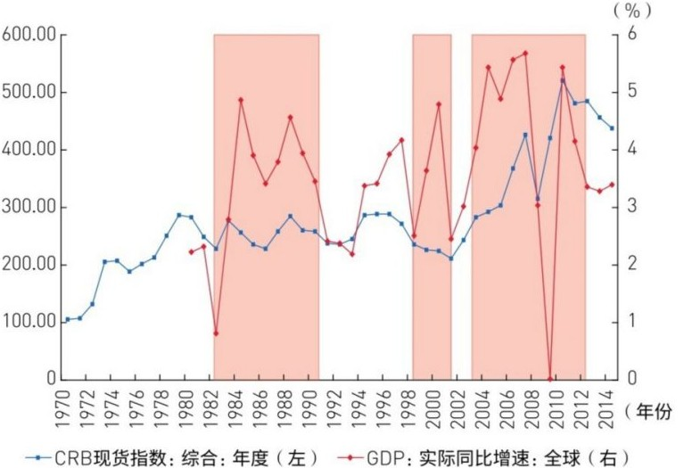

## PDF 原页 256（页脚 255）

▲图9-3 全球CPI同比与CRB现货指数
资料来源：Wind资讯，中信建投证券研究发展部。

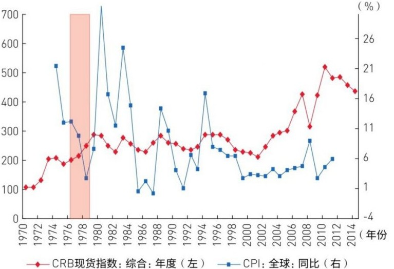

## PDF 原页 257（页脚 256）

▲图9-4 美国GDP增速与CRB现货指数
资料来源：Wind资讯，中信建投证券研究发展部。

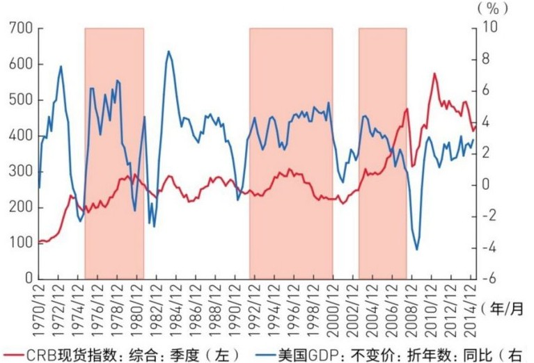

## PDF 原页 258（页脚 257）

▲图9-5 美国CPI当月同比与CRB现货指数
资料来源：Wind资讯，中信建投证券研究发展部。

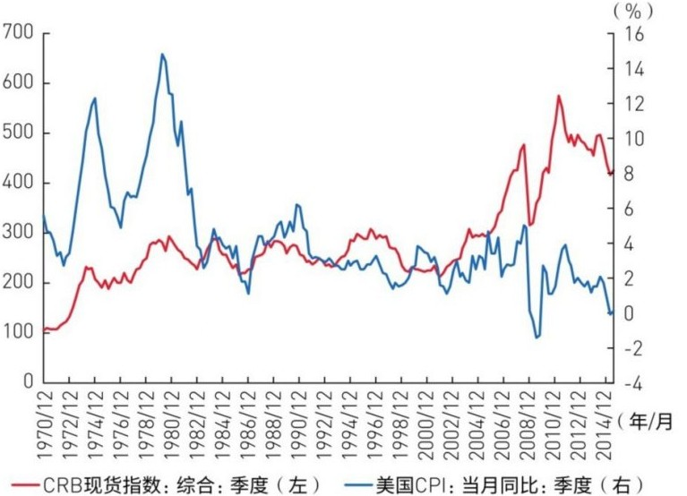

## PDF 原页 259（页脚 258）

▲图9-6 全球GDP增速与COMEX（纽约商业交易所）黄金期货价格
资料来源：Wind资讯，中信建投证券研究发展部。

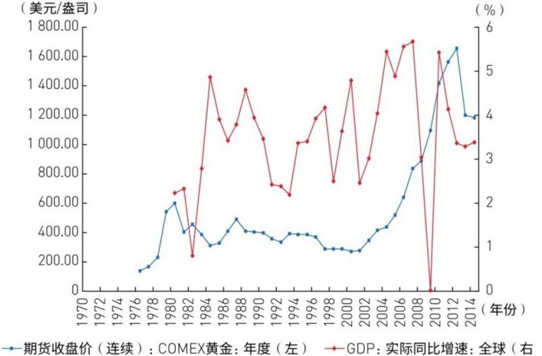

## PDF 原页 260（页脚 259）

▲图9-7 全球CPI同比与COMEX黄金期货价格
资料来源：Wind资讯，中信建投证券研究发展部。

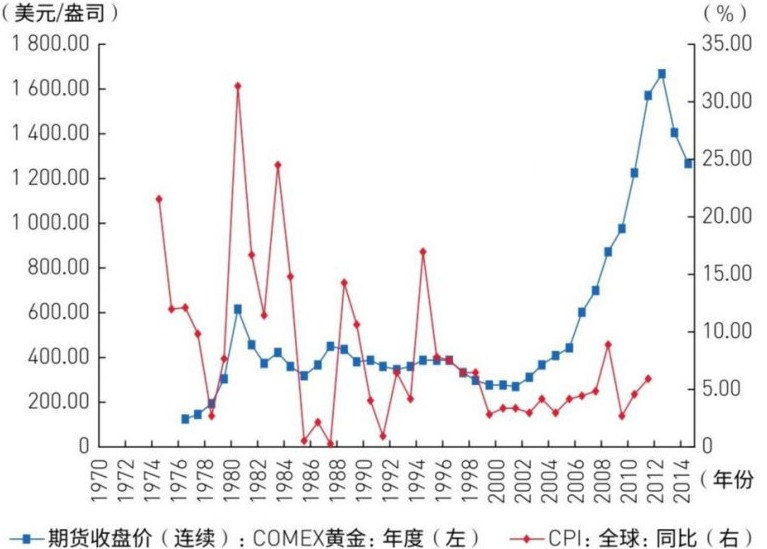

## PDF 原页 261（页脚 260）

▲图9-8 美国GDP增速与COMEX黄金期货价格
资料来源：Wind资讯，中信建投证券研究发展部。

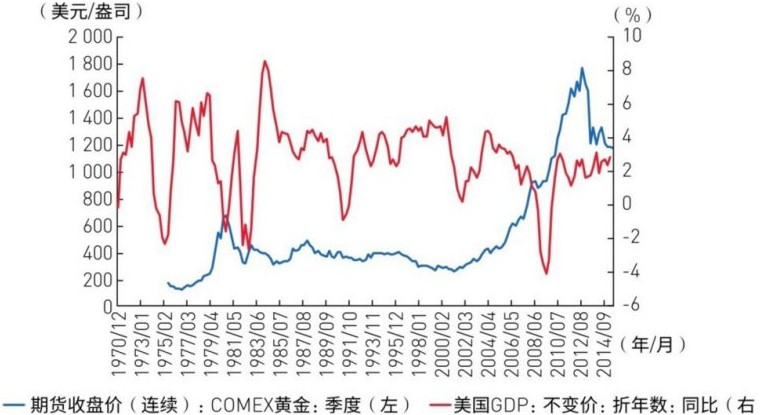

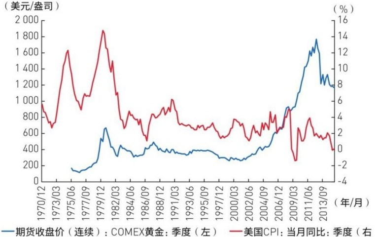

## PDF 原页 262（页脚 261）

图9-9 美国CPI同比与COMEX黄金期货价格
资料来源：Wind资讯，中信建投证券研究发展部。
由于在当今世界经济格局中美国仍是全球头号引擎，美元仍是最核心的国际货币，
是大宗商品与黄金的定价货币，所以大宗商品与黄金价格波动应该与美元强弱之间
存在密切的镜像关系。从图9-10和图9-11中也可以明显看出，美元走势对大宗商品
及黄金价格波动的解释力强于前面分析的周期数据。
▲图9-10 美元指数与CRB现货指数
资料来源：Wind资讯，中信建投证券研究发展部。

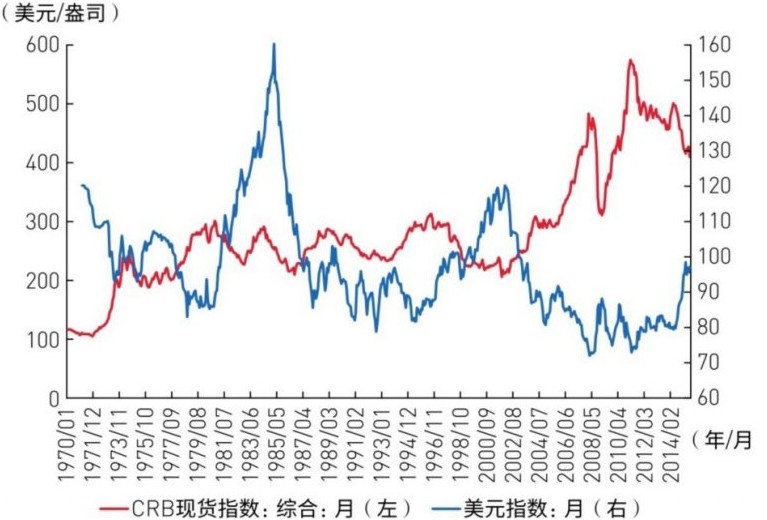

## PDF 原页 263（页脚 262）

图9-11 美元指数与COMEX黄金期货价格
资料来源：Wind资讯，中信建投证券研究发展部。
因此，在黄金与大宗商品全球定价的时代，在美元作为其定价货币的情况下，忽视
美元因素的美林投资时钟理论的精准性是远远不够的。反过来讲，如果在美林投资
时钟分析框架中加入美元（汇率）分析，其适用范围与研判的精准性就会显著提
高。经济运行存在多周期嵌套决定了大类资产轮动的复杂性。
从周期的角度看，美林时钟理论基于经济朱格拉周期的波动而建立起来，它解释了
以固定资产投资为主导的中周期运行中的资产轮动问题。但是从周期的角度看，这
个模型至少存在两个大的缺陷。首先，中周期受制于康波及房地产周期，中周期在
康波及房地产周期中处于不同的位置决定了这个中周期的根本特征。从康波的角度
看，由于一个康波包含6个中周期，所以每个中周期的强弱取决于当时的康波阶
段。而从大类资产的角度看，这个问题更复杂，虽然股债更多受中周期趋势的制
约，美林时钟理论对其大致可用，但商品却由康波决定，特别是在康波的衰退和萧
条期，商品将表现出异常波动。所以，美林时钟并不适用于商品的研判，这是一个
重大缺陷。其次，从细节的角度看，由于中周期本身由3个库存周期组成，3个库存

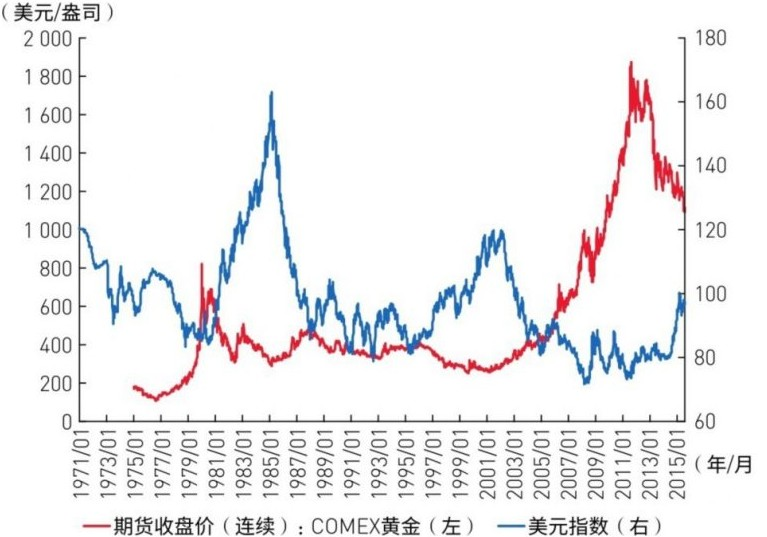

## PDF 原页 264（页脚 263）

周期又有各自的循环规律，资产配置在从道向术的层面落实时，实际上使用的是以
中周期为指针的时间钟，有时候使用的却是库存周期循环，所以很多时候这种指针
是很模糊的。
在我们看来，美林时钟理论可以作为大类资产配置的基础，但必须被改造，从而建
立一套完善的全球大类资产配置的方法。在这方面，我们认为至少有几件事情可以
做。第一，加入全球因素，第一步是加入美元，而美元主要研究欧美相对强弱问
题。第二步是加入中国，中国与欧美的关系基于房地产周期反身性的关系。第二，
加入康波因素，将时钟置于不同康波阶段进行分别配置。第三，分清中周期和库存
周期对大类资产配置的不同影响，从道落实到术。本章先做第一步，即加入美元因
素。
美 元 周 期 对 国 际 大 类 资 产 配 置 的 意 义
美 元 仍 是 国 际 外 汇 与 商 品 市 场 上 的 价 值 评 判 尺 度
浮动汇率制下，反映美元强弱的已不再是其对黄金的绝对购买力，而是相对于其他
主要国际货币的比价。这就意味着，美元指数走强必然存在其他主要货币兑美元走
弱。而且，即便是美元指数权重构成之外的其他货币，其币值强弱也与美元指数之
间存在紧密的负相关关系。因此，在当今的全球化投资时代，除了对象国标的资产
的收益率，由美元周期所影响的对象国汇率变化同样是一个不可忽视的因素（见图
9-12至图9-15）。

## PDF 原页 265（页脚 264）

▲图9-12 全球官方外汇储备中主要货币所占规模
资料来源：Wind资讯，中信建投证券研究发展部。

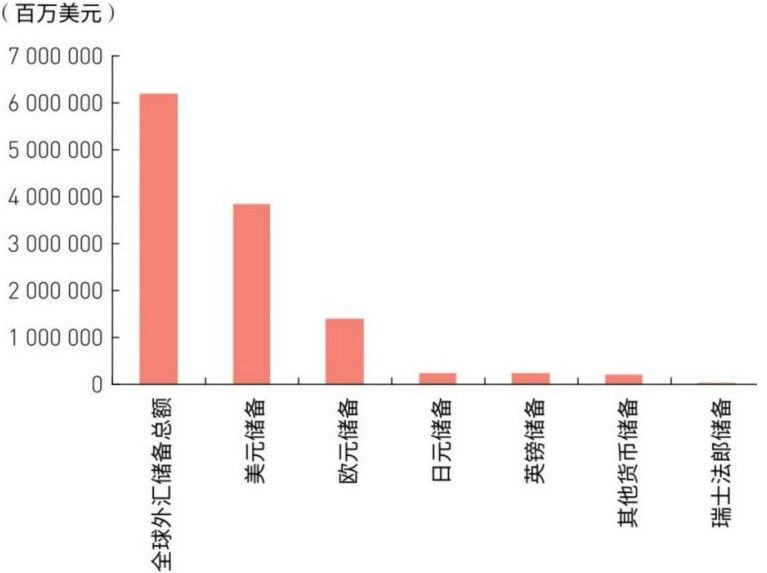

## PDF 原页 266（页脚 265）

▲图9-13 美元指数权重构成
资料来源：Wind资讯，中信建投证券研究发展部。

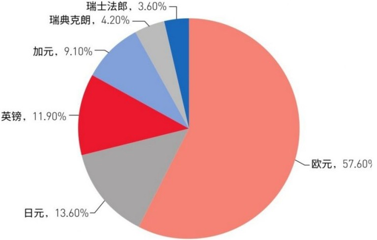

## PDF 原页 267（页脚 266）

▲图9-14 美元指数与欧元、英镑兑美元
资料来源：Wind资讯，中信建投证券研究发展部。

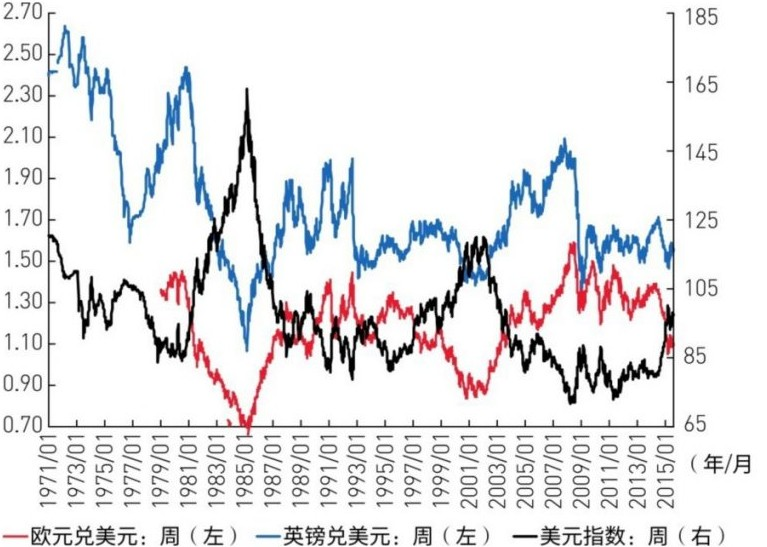

## PDF 原页 268（页脚 267）

图9-15 美元指数与新兴市场货币指数
资料来源：Wind资讯，中信建投证券研究发展部。
商 品 （ 黄 金 与 大 宗 ） 价 格 周 期 与 美 元 周 期
除了第一部分已经讲过的，美元作为当今国际大宗商品定价货币对商品价格有不可
忽视的影响，美元周期中也蕴含着国际经济强弱格局变化的逻辑。在后面的分析中
我们将详细阐述，美元的强势期一般都是国际经济的相对疲弱期，尤其是作为大宗
商品主要需求对象的工业生产国往往也处于不太景气的态势。因此，美元在周期强
弱演变的过程中对国际大宗商品的影响除了直接的“价值尺度”角色，还包含对大
宗商品需求强弱变化的逻辑。这也是我们在第一部分能明显看出美元周期对大宗商
品价格变化的解释力要强于经济周期的原因。
在浮动汇率制与信用货币制度下，美元的价值不稳定和长期趋向贬值是一个国际社
会普遍担忧和不满的问题。作为曾经的实物货币以及后来的货币之锚，黄金的真实
价值相对美元更受国际社会的认可。由于黄金用美元标价，而美元价格不稳定，这

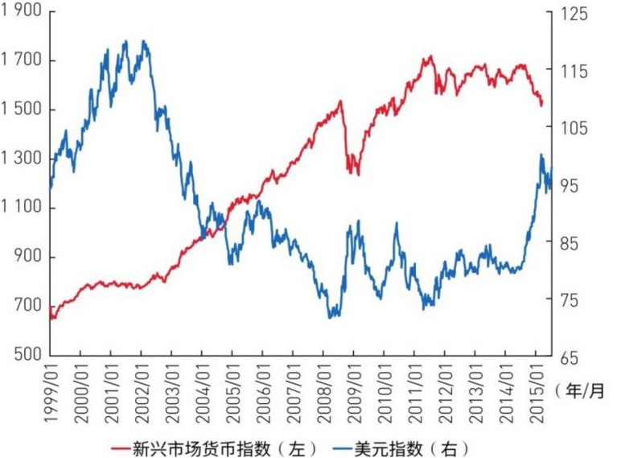

## PDF 原页 269（页脚 268）

就使得黄金的名义价值（价格）呈现出随美元持续波动的态势，并且在投资需求追
涨杀跌的推动下，黄金价格出现幅度更大的波动。因此，做贵金属投资，研究美元
周期比研究经济周期更重要（见图9-16、图9-17）。
▲图9-16 黄金价格波动与美元周期
资料来源：Erbands Havey（2013），中信建投证券研究发展部。

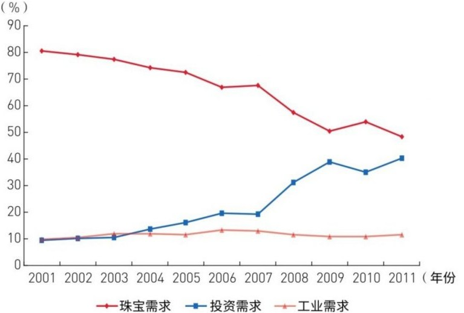

## PDF 原页 270（页脚 269）

图9-17 黄金价格与美元指数
资料来源：Wind资讯，中信建投证券研究发展部。
美 元 周 期 主 导 新 兴 市 场 与 发 达 市 场 间 的 趋 同 与 背 离
除了前述作为“价值评判尺度”而对外汇与大宗商品市场走势具有不可忽视的影
响，美元的强弱变化还直接决定着国家之间股市与债市的牛熊背离。从图9-18、图
9-19、图9-20、图9-21、图9-22、图9-23中可以明显看出，在美元的相对弱势期，
新兴市场与发达市场股市与债市牛熊格局趋同；而在美元的强势阶段，新兴市场与
发达市场股市与债市均表现出显著的牛熊背离格局。对于不同的美元走势阶段，新
兴市场与发达市场股市与债市之间的这种趋同与背离，我们认为是由于强势美元阶
段往往是新兴市场的风险高发期，新兴市场与发达市场在强势美元阶段风险水平出
现了明显的分化。
我们在国际经济年度报告《美元崛起：挑战与机遇》中已经做过分析：历史上美元
两轮牛市行情期间，也是新兴市场的风险高发期，比如20世纪80年代美元牛市行情
中爆发了拉美债务危机，90年代美元牛市行情中爆发了亚洲金融危机。美元趋势走

## PDF 原页 271（页脚 270）

强往往引爆新兴经济体群体性危机，原因在于，在美元走强的过程中，那些对国际
市场或资源依赖较大的新兴经济体将遭遇经常账户与资本账户的双重冲击，进而先
前隐藏的风险容易被暴露、放大，最终发生危机。
▲图9-18 美元强势期新兴市场与发达市场股票牛熊格局
资料来源：Wind资讯，中信建投证券研究发展部。

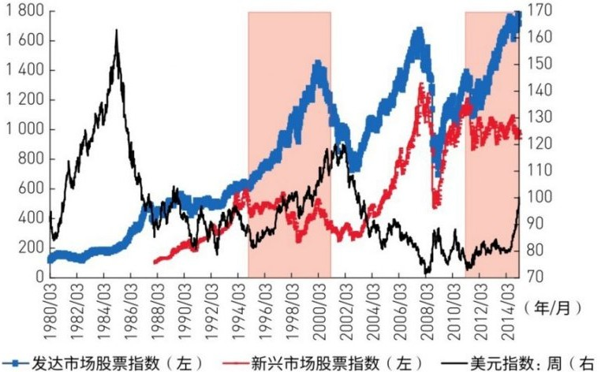

## PDF 原页 272（页脚 271）

▲图9-19 美元强势期新兴市场与发达市场债市牛熊格局（1）
资料来源：Wind资讯，中信建投证券研究发展部。

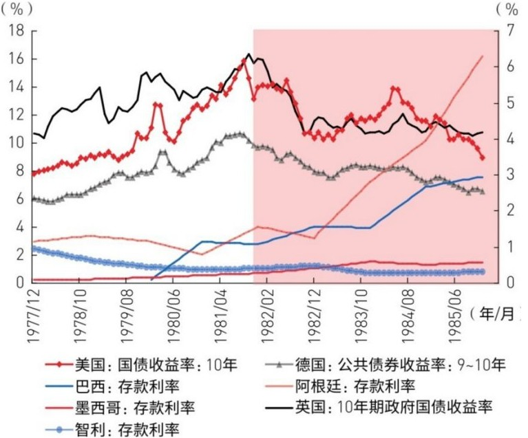

## PDF 原页 273（页脚 272）

▲图9-20 美元强势期新兴市场与发达市场债市牛熊格局（2）
资料来源：Wind资讯，中信建投证券研究发展部。

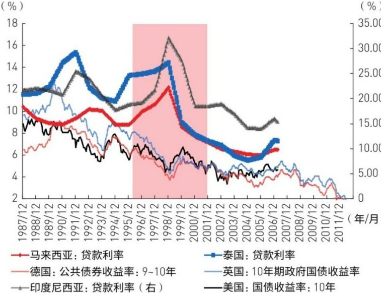

## PDF 原页 274（页脚 273）

▲图9-21 美元指数与新兴市场的群体性危机
资料来源：Wind资讯，中信建投证券研究发展部。

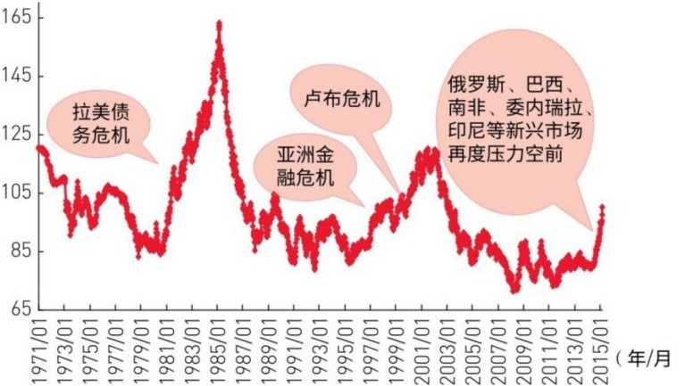

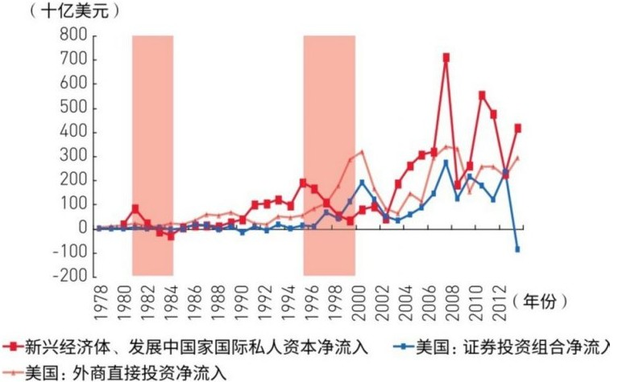

## PDF 原页 275（页脚 274）

图9-22 美元强势期国际私人资本逃离新兴市场
资料来源：Wind资讯，中信建投证券研究发展部。
在经常账户方面，形成美元牛市的美强而欧弱（第二次还包括日本弱）的格局意味
着全球经济是相对低迷的，进而对新兴经济体的出口不利（强美元对资源品出口国
还存在进一步的冲击）。在资本账户方面，美元走强，美国资产升值，还会诱发国
际资本从已经相对脆弱的新兴市场回流美国。资本大规模外流容易引发货币危机，
恐慌情绪蔓延之后进一步发展成债务危机，甚至升级为经济危机。
图9-23 美元强势期国际资本流入美国
资料来源：Wind资讯，中信建投证券研究发展部。
美 元 强 弱 演 变 过 程 中 的 国 际 格 局 背 景 与 经 济 周 期 逻 辑
美 元 牛 市 的 国 际 格 局 背 景

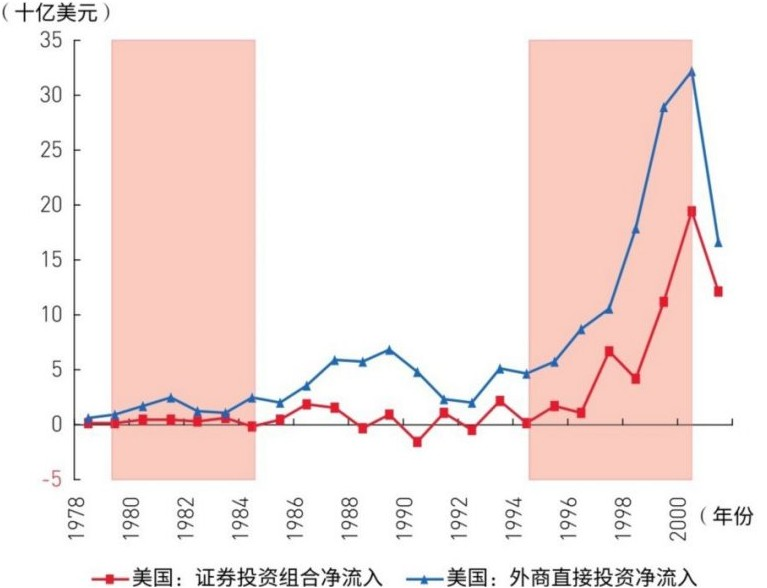

## PDF 原页 276（页脚 275）

1971年美元与黄金脱钩之后，国际货币体系进入浮动汇率时代。在浮动汇率制下，
反映美元强弱的已不再是其对黄金的绝对购买力，而是相对于其他主要国际货币的
比价。这意味着，美元指数走强必然存在其他主要货币兑美元走弱。在影响美元指
数的主要货币中，欧洲货币（现在的欧元，过去的德国马克、法郎、里拉、荷兰
盾）的权重占据了半壁江山还多。因此，回顾布雷顿森林体系崩溃之后美元在1980
—1985年与1995—2001年的两轮牛市行情，基本上均呈现出美强欧弱的国际格局。
此外，20世纪90年代的牛市行情还包括美强日弱的格局。
图9-24 美元指数的历史走势格局
资料来源：Wind资讯，中信建投证券研究发展部。
1 9 8 0 — 1 9 8 5 年 的 美 元 牛 市
1978年底，伊朗政局动荡，之后又爆发两伊战争，油价在1979年开始暴涨，从每桶
13美元猛增至1981年的每桶34美元，导致第二次石油危机出现。随着石油危机的发
酵蔓延，20世纪70年代末80年代初，一场世界级的经济危机席卷主要资本主义国
家，首先在美国（1979年4月）、英国（1979年7月）爆发，到1980年上半年，西欧
20多个国家和日本等普遍陷入危机。
1981年初里根入主白宫，为了摆脱长期存在的经济滞胀局面，他以控制通货膨胀作
为宏观政策的首要目标，采取了松财政、紧货币的政策。一方面实行减税以刺激增

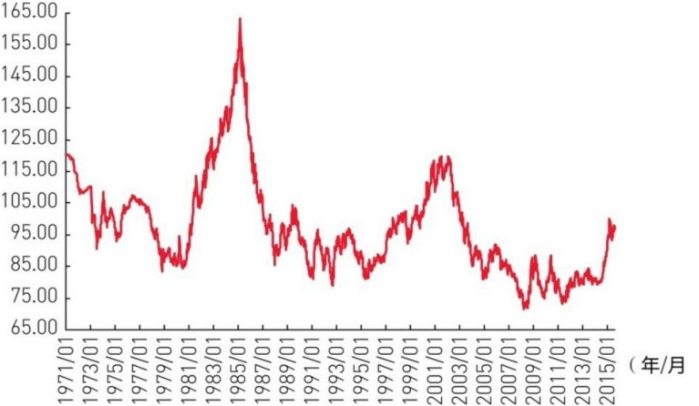

## PDF 原页 277（页脚 276）

长；另一方面严格控制货币发行量，抑制通货膨胀，并提高利率以吸引外资来弥补
巨额的财政赤字。美国经济从1983年底开始回升，工业生产连续增长。到1984年，
美国的经济复苏更为强劲，达到6.9%，为33年来的最高纪录，比同期其他西方国家
高出两倍多（可参考表9-1）。经济的高速增长，增强了国际金融界对美元的信
心。
▲图9-25 原油价格
资料来源：Wind资讯，中信建投证券研究发展部。

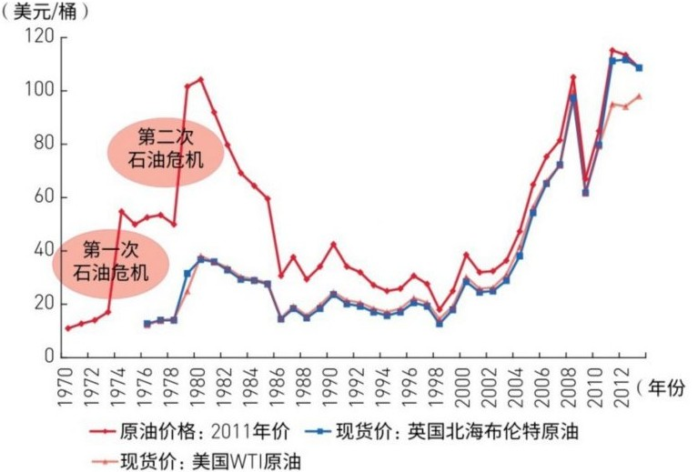

## PDF 原页 278（页脚 277）

图9-26 第二次石油危机后美、德、法、意、英、日、加GDP增速
资料来源：Wind资讯，中信建投证券研究发展部。
美国通货膨胀下降而利率高企。美国通货膨胀从1980年起就有所下降，到1984年通
胀情况有了明显改善，消费者物价上涨率从过去的两位数降至4%。美国在通货膨胀
得到控制的同时，利率一直维持较高水平。1984年，美国联邦储备银行的贴现率一
直维持在8%～9%，商业银行的优惠放款利率则在10%上下波动。在其他国家相继调
低利率之时，美国利率保持较高水平，吸引了大量国际资金，从而有力地支持了美
元汇率。据估计，1984年从世界各地流入美国的资金共约1000亿美元。这个数目足
以弥补美国联邦预算赤字的一半以上，或者相当于美国净投资总额的40%。
表9-1 美国劳动生产率的变化

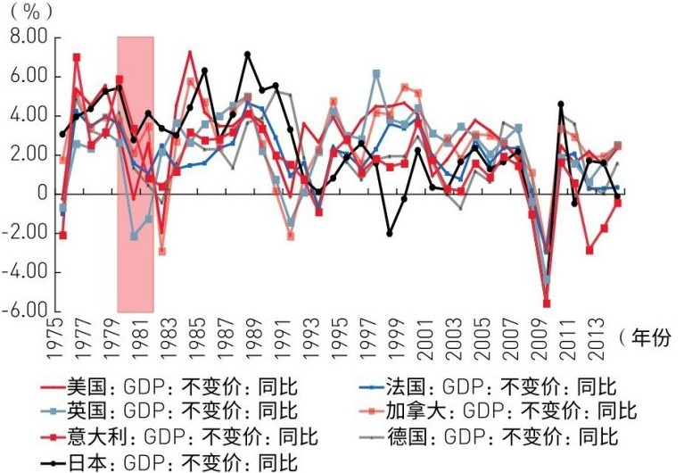

## PDF 原页 279（页脚 278）

资料来源：陈宝森，《美国经济与政府政策——从罗斯福到里根》，社会科学文献
出版社，2014年；中信建投证券研究发展部。
与此同时，欧洲遭遇沉重打击，且复苏缓慢乏力。在美国经济回升的带动下，英国
从1982年12月，联邦德国、卢森堡、荷兰、比利时等西欧国家从1983年初开始回
升。法国和意大利1983年上半年尚在沟底徘徊，直到年底才出现一些转机。而且即
便在走出危机低谷之后，相较于美国经济的强劲表现，西欧经济的表现也逊色很多
（可参考图9-27至图9-30）。
▲图9-27 美、德、法、意GDP增速
资料来源：Wind资讯，中信建投证券研究发展部。

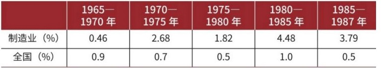

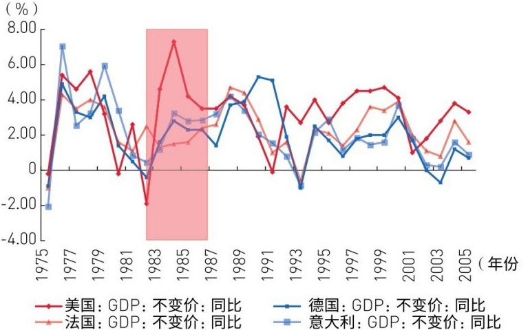

## PDF 原页 280（页脚 279）

▲图9-28 美、英、加GDP增速
资料来源：Wind资讯，中信建投证券研究发展部。

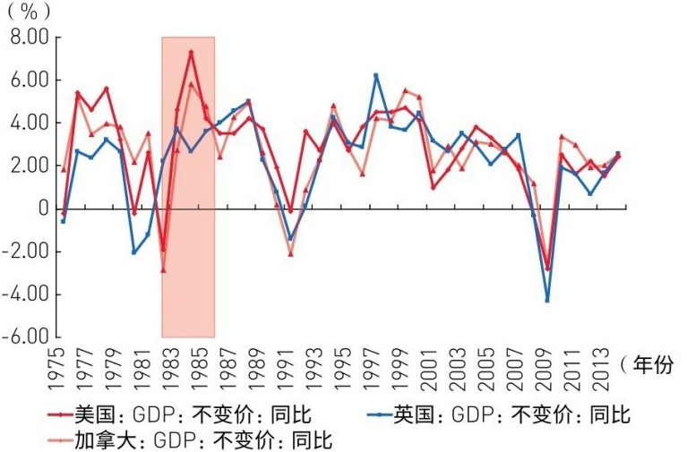

## PDF 原页 281（页脚 280）

▲图9-29 美、德、法、意实际利率
资料来源：Wind资讯，中信建投证券研究发展部。

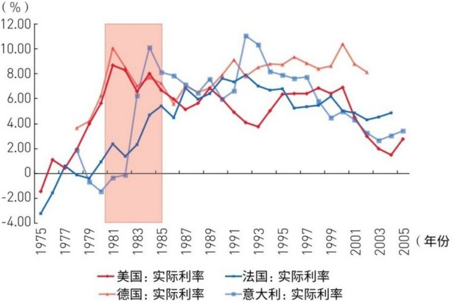

## PDF 原页 282（页脚 281）

图9-30 美、德、法、意实际利率差
资料来源：Wind资讯，中信建投证券研究发展部。
20世纪80年代的美元牛市发生在第五次康波的复苏阶段，康波的复苏由主导国引
导，这是周期的必然规律，按照美国的周期规律，1982年应该是中周期的低点，同
时也是美国房地产周期的中段。但必须注意的是，欧洲在康波及房地产周期趋势上
与美国保持一致，欧美的强弱差异是美元强势的基本原因（见图9-31、图9-32）。

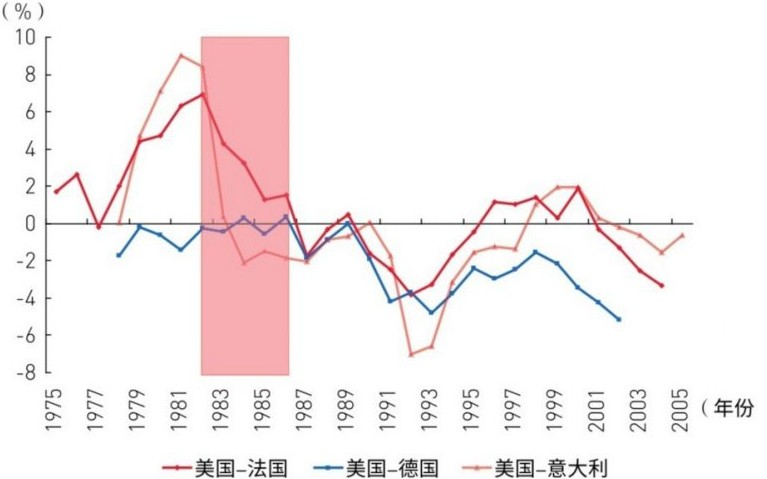

## PDF 原页 283（页脚 282）

▲图9-31 英镑兑美元、欧元兑美元
资料来源：Wind资讯，中信建投证券研究发展部。
图9-32 美元兑瑞士法郎

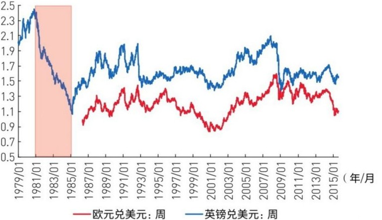

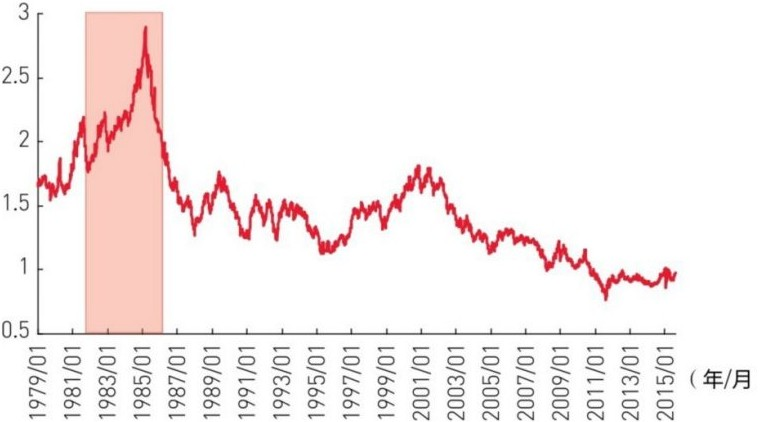

## PDF 原页 284（页脚 283）

资料来源：Wind资讯，中信建投证券研究发展部。
1 9 9 5 — 2 0 0 1 年 的 美 元 牛 市
美元自1995年开始的一轮牛市行情一直持续到2001年7月（科技网络股泡沫破裂效
益开始蔓延）。从主要货币的升值程度来看，从1995年4月美元兑日元的低点81日
元兑1美元，到1998年8月147日元兑1美元，升值幅度超过80%；欧元兑美元从1996
年11月1.41美元兑1欧元的高点到2001年11月0.84美元兑1欧元，贬值幅度超过
40%；英镑兑美元从1996年11月的高点到2001年6月的低点，贬值幅度达19%。
1991—2000年的美国经济状况超出了传统经济理论。美国经济自1991年3月走出衰
退以后，保持了近10年的持续增长势态，经济扩张周期明显延长，而收缩期明显缩
短。特别是20世纪90年代最后几年，经济在高速平稳增长的同时，通货膨胀率、失
业率和财政赤字都控制在较低水平，呈现出近几十年少有的“一高三低”的理想状
态（见图9-33、图9-34、图9-35）。1995—1999年的5年间，美国经济生产率年均
增长4.8%，这个增长率近一半的贡献来自劳动力投入的增加，这是劳动力的一个自
然增长率，还得益于20世纪90年代初失业率的下降；另外一半多的贡献来自平均劳
动生产率的提高，这个时期劳动生产率的增长是25年前的2倍。

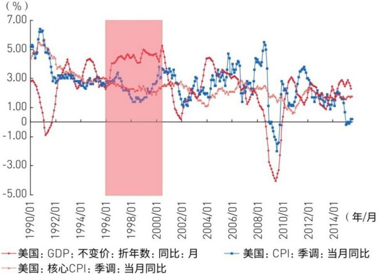

## PDF 原页 285（页脚 284）

▲图9-33 美国20世纪90年代高增长低通胀的黄金期
资料来源：Wind资讯，中信建投证券研究发展部。
▲图9-34 美国失业率（季调）
资料来源：Wind资讯，中信建投证券研究发展部。

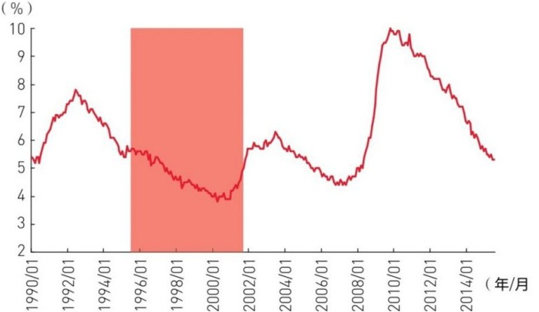

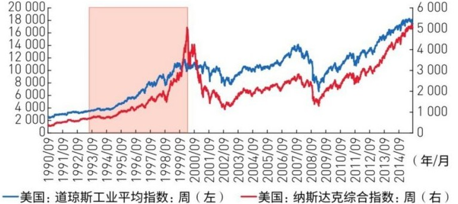

## PDF 原页 286（页脚 285）

图9-35 美国道琼斯工业平均指数与纳斯达克综合指数
资料来源：Wind资讯，中信建投证券研究发展部。
进入20世纪90年代之后，当世界经济从之前的低迷中逐步恢复发展，并表现出相对
景气的状态时，由主要发达国家构成的西欧经济却走向增长的低谷。90年代前半
期，西欧经济遭到严重危机和多次货币风潮的打击，陷入了起伏不定、失业恶化、
财政困难的局面。1991—1993年，严重的经济危机席卷西欧各国。1992年秋、1993
年秋和1995年春，欧洲货币体系连遭三次危机的冲击。在此期间，在德国统一后紧
缩政策和高利率的钳制、欧洲汇率机制动荡不稳、各国巨额财政赤字的沉重压力及
《马斯特里赫特条约》达标的约束等影响下，欧盟国家普遍实行严厉的宏观调控政
策，试图通过提高利率以遏制赤字和整顿财政失衡，控制预期通货膨胀的上升。因
此，西欧经济在20世纪90年代前半期出现了“三高两低”（失业率高，政府财政赤
字、国债高，利率水平高，经济增速低，通胀水平低）的显著特点（见图9-36至图
9-39）。
1989年，欧共体12国的经济增长率为3.5%，而到了1995年，欧盟15国经济增长率已
下降到2.5%，1996年下降到1.6%。其中德国为1.3%，英国为2.2%，法国为1.3%，意
大利为1.1%。直到1997年下半年，主要国家的经济景气才走出低谷，开始缓慢复
苏。而且失业率居高不下，政府预算吃紧的局面仍未得到根本的扭转，通货紧缩的
风险迟迟挥之不去。
从周期的角度看，1991年美国启动新的中周期，1995年之后，美国的中周期进入强
势阶段，而彼时是美国房地产周期的强势阶段，所以，美元升值理论上都是在美国
房地产周期和中周期的强势阶段出现的。值得注意的是，1995年的美元牛市出现在
康波的繁荣阶段，但那时美国经济相对于欧日的强势却不如1980年的美元牛市明
显。

## PDF 原页 287（页脚 286）

▲图9-36 美、德、法、意GDP增速
资料来源：Wind资讯，中信建投证券研究发展部。

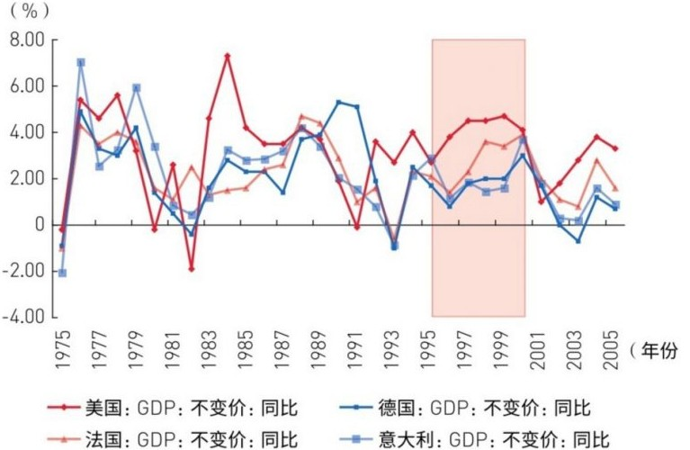

## PDF 原页 288（页脚 287）

▲图9-37 美、德、法、意长期失业率
资料来源：Wind资讯，中信建投证券研究发展部。

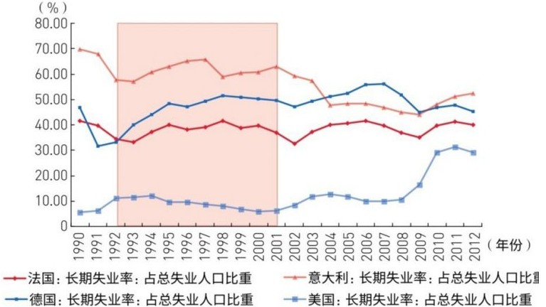

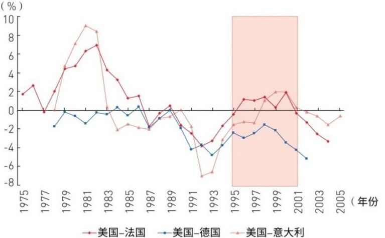

## PDF 原页 289（页脚 288）

▲图9-38 美、德、法、意实际利率差
资料来源：Wind资讯，中信建投证券研究发展部。
图9-39 英镑兑美元、欧元兑美元
资料来源：Wind资讯，中信建投证券研究发展部。
2 0 1 1 — 2 0 1 5 年 的 美 元 牛 市
2011年12月15日，我们发表了《美元破百 冲击中国》的报告，指出：“长波创新
周期中，主导国货币与其他货币强弱关系会呈现周期波动，波长约为15年。一个长
波包含3个货币周期。而2012年开始，美国中周期力量恢复。在中、短周期力量作
用下，经济上行。同时，利用周期理论，可以判断出2012—2013年，英国、德国、
法国经济中周期尚未启动。世界经济格局，美强欧弱。”这些判断实际上支持了我
们美元牛市的判断。
我们当时基于对美国经济周期的判断，认为美国的新一轮房地产周期已经在2011年
启动，而当时的欧洲正饱受主权债务危机之苦，欧元区会不会解体，何时解体成为
国际社会探讨的热点。随着危机的持续发酵升级，欧洲经济也急转直下，GDP增速
在零以下挣扎了6个季度之久。直到2013年随着欧洲央行和欧盟应对危机的态度日
渐坚决、果断，欧债危机才开始缓和，经济景气情况缓慢好转。而同时，美国经济

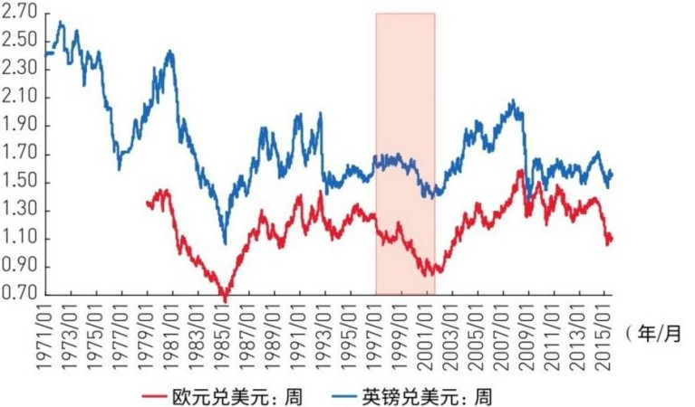

## PDF 原页 290（页脚 289）

在接连的QE（量化宽松）助推下，房地产市场与金融系统不断得到修复，总体景气
态势不断回升。
2014年下半年以来，由于受乌克兰局势恶化、对俄罗斯经济制裁升级、中国与美国
之外的其他经济体景气持续低迷的影响，欧洲出口形势恶化，景气再度低迷。与此
同时，美国经济继续保持着令人羡慕的一枝独秀，房地产市场持续复苏，居民就业
持续改善，收入水平稳步提高，消费情况良好，整个经济系统的正反馈效应明显形
成。由于美强欧弱的格局自2011年一直延续到2015年中期，因此美元总体呈现强势
特征（可参见图9-40至图9-42）。
▲图9-40 美元指数
资料来源：Wind资讯，中信建投证券研究发展部。

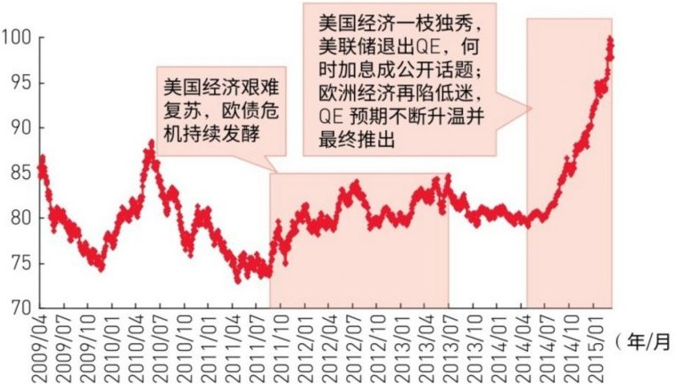

## PDF 原页 291（页脚 290）

▲图9-41 美国与欧元区GDP增速
资料来源：Wind资讯，中信建投证券研究发展部。

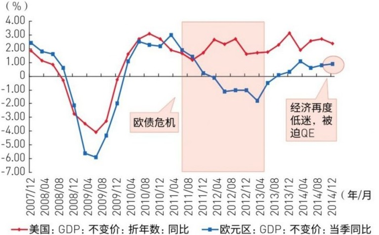

## PDF 原页 292（页脚 291）

图9-42 美国与欧元区PMI（采购经理指数）
资料来源：Wind资讯，中信建投证券研究发展部。
除了在美元走势中起决定作用的美欧经济景气格局，美元指数中的日元因素再度在
本轮美元牛市行情中起到推波助澜的作用（见图9-43至图9-44）。从2012年底以超
宽松货币政策和汇率贬值为主要特征的安倍经济学推出，到2014年下半年安倍经济
学光环褪去经济再陷技术性衰退，美元兑日元持续升值。2012年9月，1美元兑78日
元，而到2014年1美元已经升值到了兑121日元。

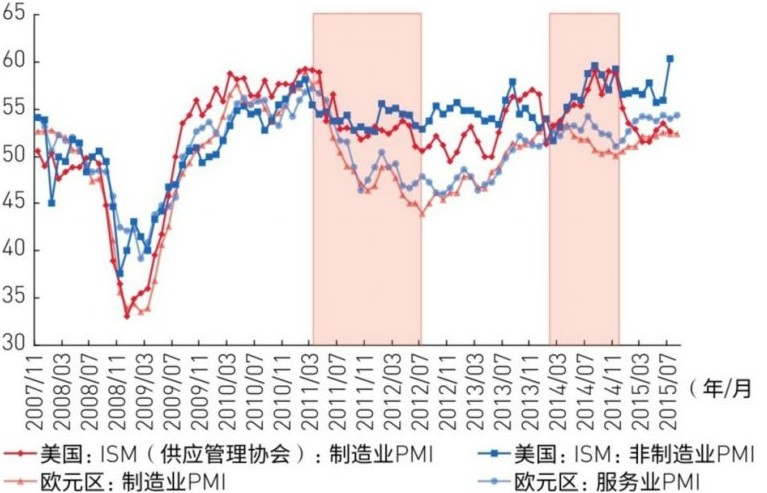

## PDF 原页 293（页脚 292）

▲图9-43 美国与日本GDP增速
资料来源：Wind资讯，中信建投证券研究发展部。

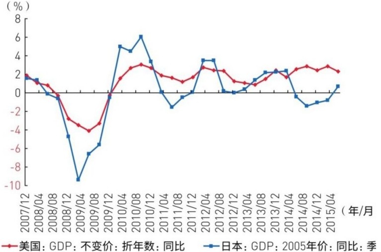

## PDF 原页 294（页脚 293）

图9-44 欧元兑美元与美元兑日元
资料来源：Wind资讯，中信建投证券研究发展部。
美 元 强 弱 演 变 的 周 期 逻 辑
——地产周期
我们在前面分析了布雷顿森林体系崩溃后的三轮美元牛市行情，皆发生在一次大的
全球经济调整之后所出现的美强欧弱（一定程度上还包括日本）的大背景下。
如果从经济周期的逻辑来审视美元牛熊周期，三次美元牛市行情形成之前所出现的
全球经济的显著回落形成了全球经济周期的低谷期，标志着前一个周期的结束和新
周期的开始。如果从美国与欧洲经济增速的角度考察，我们可以发现，三轮美元牛
市行情启动之前的美欧经济调整，皆出现经济增速负增长级别的回落。正是美欧经
济同时出现了负增长的回落，才造就了全球经济的回落。
美 元 牛 市 与 房 地 产 周 期

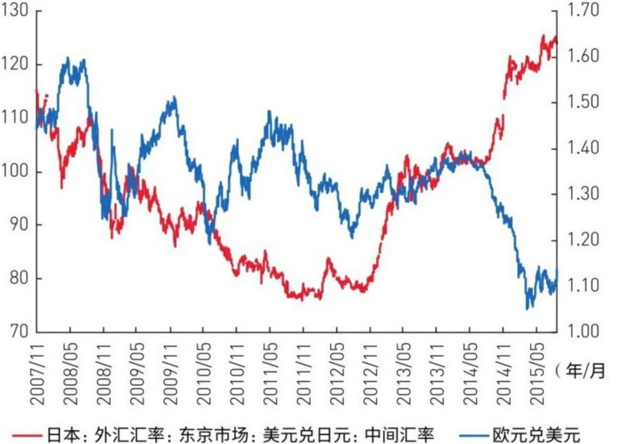

## PDF 原页 295（页脚 294）

概括而言，布雷顿森林体系崩溃之后的三轮美元周期与美国的地产景气周期重叠。
由于全球经济一体化的影响，欧美地产景气周期除了节奏上略有差别，趋势趋同，
所以也可以说，美元周期孕育于欧美地产景气周期。
回顾房地产周期，1930年美国经济学家西蒙·库兹涅茨在《生产和价格的长期运
动》一书中提出，经济中存在长度为15～25年的长期波动。这种波动在美国的许多
经济活动尤其是建筑业中表现得特别明显，所以库兹涅茨周期也被称为建筑业周
期。
由于房地产周期与经济周期、金融条件、人口增长、移民周期等息息相关，除了人
口增长有其自身相对稳定的变化周期，经济周期、货币金融条件与移民情况等都存
在一定的不稳定性。比如央行的货币政策理念，美联储掌门人从20世纪70年代末期
以来就经历了新古典学派向凯恩斯学派的演变，欧洲央行的货币政策理念在经历欧
债危机冲击之后也发生了明显的变化。经济周期存在多周期嵌套问题，因此每轮周
期又都有一定的差别。移民受中央政府的政策影响很大，且易变化。所以，受这些
不稳定因素的影响，每个房地产周期在时间长度上都呈现出一定的差别。
欧 美 房 地 产 周 期 强 弱 之 差 原 因 研 究
对于地产周期为什么会孕育美元周期，我们认为，关键还在于欧美地产周期中两者
的节奏与强弱差异。对于为什么美国的地产周期总是领先于欧洲，显然从人口包括
移民的角度都不太好解释，而用经济周期节奏差异解释地产周期节奏差异，显然又
是一个因果关系难以理清的问题，因为地产周期与经济增长周期几乎是同步的。我
们认为，造成这种节奏差异的关键因素在于两者货币金融条件的差异，因为欧洲的
中央银行（德国模式）和美联储在货币政策目标与理念上有着明显的差别。
在欧洲大陆，德国央行主导着货币政策理念的主基调，由于受历史上多次严重通胀
教训的影响，二战之后的德国央行把稳定通胀作为其几乎唯一的政策目标。与欧洲
众央行不同，美联储既重视通胀问题，也重视就业问题。所以在遇到经济困难时，
美联储为了稳定社会就业会毫不犹豫地采取积极的货币政策，而欧洲央行在该问题
上会表现得比较谨慎。对于大家最为熟知的最近一轮的全球经济危机，美联储在快
速把利率降到地板上之后，又不遗余力地推出了第三轮量化宽松。而欧洲央行在危
机之后经济刚有好转的情况下便急忙加息，导致经济二次探底，在主权债务危机蔓
延之际迟迟不愿伸手相助，坐看危机爆发，就是一种典型的由于政策理念差别造成
的景气显著分化。
概括而言，地产周期是影响经济周期众因素中最有力的一个，所以地产周期的回落
往往意味着经济周期将出现深度调整。而在经济出现深度调整的情况下，欧美央行
由于货币政策理念的差别，在刺激经济的节奏与力度上产生差别，造成危机后出现
美强欧弱，美国的经济与货币政策周期领先于欧洲，进而出现美元走牛的气候和格

## PDF 原页 296（页脚 295）

局。同样，美国的经济与政策周期领先于欧洲，造成美国地产景气先于欧洲受到货
币因素的抑制，进而导致美强欧弱的格局逐渐反转，形成美元弱势的气候与格局。
关 于 美 强 欧 弱 解 释 美 元 问 题 的 延 伸 思 考
当然，这里面有一个核心问题，就是美强欧弱的格局是不是有中长期的因素，或者
美强欧弱是不是未来几十年的大趋势（见图9-45至图9-50）。以目前对欧美经济增
长的核心驱动力的研判来看，美强欧弱是一个中期因素，但这个因素并不是当前才
出现的。所以，美强欧弱问题仅能解释美元强势的原因，对为何在美强欧弱中期趋
势中美元会在某个阶段呈现美元弱势状态是不能做出有力解释的。这就涉及另一个
美元弱势期原因研究的问题，在我们看来，美元弱势期的根源还是在于东西半球房
地产周期的反身性问题，即东半球房地产周期呈现上行趋势时，美元处于弱势期。
所以，在国际大类资产配置中加入美元因素，并用美欧的强弱差异来解释，这是一
个美元强势期的框架。而当进入美元弱势期后，我们必须加入亚洲国家因素，才能
解释当时的国际大类资产配置。
▲图9-45 全球GDP增速与美元指数

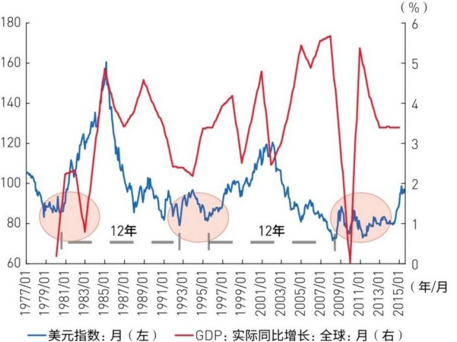

## PDF 原页 297（页脚 296）

资料来源：Wind资讯，中信建投证券研究发展部。
▲图9-46 美、德、法GDP增速与美元指数
资料来源：Wind资讯，中信建投证券研究发展部。

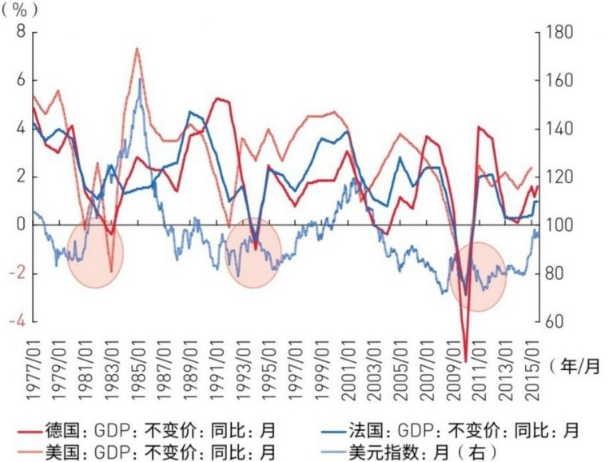

## PDF 原页 298（页脚 297）

▲图9-47 美国房价同比增速与美元指数
资料来源：Wind资讯，中信建投证券研究发展部。

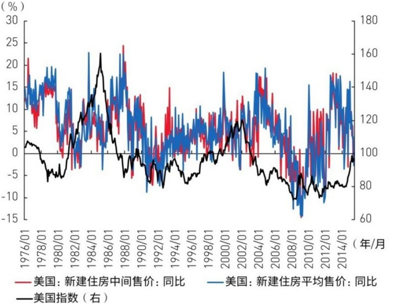

## PDF 原页 299（页脚 298）

▲图9-48 美国房价增速与GDP增速
资料来源：Wind资讯，中信建投证券研究发展部。

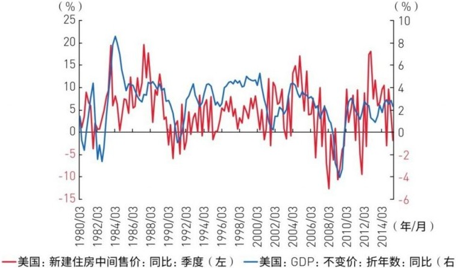

## PDF 原页 300（页脚 299）

▲图9-49 美国与欧元区房屋价格指数
资料来源：Wind资讯，中信建投证券研究发展部。

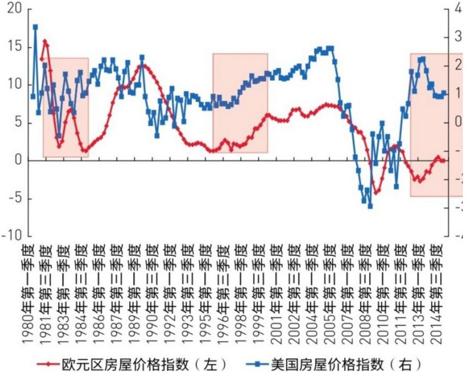

## PDF 原页 301（页脚 300）

图9-50 美国与欧洲利率
资料来源：Wind资讯，中信建投证券研究发展部。
纳 入 美 元 因 素 的 全 球 宏 观 对 冲 框 架
美 欧 坐 标 系 下 的 美 林 投 资 时 钟 与 美 元 强 弱 格 局
美林投资时钟讲述的是不同周期阶段的大类资产配置理论，而如我们前面所述，在
当今全球经济一体化的时代，美国经济主导着世界经济运行的主旋律，如果欧美经
济运行同步，则对世界经济周期走势的代表性更强。如果以美欧经济周期为横竖坐
标，则经典的美林投资时钟中所描述的经济周期的四个阶段，就相当于美欧坐标系
第一、第三象限中的四个区块（如图9-51）。

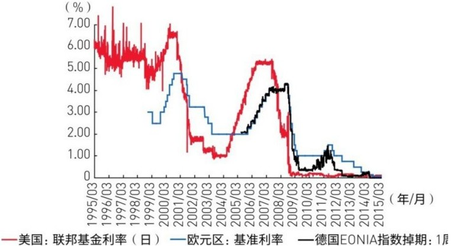

## PDF 原页 302（页脚 301）

图9-51 坐标系中的象限分布
资料来源：Wind资讯，中信建投证券研究发展部。
在美欧周期坐标体系中，经典的美林投资时钟只占我们坐标系中的一少部分，经典
区域之外还有更多符合现实中欧美经济周期不同步的区域。我们已经分析过，决定
美元强弱变化的直接原因是欧美经济周期不同步，美强欧弱形成美元强势行情，欧
强美弱（欧洲变强美国变弱）则形成弱美元走势。

## PDF 原页 303（页脚 302）

于是严格来讲，在我们的这个坐标系中，美国和欧洲经济周期完全同步的时刻只能
出现在穿越第一、第三象限的那条45度线上。第一象限45度线的下方属于美国景气
好于欧洲经济周期的情况，45度线的上方属于欧洲景气好于美国的情况。在第二象
限中，欧洲的情况要好于美国。第三象限属于美欧都不理想的状态，45度线以上属
于欧洲比美国更差的区域，45度线下方属于美国比欧洲更差的情况。第四象限属于
美国好于欧洲的情况。随着各区域中美欧景气格局强弱差别的转换，相应地也就出
现了美元的强弱区间（见图9-52）。
图9-52 美欧周期坐标系中的美元强弱区间
资料来源：Wind资讯，中信建投证券研究发展部。

## PDF 原页 304（页脚 303）

不过需要说明的是，在现实中，在欧美景气态势未表现出显著分化的情况下，亦即
在接近45度线的区域，美元更多地会表现出一种无趋势震荡态势，也即随机波动
（见图9-53、图9-54）。
▲图9-53 美欧周期坐标系中的美元无趋势震荡区域
资料来源：Wind资讯，中信建投证券研究发展部。

## PDF 原页 305（页脚 304）

图9-54 美欧周期坐标系中的景气强弱格局划分
资料来源：Wind资讯，中信建投证券研究发展部。
美 欧 坐 标 系 下 的 全 球 宏 观 对 冲 框 架
关于大宗商品的做多做空区间，在经典的美林投资时钟框架下，大宗商品的高收益
率阶段在过热阶段（区域D）和滞胀阶段（区域A）。不过在我们的欧美双坐标宏观
对冲框架下，除了区域A和区域D，美国经济处于滞胀而欧洲经济处于过热或复苏阶
段的区域E、区域H，以及欧洲经济处于过热阶段而美国经济处于复苏阶段的区域G
都是可以做多的区间。这些区间除了有需求方面的因素，还有弱美元因素对大宗商
品价格形成支撑。对于大宗商品的做空区间，除了美林投资时钟中经济衰退阶段
（区域B），美国经济处于从滞胀向衰退阶段转变且欧洲已处于衰退阶段的区域P，
以及美国经济刚刚走出衰退但欧洲仍处于衰退阶段的区域N都是适合做空的区域。

## PDF 原页 306（页脚 305）

虽然区域P和区域N的需求状况要略好于区域B，但是区域P和区域N的强美元因素是
不可忽视的利空因素。
关于黄金（贵金属）的做多做空区间，相较于一般大宗商品，黄金与贵金属的做多
区间更广泛，除了经典的美林投资时钟中的区域A与区域B，弱美元区域E、区域F、
区域I、区域J都是可以做多的区间。而做空区间则集中在强美元区间的第四象限
（见表9-2）。
表9-2 从一维到二维，美欧双周期框架下的国际投资时钟
资料来源：Wind资讯，中信建投证券研究发展部。
美 国 、 欧 洲 、 中 国 三 周 期 框 架 下 的 全 球 大 类 资 产 配 置
虽然我们在欧美双坐标框架体系下对全球大类资产配置的研判已经较经典投资有了
显著提升，但是在当今的国际经济体系下，忽视中国的分析框架仍是不完备的。
中国加入世界贸易组织后，经济高速增长，中国因素成为左右全球大宗商品市场价
格走势的最重要力量，全球大宗商品市场80%以上的增量需求来自中国，能源价格
和工业金属价格也从当年开始一飞冲天。现在，中国已经成为全球最大的大宗商品
消费国。在当今的国际分工体系中，中国处于中游制造的环节，因此其经济景气状
况受下游主要终端消费品市场（美、欧）的影响较大，经济周期在趋势上保持较高
的一致性。不过，中国作为一个发展中的制造大国，其自身的发展存在结构性不平
衡，这使其经济周期在趋势上与美欧保持一致的情况下，节奏上会有一定的区别
（中国政府宏观调控的导向与力度对中国经济周期运行节奏影响较大）。

## PDF 原页 307（页脚 306）

我们在前面已经提出，本章是在美欧框架下在美林投资时钟的基础上添加了美元因
素，但这只是美元强势期的框架，在解释美元弱势期的框架时，必须加入亚洲及中
国因素，这将是我们工作的第二步（见图9-55至图9-58）。
▲图9-55 美国、欧元区、中国GDP增速
资料来源：Wind资讯，中信建投证券研究发展部。

## PDF 原页 308（页脚 307）

▲图9-56 美国、欧元区、中国经济总量（购买力平价法）在全球的比重
资料来源：Wind资讯，中信建投证券研究发展部。

## PDF 原页 309（页脚 308）

▲图9-57 美国与中国商品贸易进口规模占全球的比重
资料来源：Wind资讯，中信建投证券研究发展部。

## PDF 原页 310（页脚 309）

图9-58 世界贸易组织燃料和矿产品进口规模
资料来源：Wind资讯，中信建投证券研究发展部。

