# 12 康波中的房地产周期研究

> 所属部分：第二部分 大类资产配置。

> 微信读书目录页码：623–661。这与 PDF 页脚页码是两套不同的分页。
> PDF 来源范围：物理第 359–380 页，页脚印刷页码 358–379。每页附原图，保留图表与版式。

## PDF 原页 359（页脚 358）

1 2
康 波 中 的 房 地 产 周 期 研 究
·2016年9月5日
自库兹涅茨定义建筑业周期后，房地产周期的运动一直不具有经典特征。到底当代
房地产周期是不是库兹涅茨定义的运动模式，这是一个非常重要的经济增长和资产
价格问题。从逻辑的角度看，房地产周期首先是一个国别周期问题，它与技术周期
和商品周期的最大不同点是，它不具有全球的共时性。但是单纯从一个国家的工业
化和城市化进程来推导其房地产周期显然是不够的，因为中国的房地产周期是中国
经济增长的原因和结果，同时中国经济的增长是第五次康波繁荣扩散的结果，所
以，房地产周期国别的差异和非共时性一定不会是单纯国内因素导致的，它是全球
繁荣扩散和传递的结果。以我们对康波理论的理解，房地产周期是康波周期的子周
期，它一定会存在一个康波内部的波动规律，本章就研究这个问题。
从内因上看，康波增长的根源是由技术创新导致的。但是增长不单纯是技术创新问
题，所以，技术创新对导入期和展开期的划分确实不能描述增长的全部。因为现实
的增长除了作为技术革命的主导产业，增长的最核心载体应该是房地产周期，这对
个体国家的经济增长最重要。而房地产周期一定滞后于技术周期，可以把房地产周
期视为技术革命的引致增长。同时，技术是从主导国逐步向外围传递的，增长也是
如此，这就决定了房地产周期亦如此。房地产周期存在从主导国向外围国家依次传
递的过程，而这种各国房地产周期之间的传递关系就决定了大宗商品周期的出现，
以及美元周期的问题。
所以，这种逻辑关系可以被用来推导房地产周期在康波中的划分问题。首先，我们
认为，康波的主导国是技术革命的发起国，其房地产周期应滞后于技术革命。而随
着技术革命和繁荣向外围国家扩散，首先受影响的是主导国的几个外围经济体，比
如本次康波以美国为主导国，英法德等为外围。随后是向追赶国扩散，本次康波就
是中国的工业化。随后是向康波中附属经济体的更外围扩散，例如上次康波中的新
加坡、韩国。按这种关系，我们可以清晰地发现，房地产周期在世界各种类型的国
家和地区之间的传递过程，而这种传递过程对我们判断纷繁复杂的世界房地产周期
的非共时性提供了基本的研究脉络。
历史数据的统计学规律证明了康波被划分为两个30年周期的统计学意义，而且两个
30年周期适用于技术周期、房地产周期和大宗商品周期。我们的研究证明，房地产
周期确实在跟随康波运行，在一个60年的康波中，房地产周期主要存在两个波动，

## PDF 原页 360（页脚 359）

而这两个波动分为一大一小，我们认为，这符合房地产周期的真实周期特征。在这
样的认知下，我们又研究了主导国、追赶国、资源国和附属经济体之间在房地产周
期方面的领先和滞后关系，这种关系对我们定位当前各类国家所处的房地产阶段具
有很好的借鉴意义。
房 地 产 周 期 与 库 兹 涅 茨 周 期
1930年，美国经济学家西蒙·库兹涅茨在《生产和价格的长期运动》一书中，根据
19世纪初到20世纪初美、英、法、德、比利时等国60种工、农业主要产品的生产量
和35种工、农业主要产品的价格变动的时间数列资料，剔除其中短周期和中周期的
变动，着重分析了有关数列的长期波动过程，指出经济中存在长度为15到25年不等
的长期波动。这种波动在美国的许多经济活动，尤其是建筑业中表现得特别明显，
所以库兹涅茨周期也被称为建筑业周期或房地产周期。库兹涅茨周期是由居民财产
购建和人口转移两大因素互相作用推进发展的。从水泥周期（建筑业周期）看，价
格周期从谷到谷的时间为1880年到1913年左右（33年），产量周期从1894年到1918
年左右（24年）（见图12-1）。从1890年以后的生铁周期看，价格周期从谷到谷的
时间为1895年到1915年左右（20年），产量周期从1895年到1925年左右（30年）
（见图12-2）。

## PDF 原页 361（页脚 360）

图12-1 1880—1924年水泥的产量和价格周期
资料来源：中信建投证券研究发展部。
霍伊特在其著作《百年来芝加哥地区的土地价格》一书中详细阐述了1830—1933年
芝加哥的房地产周期。103年间，建筑活动的事件按照先后顺序不自觉地重复发生
了五六遍，平均间隔为18年。霍伊特认为，长达18～20年的房地产周期非常缓慢，
但是周期振幅非常大。哈里森是房地产周期研究的另一位重要学者，其代表作为
《土地的力量》（The Power in the Land）和《荣衰：2010年的萧条与房价》
（Boom Bust House Prices and the Depression of 2010）。哈里森对200多年来
英国和美国的经济和房地产史进行研究，也得到了18年左右的房地产周期。霍伊
特、哈里森等人使用的是名义土地价格。

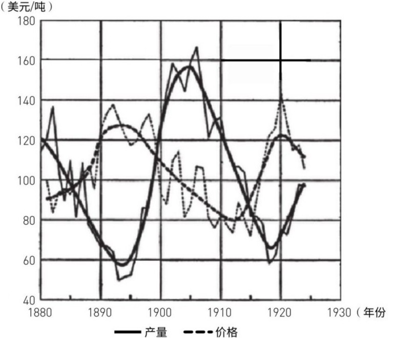

## PDF 原页 362（页脚 361）

图12-2 1854—1924年生铁的产量和价格周期
资料来源：中信建投证券研究发展部。
从上文看，库兹涅茨的水泥价格周期为30年左右，水泥产量周期达24年左右，要长
于霍伊特、哈里森等人的土地价格周期。自库兹涅茨定义建筑业周期后，房地产周
期的运动一直不具有经典特征。当代房地产周期到底是不是库兹涅茨定义的运动模
式，这是一个非常重要的经济增长和资产价格问题，这也是本章求解的问题之一。
区别于上述作者，我们选取了美国、英国、法国、日本、中国、澳大利亚、加拿
大、新加坡、巴西等国家和地区的实际房价（剔除了通胀因素），研究了第三次康
波以来的全球房地产周期。我们的研究表明，1890年以来的房地产周期平均时长为
25～30年，且房地产周期确实在跟随康波周期运行。在一个60年的康波中，房地产
周期主要存在两次波动，这两次波动分为一大一小，即强周期和弱周期，这也符合
房地产周期的真实周期特征。我们的研究从康波周期的视角拓展并深化了房地产周
期的现有研究，并对定位当前房地产周期的走势和所处阶段具有很好的借鉴意义。

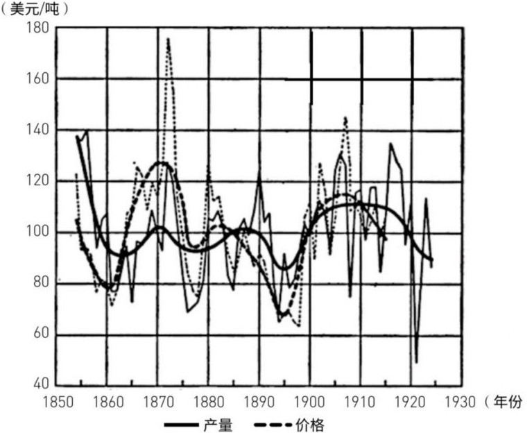

## PDF 原页 363（页脚 362）

第 三 次 康 波 以 来 的 房 地 产 周 期
第 三 次 康 波 以 来 的 房 地 产 周 期 划 分
把房地产周期置于康波周期框架中研究，可以更清晰地看到房地产周期追随康波内
部的波动规律。
为研究较长历史时期内的实际房地产周期，我们以多国房地产实际价格作为研究基
础，即采用名义价格剔除CPI通胀因素后得到实际价格。其中，美国数据来自耶鲁
大学罗伯特·希勒教授在《非理性繁荣》一书中采用的1890年到2012年实际房价指
数。法国、英国名义房价数据来自两国的国家统计局，其他国家的名义房价数据来
自国际清算银行。物价指数来自各国国家统计局及圣路易斯联储经济数据库，研究
区间为1890—2013年，共123年。我们选取了第三次康波繁荣以来美国、法国、英
国、日本、中国、新加坡、澳大利亚、加拿大、巴西等国家和地区的实际房价数据
（见图12-3）。研究发现，在历次康波中，主导国的房地产周期均领先于追赶国、
附属经济体以及资源国。尤其是美国、英国、法国等工业化时间较早的发达国家。
因此，我们选取美、英、法等主导国的房地产周期作为房地产周期划分的主要依
据。
图12-3 第三次康波以来的全球房地产实际价格走势（1890—2013年）
资料来源：中信建投证券研究发展部。
我们基于滤波方法对1890—2015年美国名义房价和实际房价进行研究，并得到房价
波动的序列。从图12-4中我们可以看到，两者的波动走势基本一致。除了1914—
1920年一战期间名义房价与实际房价有一定背离，当时物价在战时融资和货币快速

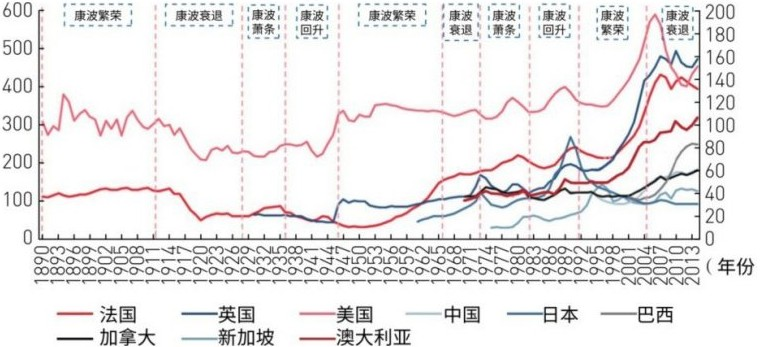

## PDF 原页 364（页脚 363）

扩张的助推下达到了20%以上，导致实际房价剔除物价因素后出现了快速回落。本
章将研究房地产周期的实际因素，因此以实际房价的周期波动作为主要研究对象。
如无特别说明，下文的房地产周期均指实际房价的波动周期。
图12-4 美国的实际房价周期与名义房价周期走势基本一致
注：除了1915—1920年一战期间略有背离（高通胀），名义房价周期的长度比实际
房价周期要稍短，其他时期走势基本一致。
资料来源：中信建投证券研究发展部。
根据美、英、法等国的实际房价数据，并结合康波运行特点，我们认为第三次康波
以来的房地产周期可划分为1892—1920年（28年）、1920—1942年（22年）、1942
—1975年（33年）、1975—1995年（20年）、1995—2025年（30年）5个周期（见
图12-5）。其中，根据康波阶段、库兹涅茨建筑业周期等情况，我们将1892年定为
当时那个房地产周期的启动点。从发达国家的房地产周期看，一个康波周期大致存
在两个房地产周期。我们发现，在第四次和第五次康波周期中，主导国美国的房地
产周期要领先于英国、法国等外围主导国，因此主要以美国的房地产周期作为划分
基准，并在此基础上推演房地产周期的波动规律以及国别之间的传递顺序。

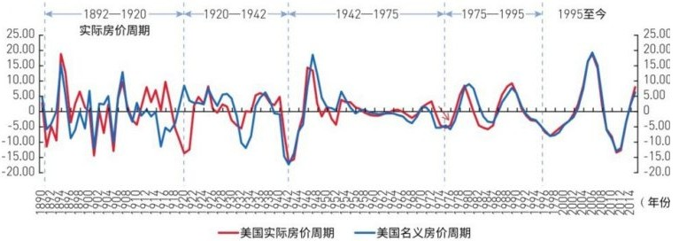

## PDF 原页 365（页脚 364）

图12-5 发达国家的房地产周期划分
资料来源：中信建投证券研究发展部。
我们发现，在1942—1975年的房地产周期中，美国于1955年见顶回落，而英国和法
国仍处于上升通道，剔除领先因素，美国的上升期较短。从数据结构看，同期美国
的名义房价处于增长停滞状态，物价则稳中略升，这导致实际房价的回落。我们认
为，造成当时房价停滞增长甚至回落的原因可能是人口结构的变化以及货币政策的
影响。从人口结构看，美国的主要置业人口（25～44岁）在20世纪50年代中期到60
年代末处于停滞增长甚至下降状态，势必对房价形成压制作用（见图12-6）。
图12-6 美国置业人口的变化
资料来源：中信建投证券研究发展部。

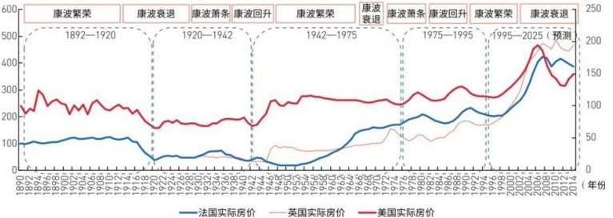

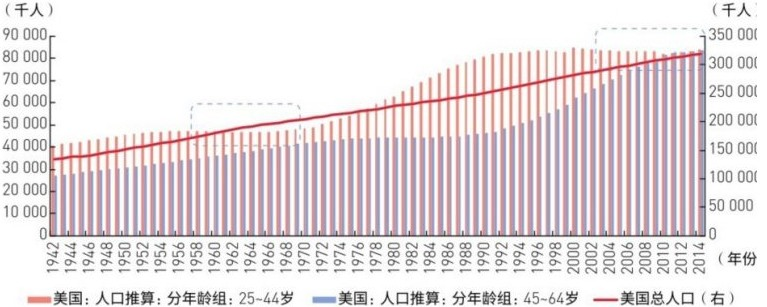

## PDF 原页 366（页脚 365）

不过，2000年后的置业人口也存在停滞增长状态，何以房价能够快速上涨？我们认
为，这可能与当时的货币政策有关。20世纪50年代中期开始至70年代，美国长期利
率趋于上升，对房价势必有抑制影响（见图12-7）。此段时期，由于需求回落和生
产过剩等，美国还爆发了多次经济衰退，比如1953—1954年、1957—1958年、1960
—1961年，这些因素也印证了房价趋弱的背景。而在2001年“9·11”恐怖袭击事
件和互联网泡沫破灭后，美联储的大幅降息使得美国进入了40年来最宽松的货币政
策环境，随着房地产信贷机构不断放宽贷款条件，房地产实际价格被一路推高，至
2006年达到历史顶峰。因此，货币政策扰动叠加人口结构因素是20世纪50年代房价
上行期相对于英法两国过短的重要原因。
我们研究了房地产周期的时长问题。其中，1892—1995年，房地产周期的平均时长
约为26年。1920—1995年，房地产周期的平均时长为25年左右。这意味着一个房地
产周期的平均时长约为25年，即一个康波周期可能存在两个房地产周期。其中，房
地产周期的上行期平均为8.5年左右，下行期平均为17年左右，表明上行期要明显
短于下行期。此外，启动于回升期或繁荣期的房地产周期下行阶段要明显长于上行
阶段，这也是我们推算本次房地产周期运行特点的一个依据。
图12-7 利率与实际房价指数
资料来源：中信建投证券研究发展部。
我们发现，若从启动时点看，启动于回升期或繁荣期的房地产周期，平均时长为31
年左右；启动于衰退期或萧条期的房地产周期，平均时长为21年左右，前者要长于
后者（见表12-1）。根据这个特征，我们大致可以推算，启动于1995年（康波繁荣
期）的本次房地产周期可能要到2020—2025年才会触及大底，历时25～30年。这个
低点与商品产能周期的低点（2030年）是接近的。下文的分析表明，房地产周期会
领先于产能周期，因此，对本次房地产大底的判断也符合历史经验。据此推算，下

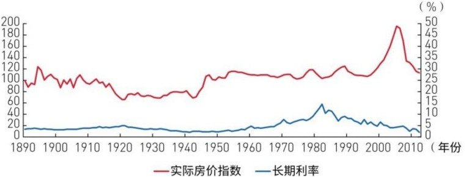

## PDF 原页 367（页脚 366）

一次房地产周期将可能开启于康波萧条阶段，可能持续至2045—2050年，即运行至
第六次康波繁荣阶段，长度20～25年。
根据上述分析，我们认为美国房地产价格在2012年的反弹很有可能是下行期的一次
B浪反弹。主导国美国本轮房地产周期启动于1995年左右，并在2006年已实质性见
顶并回落至2012年，但随后出现反弹。根据我们的研究，本轮房地产周期启动于康
波繁荣期，因此周期时长可能长达25～30年。从这个角度看，2012年之后美国房价
的反弹应该只是房地产大周期下行期的一次B浪反弹，最终大底要在2020—2025年
才会达到。对这次反弹性质的界定，将直接影响到对未来几年房地产周期走势和方
向的判断（见图12-8）。
表12-1 历次房地产周期所处康波阶段及时间长度
▲注：启动于回升期或繁荣期的周期时长，即1892—1920年、1942—1976年两次康
波的平均时长；启动于衰退期或萧条期的周期时长，即1920—1942年、1975—1995
年两次康波的平均时长。

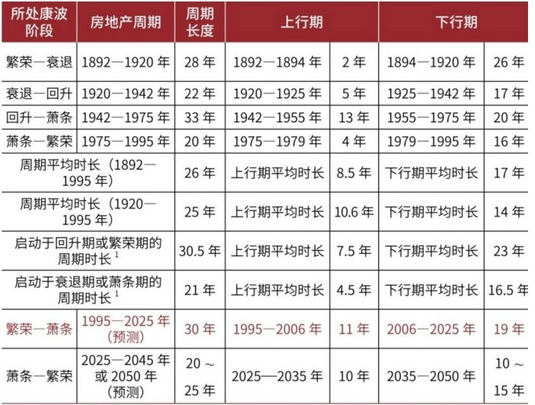

## PDF 原页 368（页脚 367）

资料来源：中信建投证券研究发展部。
图12-8 房地产周期的上行期和下行期
资料来源：中信建投证券研究发展部。
房 地 产 周 期 中 的 强 周 期 和 弱 周 期
启动于不同康波阶段的房地产周期，其房价波动性存在较明显的差异（见表12-
2）。研究发现，启动点位于康波繁荣阶段或回升阶段的房地产周期（尤其是回升
阶段），其上行期平均涨幅为49.4%，下行期平均跌幅为29.2%；启动点在康波衰退
阶段或萧条阶段的房地产周期，其上行期平均涨幅为23.3%，下行期平均跌幅为
12.9%。这意味着，房地产周期存在强周期和弱周期。识别房地产周期的强弱不仅
有助于判断房地产投资的潜在利益，还可以与大宗商品周期、中周期的强度互相验
证。
表12-2 美国房地产周期的波动性

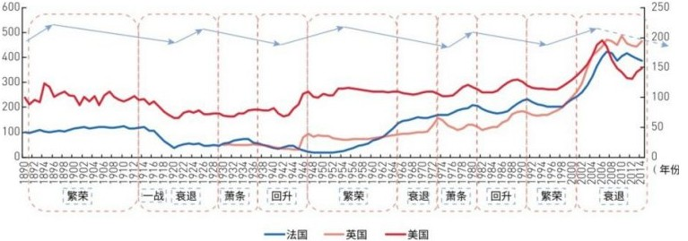

## PDF 原页 369（页脚 368）

资料来源：中信建投证券研究发展部。
我们认为，导致强弱周期差异的原因可能在于，相对于康波衰退期或萧条期，康波
回升或繁荣阶段正处于新技术加快扩散和应用的重要时期。从逻辑上看，随着作为
技术革命的主导产业加速发展，以及相关产业链在国家间的联动，其所引致的房地
产需求增长将是较为强烈的。与此同时，经济中产生了许多对新领域的投资活动，
由此带来了大量新的产业人口。随着收入水平的提高，人们有了更大的房地产置业
需求。同时，由于这些时期产生了大量富余的产业资本，在逐利性驱动下，它们演
化成金融资本流向房地产领域，并催生房地产投机活动。因此，从上述角度看，启
动于康波回升或繁荣阶段的房地产波动性会更大一些。
按照历史经验，启动于1995年（康波繁荣阶段）的新一轮房地产周期将是一次较强
的房地产周期。数据显示，从1995年至2006年高点，美国实际房价上涨了71.2%，
而2006—2012年的跌幅也达到了32.5%，涨跌幅均超过前几次房地产周期的平均水
平。这进一步验证了强弱周期的运行规律。照此推论，下一次房地产周期将于2020
—2025年启动，按照我们的研究，即启动于康波周期的萧条阶段，届时的房地产周
期时长和波动性将属于相对较弱的水平。房地产周期的强周期和弱周期在英国、法
国等发达国家同样存在，从而印证了这种规律性的波动（见图12-9至图12-11）。
房地产强弱周期的特点也可通过货币增速加以验证（见表12-3）。

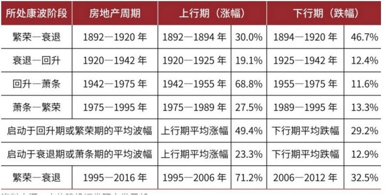

## PDF 原页 370（页脚 369）

▲图12-9 美国房地产周期的强周期和弱周期
资料来源：中信建投证券研究发展部。
▲图12-10 英国房地产周期的强周期和弱周期
资料来源：中信建投证券研究发展部。
▲图12-11 法国房地产周期的强周期和弱周期

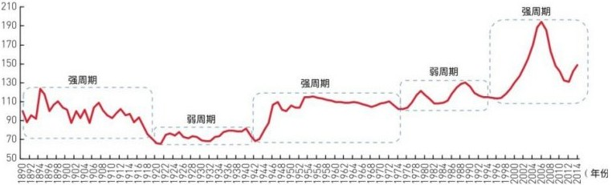

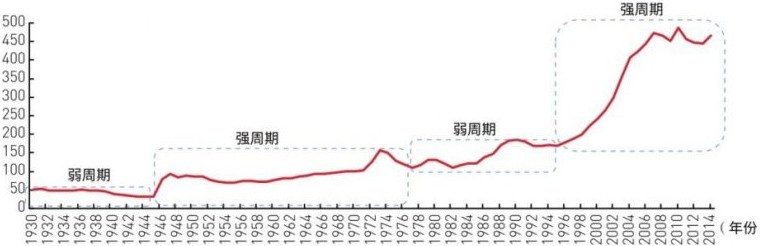

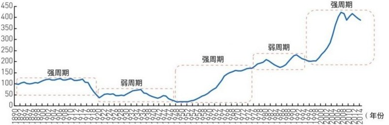

## PDF 原页 371（页脚 370）

资料来源：中信建投证券研究发展部。
▼表12-3 房地产周期与货币增速的关系
资料来源：NBER（美国权威经济研究机构），Wind资讯，中信建投证券研究发展
部。
房 地 产 周 期 与 商 品 周 期 、 中 周 期
房 地 产 周 期 与 商 品 周 期
我们在第11章研究了基本工业金属和原油的产能周期，结果发现，一个康波周期商
品价格波动内部嵌套着两个商品的产能周期，每个产能周期25～30年。
我们认为，房地产周期是驱动商品周期的重要力量。从逻辑上看，康波增长除了作
为技术革命的主导产业，现实增长的最核心载体就是房地产周期。这意味着，房地
产周期是决定商品产能周期出现的重要因素。对20世纪80年代开始的附属经济体
（新加坡）和2000年后加速工业化的追赶国（中国）而言，房地产投资是推动这些
国家和地区工业投资和经济增长的主导产业部门之一。房地产周期作为技术创新的
引致增长，其繁荣与衰退必然关系到商品产能周期的兴衰，也影响着商品产能周期
的启动与衰退（见图12-12和图12-13）。

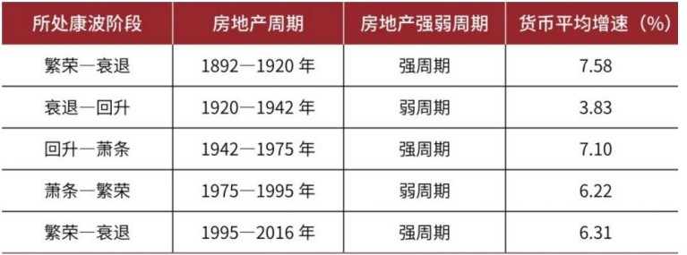

## PDF 原页 372（页脚 371）

图12-12 房地产周期与产能周期密切相关
注：名义金属价格周期是对名义金属价格做滤波得到的周期性波动序列。
资料来源：中信建投证券研究发展部。
在第11章中，我们得到的产能周期启动点序列是1945—1972—2002—2030年，这几
个时点与本章推算的房地产周期启动点“1942—1975—1995—2020年（至2025年之
间）”比较接近，即产能周期启动点往往位于房地产周期启动点附近。比如，1945
年的产能周期启动点位于1942年房地产周期开启之后；1972年产能周期略微领先于
1975年的房地产启动点；1995年房地产周期开启后，产能周期于2002年启动。从历
次房地产周期和产能周期的经验来看，房地产周期启动点要领先于产能周期3～7
年。我们推算下一次房地产周期将在2020—2025年开启，而下一次产能周期的开启
点可能在2030年，即房地产周期可能领先产能周期5～10年。领先时间拉长的原
因，可能在于下一轮房地产周期启动于萧条期，属于弱的房地产周期，叠加萧条
期，因此对产能周期影响有所滞后。

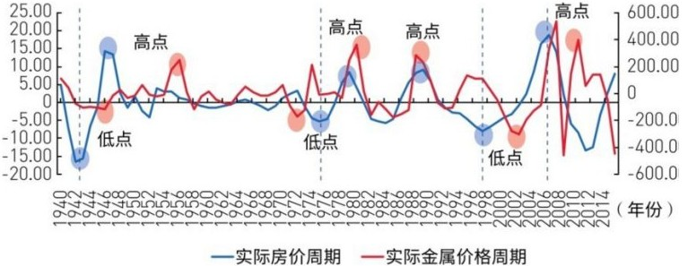

## PDF 原页 373（页脚 372）

图12-13 房地产周期与商品产能周期
资料来源：中信建投证券研究发展部。
研究发现，产能周期的启动点位于诸如二战后美国的黄金增长时期、1955年后日本
工业化时期、2000年中国工业化时期，这些时点也恰好对应着美国、日本、中国等
人口和经济大国城市化较快的阶段。从美国看，二战后1950—1960年城市化率由
60%升至70%，上升10%仅用了10年时间（见图12-14）。1967年之后，日本大致用了
15年在1982年将城市化率从50%提升到60%（见图12-15）。中国从2000年到2010
年，城市化率从35%提升到了50%左右（见图12-16）。城市化是驱动房地产周期的
重要力量，因此也成了推动房地产周期上行的重要因素。
▲图12-14 美国实际房价指数与城市化率

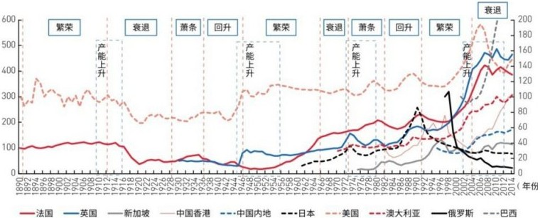

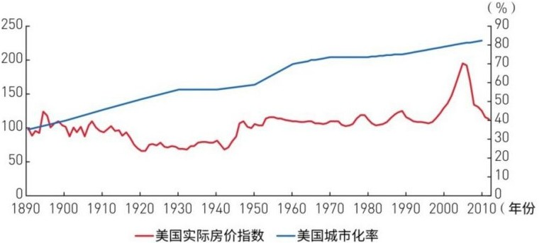

## PDF 原页 374（页脚 373）

资料来源：Wind资讯，中信建投证券研究发展部。
▲图12-15 日本城市土地价格指数与城市化率
资料来源：Wind资讯，中信建投证券研究发展部。
图12-16 中国城市实际房价指数与城市化率
资料来源：Wind资讯，中信建投证券研究发展部。
房 地 产 周 期 与 中 周 期
由于一个房地产周期跨越20～30年，明显长于9～10年的中周期（资本支出周期或
称朱格拉周期），因此，一个房地产周期的内部走势可能会受到不同阶段中周期的

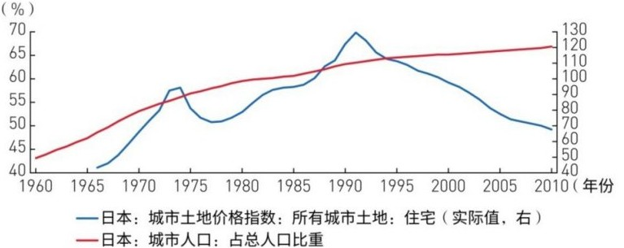

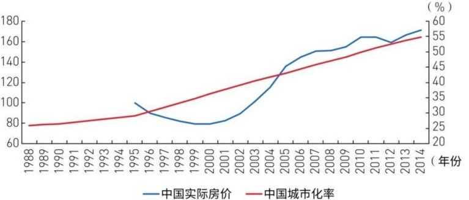

## PDF 原页 375（页脚 374）

影响。根据我们对美国产出缺口和设备投资占比情况的研究，1942年以来，美国中
周期低点（启动点）的大致出现时间为“1945—1954—1964—1975—1982—1991—
2001—2009年”。从中周期的角度看，我们发现了房地产周期与中周期的一些关
联。
图12-17 房地产周期内部走势与中周期
资料来源：Wind资讯，中信建投证券研究发展部。
（1）中周期的下行期大致对应的是房地产周期的回调或下行阶段，而中周期的上
行期则对应了房地产周期的上行或反弹阶段。房地产周期见顶下行后出现的反弹可
能源于中周期上行力量的影响。
（2）中周期的低点之前通常对应的是房地产周期的回调或下行阶段，而房地产周
期的低点大致出现在中周期低点附近或之后。
（3）美国本次房地产周期启动于1995年左右，并于2006年见顶，在实际房价见顶
后的下行过程中，中周期在2009年开启了上行阶段至今，而房地产周期则在2012年
出现了B浪反弹，这正好对应了中周期的上行期。
（4）根据我们的研究，美国中周期从2009年开启，并在2015年出现中周期的高
点，最终低点可能在2019年附近出现。根据经验，中周期的低点之前通常对应的是
房地产周期的回调或下行阶段，因此，2012年房价的B浪反弹大概率在2019年之前
就会结束，即会在2017—2019年进入C浪下跌。
（5）房地产周期的低点大致会滞后于中周期低点，由于2019—2020年可能是美国
中周期低点，因此本轮房地产周期的终极大底可能出现在2020年之后，即在2020—
2025年见底。

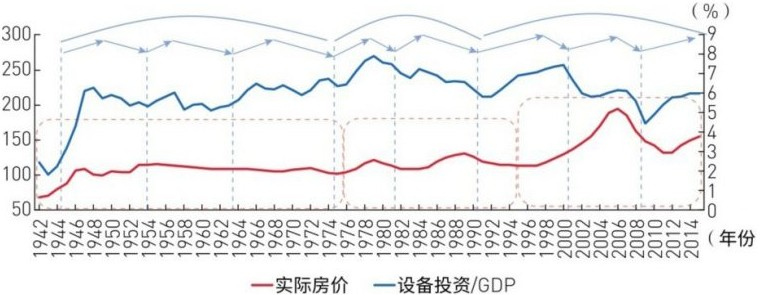

## PDF 原页 376（页脚 375）

全 球 房 地 产 周 期 演 进 的 传 递 规 律
我们还发现，在全球房地产周期中，核心主导国、外围主导国、追赶国、附属经济
体、资源国等不同层次之间存在较明显的领先滞后关系，即全球房地产周期的演进
遵循着“主导国—外围主导国—追赶国—附属经济体、资源国”的传递顺序。这对
我们判断主要国家的房地产周期所处阶段意义重大。下文将核心主导国简称为主导
国，将外围主导国简称为外围国。
首先，我们对不同康波周期中的国别层次关系进行划分。就选取的国家样本而言，
在第三次康波周期中，英国属于主导国，美国、法国属于外围国；在第四次康波
中，美国超越英国，成为全球经济主导国，英国演变为外围国，日本、澳大利亚、
加拿大等国由于处于技术创新和经济增长较快速的阶段，属于这一时期的追赶国。
新加坡则是第四次康波中的附属经济体。
在第五次康波周期中，美国仍是全球技术创新和经济发展的主导国，因此属于主导
国。而进入20世纪90年代以后，尽管日本经济体量仍然较大，但随着其工业化高速
发展后经济增速已大幅下降，技术创新能力弱化，因此属于外围国。同理，在这次
康波中，澳大利亚和加拿大的经济增速中枢和创新能力下降，也属于资源国，因此
可以认为，澳大利亚和加拿大可能具备外围国与资源国的双重属性。这一时期中国
处在高速的工业化和城市化的进程中，技术创新趋于活跃，因此属于典型的追赶
国。对于附属经济体的选择，由于本次康波萧条阶段仍未结束，因此暂时无法确定
新加坡是否仍属于第五次康波中的附属经济体。此外，我们选取了巴西作为典型的
资源国（见表12-4）。我们主要从第四次康波开始研究。
表12-4 不同康波周期中的国别层次关系
资料来源：中信建投证券研究发展部。
先来分析主导国、外围国、追赶国之间的房地产周期传递关系。在第四次康波的第
一轮房地产周期（1942—1975年）中，主导国美国领先于外围国（英、法）1～6年
触底，而高点则领先外围国英国近18年，美国领先这么多年见顶，可能与20世纪50
年代中后期开始的美国置业人口变化以及货币政策有关。在第四次康波的第二轮房

## PDF 原页 377（页脚 376）

地产周期（1975—1995年）中，从低点看，美国与法国基本同步，但领先于外围国
（英）2年左右，而领先于追赶国（日、澳大利亚、加拿大）2～10年。从高点看，
美国领先于外围国（英）和追赶国（日）1年左右，但与追赶国（澳大利亚、加拿
大）基本同步。
在第五次康波周期的第一轮房地产周期（1995—2020年）中，从低点看，美国与英
国基本同步，但领先于外围国（法、澳大利亚、加拿大）1～3年，而领先于追赶国
（中国）5年左右。从高点看，美国领先于外围国（英、法）1年左右，但对外围国
澳大利亚和加拿大而言，仍处于上升趋势，其高点有待未来进一步检验（见图12-
18）。对追赶国中国而言，自2006年以来房地产周期上行近10年，根据第四次康波
的经验，美国高点领先于附属经济体7～9年，而中国在第五次康波中是领先附属经
济体的，由此反推，2016年中国高点滞后于美国高点的时长已接近极限，2014年和
2016年可视为双头顶部，中国房地产周期很可能在2017—2018年进入下行期。
上述分析表明，主导国相对于外围国和追赶国具有较明显的领先性，而外围国也同
步或领先于追赶国的房地产周期，这表明三类国家的传递关系是切实存在的。需要
指出的是，目前看，不同层级国家之间领先滞后的时间长度规律性不强，尤其是主
导国领先于追赶国的时长，我们认为这可能与各国工业化时点和进程有关（见表
12-5）。
▲图12-18 主导国房地产周期要领先于外围国和追赶国
资料来源：Wind资讯，中信建投证券研究发展部。
▼表12-5 主导国、外围国和追赶国的房地产周期领先滞后关系

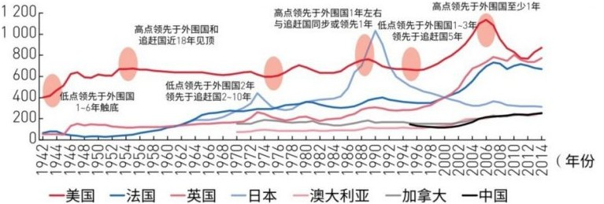

## PDF 原页 378（页脚 377）

资料来源：中信建投证券研究发展部。
在第四次康波中，新加坡属于附属经济体。在1975—1995年的房地产周期中，美国
低点领先于附属经济体3～8年，高点领先于附属经济体7～9年。据上述经验推算，
美国2006年见顶以来已有10年，由于中国要领先于新加坡，这意味着中国作为追赶
国的上行期可能已接近极限，2014年和2016年可能是双头顶部，中国房地产周期很
可能在2017—2019年进入下行期。
在第五次康波中，中国作为追赶国，其房地产周期要领先于新加坡、巴西等国。随
着1998年房改开始，中国于2000年左右正式启动新一轮房地产周期。而新加坡于

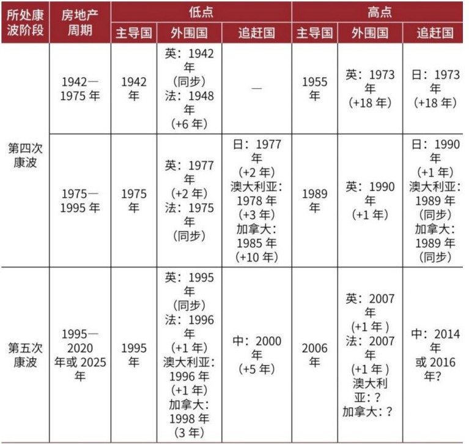

## PDF 原页 379（页脚 378）

2004年触底，巴西于2003年触底，这两个国家滞后于中国3～5年（见图12-19、表
12-6）。
▲图12-19 主导国和追赶国的房地产周期要领先于附属经济体和资源国
资料来源：中信建投证券研究发展部。
▼表12-6 附属经济体和资源国的房地产周期相对滞后
资料来源：中信建投证券研究发展部。
风 险 提 示 ： 中 美 房 地 产 周 期 或 在 2 0 1 7 — 2 0 1 9 年 共 振 下 行
上面的分析已经指出，房地产周期时长为25～30年，美国自1995年开启新一轮房地
产周期至2016年，已经历了21年，并在2006年已实质性见顶。根据经验，这次房地
产周期的最终大底有可能在2020—2025年才会出现。因此，对于2012年房价回升的
性质，我们认为其更有可能是房地产大周期下行期中的一次B浪反弹。我们对中周
期的研究也验证了这次反弹的客观存在。

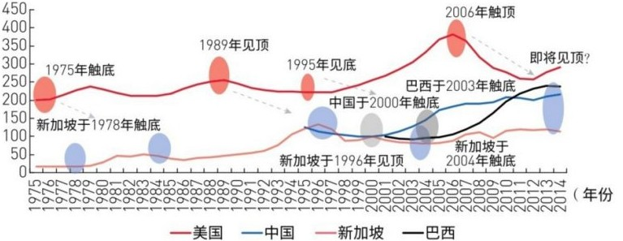

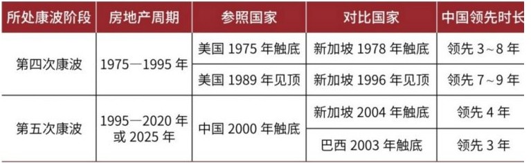

## PDF 原页 380（页脚 379）

我们还发现，中周期的低点之前通常对应的是房地产周期的回调或下行阶段，而房
地产周期的低点大致出现在中周期低点附近或之后。美国中周期从2009年开启，并
在2015年出现中周期的高点，亦即第二库存周期的高点，2019—2020年可能是本轮
中周期的低点。根据经验，中周期的低点之前通常对应的是房地产周期的回调或下
行阶段，因此，2012年房地产周期的B浪反弹大概率在2019年之前就要结束，即在
2017—2019年大概率进入C浪下跌。本轮房价的大底可能在2020年之后出现，亦即
在2020年至2025年之间见底。
房地产周期的传递关系表明，在第四次康波中，主导国美国的房地产周期要领先新
加坡7～9年。
综上分析，中美两国将很可能在2017—2019年同时处于房地产周期的下行阶段，即
出现共振下行（见图12-20）。作为全球两大经济体，这种共振向下的影响和冲击
将是重要的风险因素。从康波周期所处的阶段看，2016年正处于康波衰退向萧条转
换的阶段。这似乎意味着，中美房地产共振衰退可能成为康波萧条加速到来的风险
点。
图12-20 中美房地产周期或在2017—2019年共振下行
资料来源：中信建投证券研究发展部。

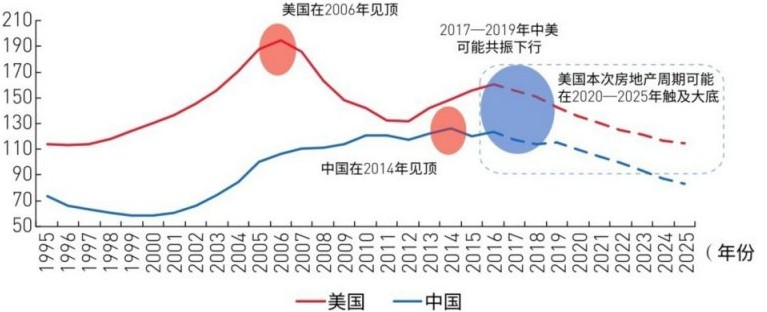

