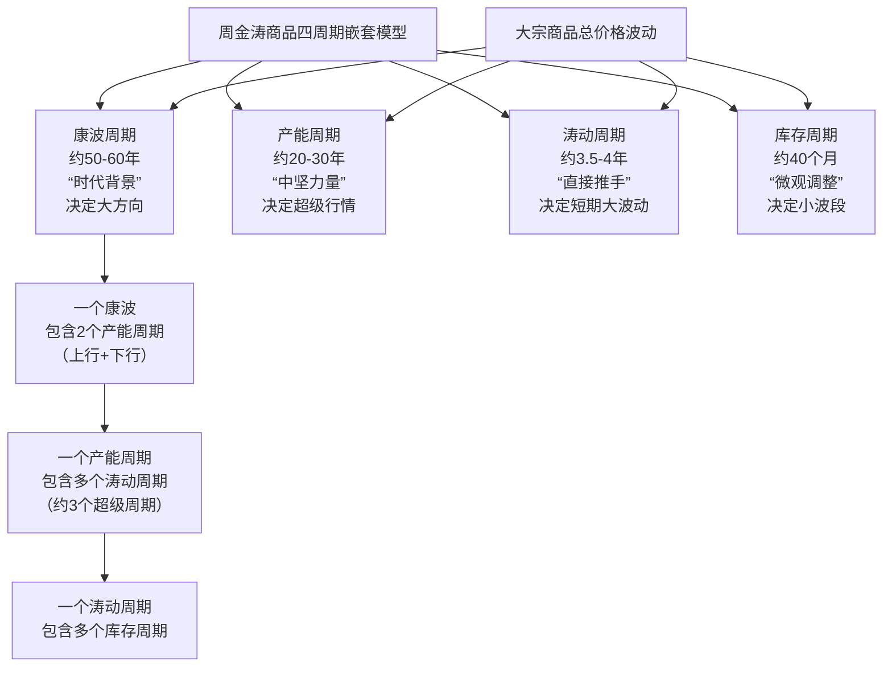

# 11 世界大宗商品周期研究｜读者评论

所属部分：第二部分 大类资产配置
微信读书 bookId：`3300128305`；chapterUid：`16`。
划线范围：98；读者评论：289；已读取回复：85/85。
数据为抓取时可见的公开评论；评论可能随时间增删。

对应正文：[《11-世界大宗商品周期研究》](../11-世界大宗商品周期研究.md)

## 1. 划线范围 360-366

划线人数：0；评论：1。

> 大宗商品周期

### 1. 静隙

一、大宗商品的核心定义
大宗商品是指可进入流通领域、用于工农业生产与消费，且具有同质化、可标准化、易储存运输等特性的大批量买卖的物质商品，主要分为三大类：
1. 能源类：原油、天然气、煤炭等，是工业的“血液”。
2. 基础原材料类：铜、铝、铁矿石、黄金、白银等金属，以及橡胶、棉花、木材等农林原料。
3. 农产品类：大豆、玉米、小麦、稻谷、白糖、咖啡等，关系民生与食品加工。
这类商品的价格通常受宏观经济、供需关系、地缘政治、气候等因素影响，波动相对明显，也是国际贸易和金融投资的重要标的。
二、大宗商品“同质化”的含义
同质化是大宗商品最核心的特征之一，指同一种类的大宗商品，无论产自何地、由哪家厂商生产，其品质、规格、性能都高度一致，可互相替代，没有本质区别。
• 举个例子：产自智利的铜矿石和产自秘鲁的铜矿石，只要品位（铜含量）相同，在市场上的价值和用途完全一样；美国的大豆和巴西的大豆，符合国标或国际标准的话，可直接替换使用。
• 正因为同质化，大宗商品才能实现标准化交易（比如期货市场的合约标准化），买卖双方无需逐一验货，只需参考标准品级定价即可。

点赞：13；回复：0；reviewId：`62003416_86j5Cd3YV`。

## 2. 划线范围 498-582

划线人数：0；评论：1。

> 我们认为，大宗商品价格的暴跌极大地改变了原有的世界秩序，主导国美国和追赶国中国都在商品价格暴跌中获益，而资源国却走向崩溃的边缘，商品价格已经成为当今世界利益分配的核心问

### 1. 鄉

相对进口国，像这类大宗商品定价权都在欧美和资源国。

点赞：0；回复：0；reviewId：`282856329_8a6EqNbre`。

## 3. 划线范围 658-699

划线人数：0；评论：4。

> 我们一直认为，大宗商品投资是人生资产中最战略的品种，主要因其投资的长周期和暴利性。

### 1. 认真工作的古晉🐻

需要学习的东西

点赞：1；回复：0；reviewId：`281069799_88ySPW9Gs`。

### 2. 十五

大宗商品投资的优越性

点赞：0；回复：0；reviewId：`308732374_8bCcHidKm`。

### 3. 墨染星辰

大宗商品投资周期性和暴利性。

点赞：0；回复：0；reviewId：`411558284_84627TKcB`。

### 4. ！、！

长周期 暴利性

点赞：0；回复：0；reviewId：`746700045_86gO7M9Sq`。

## 4. 划线范围 794-856

划线人数：0；评论：2。

> 大宗商品的底部级别问题，本质上就是商品周期的问题，以我们对世界经济周期嵌套的理解，大宗商品一定存在不同级别的周期及嵌套模式。

### 1. 十五

研究大宗商品的周期

点赞：0；回复：0；reviewId：`308732374_8bCcK6NTa`。

### 2. Chan

康波周期主导下，衰退期容易出现超级牛市，比如70年代大滞涨期、02年之后衰退期（叠加中国因素）；此外还会存在较大级别的周期性波动，这部分波动主要原因为产能周期的影响。

点赞：2；回复：0；reviewId：`3183165_8a8Le3SSy`。

## 5. 划线范围 905-953

划线人数：0；评论：7。

> 康德拉季耶夫周期是决定世界商品价格波动的根本驱动力，这一点我们在前面已经做过详细的阐述。但是除了在每次康波的衰退期出现为期10年的商品牛市，商品自身在康波的复苏、繁荣和萧条期也一定有周期性波动。

### 1. Terry Blunt

现在确实

点赞：2；回复：0；reviewId：`83339551_86Tz93Sfd`。

### 2. 冉冉上升

为什么是10年？

点赞：0；回复：0；reviewId：`374254315_8cWljVbvV`。

### 3. 星空下

19-29

点赞：0；回复：0；reviewId：`7243980_8cgxRrpYO`。

### 4. ZhaiYJ

在康波衰退期商品是牛市

点赞：4；回复：0；reviewId：`288137737_86bhp2ggi`。

### 5. 晚晴照雪映长林

哦，商品

点赞：0；回复：0；reviewId：`204963084_8bbu6Lmh3`。

### 6. 晚晴照雪映长林

康波衰退期，10年牛市，我就看到这几个字了

点赞：0；回复：0；reviewId：`204963084_8bbu4DsQZ`。

### 7. 🚶guapo joven （十点pm 睡觉勿

衰退期开始起算10年

点赞：2；回复：0；reviewId：`14293026_870kgSjRe`。

## 6. 划线范围 1024-1026

划线人数：0；评论：1。

> 周期

### 1. 追光

一切皆周期，供需＜＞周期。

点赞：0；回复：0；reviewId：`36925843_84ONzGFRk`。

## 7. 划线范围 1057-1094

划线人数：0；评论：2。

> 而大宗商品的产能周期与康波周期是如何嵌套的，这是商品周期研究的最核心问题。

### 1. 阳.

康波衰退萧条期→结构主义→主导行业→所需大宗

点赞：0；回复：0；reviewId：`426066534_8beuFvScB`。

### 2. 墨染星辰

大宗商品的产能周期。

点赞：1；回复：0；reviewId：`411558284_8462eEVh3`。

## 8. 划线范围 1173-1234

划线人数：0；评论：9。

> 任何周期性行业的价格波动都是由库存周期推动的，库存周期在商品周期中是如何表现的，这是捕捉大宗商品短期机会的基本逻辑。

### 1. 小二狗子

任何周期商品都由周期决定，短期看库存，需求预期+供给博弈，中期看产能，供给刚性约束，指标控制，进口收缩，精矿提价等，长期看康波，供需缺口，新质生产力，需要大量该商品。照这个推理，稀土，有色，这类周期商品，有望走出长牛。

点赞：28；回复：0；reviewId：`233906311_87bb3Gol2`。

### 2. y y y

长中短周期三方面找规律

点赞：0；回复：0；reviewId：`434210268_87RF4l24V`。

### 3. 杰渔

根源还是库存周期

点赞：2；回复：0；reviewId：`442224903_84VrzHDmn`。

### 4. 快乐小睡包

大宗商品价格与库存，商品价格相关

点赞：0；回复：0；reviewId：`365489913_87nL5Y7pw`。

### 5. 十八°

库存周期与大宗周期勾连镶嵌，承前启后

点赞：0；回复：0；reviewId：`259153360_8759Aui0M`。

### 6. 九日

已验证兑现的部分
周金涛在2016年前后最核心的几个判断，事后看方向基本正确：
· “2016年大宗商品出现年度级别反弹”：2016年黑色系、有色等确实走出一轮强劲反弹，这是他生前被引用最多的准确判断。
· “萧条期黄金进入长期牛市”：2019年后黄金持续走强，从约1160美元/盎司一路涨至2026年突破5500美元，避险属性在萧条环境中充分兑现。
· “房地产与康波同步见顶下行”：中国房地产在2021年后确实进入历史性下行周期，恒大暴雷等标志性事件印证了这一方向。
· “大宗商品2011—2030年整体熊市”的大框架：虽然中间有反复，但商品确实没有再回到2011年的高点水平。
明显证伪或偏差的部分
问题主要出在精确时间点和对政策干预与技术革命的低估上：
· “2019年是资产终极低点”：A股2019年初确实见底，但此后是结构性牛市而非全面大底反转；房地产更是在2019—2021年继续上涨，真正下行起点是2021年下半年。听从这个判断去买房的人，买在了高位区域。
· “2017年中期后中美资产价格全线回落”：美股2017—2021年持续大牛市，完全不符合。
· “2019年后技术真空期，商品长期横盘”：没有预见到2022年俄乌冲突带来的原油、有色大级别行情，以及AI爆发对铜、锂等需求的拉动。
· “商品熊市持续至2030年”：2022年出现了大级别商品牛市，并非单边熊市。

点赞：1；回复：0；reviewId：`216568864_8cbS1lcDF`。

### 7. 阳.

转：短期看库存，需求预期+供给博弈，
中期看产能，供给刚性约束，指标控制，进口收缩，精矿提价等，

长期看康波，供需缺口，新质生产力，需要大量该商品。
合理

点赞：3；回复：0；reviewId：`426066534_8beuZbHuM`。

### 8. zbyblue

长中短周期嵌套

点赞：0；回复：0；reviewId：`17784386_8aW3rMGzY`。

### 9. ！、！

库存商品的周期影响大宗商品

点赞：0；回复：0；reviewId：`746700045_86gOciGb7`。

## 9. 划线范围 1438-1469

划线人数：0；评论：1。

> 而在产能周期运动的同时，大宗商品存在18～20年的超级波动周期

### 1. JJessica

产能周期是否因为技术革命？大宗商品的产能无法跟上大宗商品的消耗，比如目前在AI智能开启第四次工业革命，算力中心，电力设施对铜需求的高刚性极大推升了铜的价格。铜供应的扰动进一步加剧价格波动。

点赞：8；回复：2；reviewId：`8609031_86U5ycoxd`。

- **杨柳风**：请教一下： 2026年会是大宗商品转牛的伊始吗?（点赞 0）
- **竖子**：贵金属，有色，新能源从25年不是就已经牛了吗[旺柴]（点赞 1）

## 10. 划线范围 1517-1567

划线人数：0；评论：3。

> 小级别周期波动，我们称其为商品的涛动周期，因为这一周期类似于我们理解的太阳黑子周期中的厄尔尼诺现象。

### 1. 冰果果🍧🍨

完了，又玄学了。很多人不认同这一点

点赞：1；回复：0；reviewId：`447537194_8aEVvdeeY`。

### 2. 陈雷铭

康博周期（60年）——大宗商品产能周期（25-30年）——超级波动周期（18-20年）——涛动周期

点赞：3；回复：0；reviewId：`284700689_8aH7PjA94`。

### 3. 杨潇源

他们之前如何嵌套的？

点赞：3；回复：0；reviewId：`201006431_8af06tEaa`。

## 11. 划线范围 1772-1820

划线人数：0；评论：3。

> ，价格低点在2018年至2019年之间

### 1. 李明雪

中国此轮牛市开始于2019年9月

点赞：0；回复：0；reviewId：`59296456_8cqrQCjZh`。

### 2. 墨染星辰

2018到2019年

点赞：0；回复：0；reviewId：`411558284_846388NUn`。

### 3. @雁菁💞

作者推断的很准确，2010年产能开始进入下降周期，到2015年进入下降中期，还要往后延续6到8年 ，预测2018到2019到达底部区，2018年应该就是股市的底部吧？

点赞：4；回复：3；reviewId：`380402079_80QvJzXNs`。

- **陈亚东**：2019是有色的底部（点赞 0）
- **。**：2026年是不是该回升了（点赞 0）
- **陈亚东**：根据此书，现在到2030是萧条转复苏，实际上铜从2020就开始涨（点赞 0）

## 12. 划线范围 1955-2028

划线人数：0；评论：5。

> 4)以超级周期内部涛动周期的规律来看，本次超级周期仅经历两个涛动周期，在2019年之前一定还会出现一次涛动周期，时间应该在2016年至2019年。

### 1. Mandy汝

全中

点赞：0；回复：0；reviewId：`67562433_8bNcRsiJs`。

### 2. 冰果果🍧🍨

这么看。神预测

点赞：2；回复：0；reviewId：`447537194_8aEVRkTWv`。

### 3. 赖伟肖

第三次涛动周期低点在2019年

点赞：0；回复：0；reviewId：`407557991_89yf3ey0x`。

### 4. 十八°

康波周期中的去库存周期～

点赞：0；回复：0；reviewId：`259153360_875bbbBY1`。

### 5. 🚶guapo joven （十点pm 睡觉勿

目前：

康波：萧条末→回升初；涛动：新一轮反弹浪；朱格拉：复苏初；库存：主动补库前夜。

点赞：7；回复：0；reviewId：`14293026_870lbJF8E`。

## 13. 划线范围 2144-2180

划线人数：195；评论：19。

> 而这个横盘阶段大致在2030年附近结束，随后，大宗商品开启新的产能周期。

### 1. 伏东哲

疫情 地缘政治 AI基建，已经促使大为提前了

点赞：2；回复：0；reviewId：`12087532_8bDyL53g4`。

### 2. 赖伟肖

涛动周期论：大宗商品2030年产能周期拐点全解析
 
一、核心结论（周金涛原文）
 
"2016年之后的商品价格，首先将出现一次超跌反弹，随后在2019年之前再次探底，而在2019年之后，商品价格大概率进入横盘阶段，此时是可以对商品进行战略投资的阶段。而这个横盘阶段大致在2030年附近结束，随后，商品开启新的产能周期。"
——周金涛《2016将迎来年度级别的超跌反弹》（2016年1月） 
 
二、底层逻辑：大宗商品四周期嵌套模型
 
周金涛的涛动周期论认为，大宗商品价格由四个层级的周期嵌套驱动，最长的康波周期决定了产能周期的大方向：
 
周期层级 时长 核心驱动 当前阶段 
康德拉季耶夫周期 50-60年 技术革命与全球工业化 第五次康波萧条末期→第六次康波回升期（2030年启动） 
大宗商品产能周期 25-30年 产能建设与出清的长周期错配 2002-2030年产能周期下降期（2011年见顶） 
超级周期 18-20年 需求的阶段性集中爆发 2011-2030年超级周期熊市 
涛动周期 6-7年 库存与短期供需波动 2025-2027年反弹→2028-2030年最终探底 
 
关键产能周期启动点序列：1945→1972→2002→2030，每一轮产能周期都嵌套在康波的繁荣至复苏阶段。
 
三、2019-2030年：漫长的横盘筑底期
 
1. 已验证的周期轨迹
 
- 2016年：供给侧改革带来第一波超跌反弹
- 2019年：康波萧条期与产能周期的双重低点（周金涛"人生发财靠康波"的核心节点）
- 2020-2022年：疫情+俄乌冲突引发的B浪脉冲式上涨（非新超级周期）
- 2023-2025年：回归震荡筑底，结构性行情主导
 
2. 横盘期的三大核心成因
 
- 上一轮产能过剩的持续消化：2002-2011年中国工业化驱动的大规模产能建设，虽经2015-2019年出清，但大量闲置产能仍会在价格上涨时快速复产，压制价格天花板
- 康波萧条期的总需求不足：第五次康波（信息技术革命）的红利已耗尽，全球经济增长乏力，缺乏能够拉动大宗商品普涨的统一需求引擎
- 新旧技术转换的需求真空：传统产业需求见顶回落，而AI、新能源等新技术的需求增量尚未形成规模，供需处于弱平衡状态
 
四、2030年拐点：为什么是这个时间点？
 
1. 产能周期的自然出清
 
上一轮产能扩张的高峰在2010-2011年，矿山、油田等资源项目的自然寿命约为20年。到2030年左右，上一轮建设的老旧产能将大量自然退出，而2011-2030年长达20年的资本开支不足，导致新产能无法及时补充，供需缺口将集中爆发 。
 
2. 第六次康波回升期的需求共振
 
2030年是第六次康波周期的正式启动点，其主导产业（AI、新能源、生物科技）将带来全新的大宗商品需求增量：
 
- AI基础设施：数据中心、算力网络需要大量铜、铝、硅
- 新能源转型：电动车、光伏、储能、电网改造对铜、锂、镍、稀土的需求呈指数级增长
- 全球产业链重构：区域化供应链建设将拉动钢铁、水泥等传统工业品需求
 
3. 供给约束的历史性强化
 
与上一轮产能周期不同，本轮新产能建设面临前所未有的约束：
 
- 环保政策与ESG要求大幅提高了新项目的审批门槛和建设成本
- 全球地缘政治碎片化加剧了资源国的政策风险
- 高品位资源日益枯竭，新矿山的开采难度和成本显著上升
 
五、2030年后新产能周期的核心特征
 
1. 需求驱动逻辑彻底转变
 
- 上一轮（2002-2011年）：中国工业化与城镇化的单一需求驱动
- 新一轮（2030-2040年）：全球绿色转型+AI基础设施+高端制造的多引擎驱动
 
2. 品种分化将成为主旋律
 
- 核心领涨品种：铜（"新石油"）、锂、镍、钴、稀土等新能源与AI相关的战略金属
- 传统能源：石油、煤炭需求可能已见顶，但供给收缩更快，价格将维持在高位震荡
- 黑色金属：钢铁需求趋于稳定，但供给侧改革与海外缺口将支撑利润中枢上移
 
3. 价格波动与持续时间超预期
 
- 由于供给约束更强，新产能释放周期更长，本轮大宗商品牛市的持续时间可能超过上一轮
- 全球金融化程度提高与地缘政治冲突加剧，将导致价格波动幅度显著增大
 
六、投资启示与关键时间节点
 
1. 2025-2027年：把握美元周期与地缘政治带来的阶段性反弹机会，重点关注供需错配的结构性品种
2. 2028-2030年：大宗商品新产能周期的战略布局窗口，这是康波周期给予的最后一次大规模资源品投资机会
3. 2030年后：全面配置大宗商品资产，实物资产将取代金融资产成为财富增值的核心载体
 
风险提示：周期理论是基于历史规律的概率性推演，若出现全球经济深度衰退、新能源技术突破超预期等极端情况，周期节奏可能会发生变化。

点赞：43；回复：3；reviewId：`407557991_89yfBOd8u`。

- **晚晴照雪映长林**：小本本记上（点赞 0）
- **新阳**：总结的很好（点赞 0）
- **乐言**：今年的铜已涨幅不小了（点赞 0）

### 3. Cisse

标记一下，等2030年前后来验证

点赞：1；回复：0；reviewId：`10625490_8b3hVaUtc`。

### 4. 是阿疯啊

疫情加速了这个周期，可能2025已经开始了

点赞：16；回复：2；reviewId：`20819158_84bPc3E73`。

- **小河清清👒**：看上去是2025年开始了（点赞 0）
- **iamgracia**：我觉得是，现在来看各种金属已经疯狂涨价了（点赞 1）

### 5. ljj24

真牛逼，这书2014年左右写的

点赞：1；回复：0；reviewId：`30487276_8a7D5xOsc`。

### 6. Joey

28年左右开始布局铜铝

点赞：0；回复：0；reviewId：`88967578_8daAaLqwU`。

### 7. 八宝臭豆腐

产能周期25-30年。11年开始下跌周期，19年价格见底，20年有色股票开始反映，2030年周期结束，那么股票应该是 27 28年卖掉。到时候验证想法是否正确

点赞：22；回复：0；reviewId：`8484101_85dEw2RSV`。

### 8. 在这儿呢

横盘阶段，不是价格波动很小，仍然受到基钦周期的影响，石油金融资本在盈利需要的压力下会制造地缘政治事件，价格脉冲式急速波动，如 2022 年俄乌战争、2026 年委内瑞拉事件和美伊战争。

点赞：0；回复：0；reviewId：`924539710_89kBVSfK7`。

### 9. GYZW

划重点2030年开启大宗商品新的产能周期。

点赞：7；回复：2；reviewId：`33879835_7Y0twAeco`。

- **默**：估计从26年最迟27年就要开始了，可能被疫情，以及GPT，贸易战等巨大变量搅动的提前了（点赞 2）
- **乐言**：26年看书的我告䜣你，金属已大涨（点赞 0）

### 10. FMsunyh

可能会提前，疫情+地缘战争

点赞：0；回复：0；reviewId：`413341_88VzVtYuJ`。

### 11. 林钰淇

2025年是否出现大宗商品的产能周期

点赞：0；回复：0；reviewId：`293904458_87uMrV38J`。

### 12.        

新的需求驱动出现（例如新产业革命），引发大宗商品需求全面上升，价格与投资进入新一轮上升周期。

点赞：5；回复：0；reviewId：`363182609_84zDN5G1x`。

### 13. Kathy Liu

大宗商品的产能周期

点赞：0；回复：0；reviewId：`5993783_86w64ZvPn`。

### 14. Tiger

周期进入视野，必然引动提前量。。23年引爆的GPT，已经提前进入次世代，26年必然是抢位的关键期，大宗的绞杀战。。

点赞：3；回复：0；reviewId：`426466585_85HT9clTp`。

### 15. 大河奔流

怎么说呢，煤炭在2023年到达过顶峰，然后下跌，但是2025年下半年又突然上涨。碳酸锂在2023年后一路下跌，2025年还看不到底，铜最近几年一直在高位盘桓。黄金在2024年开始暴涨，鸡蛋却跌破了4元。
总结来说，大宗商品齐涨共跌的局面不存在了。

点赞：3；回复：0；reviewId：`66920859_84tO9MHnn`。

### 16. 小药总🇨🇳

第六次技术革命

点赞：1；回复：0；reviewId：`17900621_85uCOx2Do`。

### 17. gigi

2030年要买铜 石油 新能源

点赞：2；回复：0；reviewId：`24133604_85mxjMrnA`。

### 18. E1

鸡皮疙瘩都起来了

点赞：1；回复：0；reviewId：`215867286_84EmP1OwC`。

### 19. 墨染星辰

2030年结束

点赞：0；回复：0；reviewId：`411558284_8463gXB3m`。

## 14. 划线范围 2539-2559

划线人数：0；评论：1。

> 2011年是第五次康波衰退的一个重要关口

### 1. 小药总🇨🇳

2011年是中国固定资产投资率和增长率的顶峰，是一个非常重要的年份

点赞：9；回复：0；reviewId：`17900621_85uGMTTtT`。

## 15. 划线范围 2600-2620

划线人数：0；评论：1。

> 判断伴随着美元指数的上行，大宗商品的暴跌

### 1. 榴莲你个肚儿润

美元升值，大宗商品暴跌

点赞：7；回复：6；reviewId：`36229086_83M3xCfg3`。

- **孔月Kevin**：因为当前世界主要大宗商品贸易仍然是以美元计价，美元升值必然大宗商品价格下跌，就跟现在美元预期贬值，大宗商品价格就有上涨预期一样（点赞 0）
- **十八°**：还是没理解，大宗商品以美元计价的话不是应该跟美元一起涨吗？（点赞 0）
- **L**：这个东西要从供求关系上理解，美元升值，对非美元货币来说大宗商品变贵了，因为叠加衰退，会强制压制需求，导致大宗商品下跌（点赞 1）
- **孔月Kevin**：所谓升值贬值，是个相对概念，说白了就是美元纸币印的多了，货币就不值钱了，对应的实物就得用更多的钞票去买（点赞 1）
- **归去的雁**：那现在呢 黄金大涨啊（点赞 0）
- **孔月Kevin**：现在仍然对应的是美元贬值预期，但是美国政府为了维持美元的强势地位，特别是避免美元在贬值期间大肆外流至他不想看到的国家去，因此推动强势美元，也就是说让国际资本认为持有美元现金（或短期国债）是应对世界不确定性时的最优选择，于是就出现了黄金大涨而美元并没有出现大幅贬值现象，换句话说，以黄金作为国际货币之锚来看，全世界货币都在跟着美元一起贬值（点赞 3）

## 16. 划线范围 2750-2760

划线人数：0；评论：1。

> 康德拉季耶夫周期理论

### 1. 夜游侠林瑾瑜

康德拉季耶夫周期理论，简称“康波”，是1925年俄国经济学家康德拉季耶夫提出的50—60年长经济波动理论，认为技术革命驱动经济经历复苏、繁荣、衰退、萧条四阶段循环，后被熊彼特等纳入更复杂的周期模型。

点赞：15；回复：0；reviewId：`396683476_86i8cdc7x`。

## 17. 划线范围 3086-3140

划线人数：0；评论：1。

> 波价格波动的基本特征，即价格的波动在一个很短的时间内急剧变大，最终对经济造成冲击，这实际上就是康波衰退的冲击

### 1. 🐶🐶

金价剧烈波动

点赞：2；回复：0；reviewId：`278534680_88pwg0hsS`。

## 18. 划线范围 3209-3233

划线人数：0；评论：1。

> 实际上，大宗商品价格本身也会随着经济中周期和短周

### 1. Kathy Liu

大宗商品牛市

点赞：0；回复：0；reviewId：`5993783_86w6abeWc`。

## 19. 划线范围 3330-3348

划线人数：0；评论：1。

> 这个熊市一般贯穿康波的衰退和萧条阶段

### 1. 伏东哲

不是前面说康波衰退的时候是大宗商品的牛市吗？

点赞：0；回复：0；reviewId：`12087532_8bDzyHqaD`。

## 20. 划线范围 3371-3470

划线人数：0；评论：6。

> 在大宗商品牛市和熊市阶段中，增长与通胀表现出迥异于之前的特征，可见，过去10年价格的波动特征并不适用于未来10年。因此，必须在大周期格局下理解短期的商品价格波动，这才是研究康波中价格波动的根本意义。

### 1. 冰果果🍧🍨

这句话倒是不错

点赞：0；回复：0；reviewId：`447537194_8aGgSfLGq`。

### 2. 赖伟肖

先判断大周期，再抓小周期波动

点赞：0；回复：0；reviewId：`407557991_89yjMROyW`。

### 3. 闻心说

在大前提下理解小前提

点赞：5；回复：0；reviewId：`248575238_85mrcpJP2`。

### 4. 宣竞

当大宗商品进入牛市或熊市时，宏观经济中的经济增长与通胀会呈现出与过去十年截然不同的互动模式，因此过去十年的价格波动经验不再适用。 

​​ 1. ​​康波阶段切换​​：
在康波的繁荣末期至衰退初期，供需失衡被金融市场放大，价格会出现十年一次的剧烈波动；随后进入衰退与萧条，供需重新寻找平衡，价格大幅下跌并进入熊市。

 2. ​​增长-通胀关系改变​​：
牛市阶段往往伴随“高增长＋低通胀”，而熊市阶段则容易出现“增长放缓＋通胀走低”或“滞胀”并存，这与之前十年的波动特征不同。

 3. ​​政策与货币环境差异​​：
进入熊市后，为应对经济下行，货币与财政政策趋于宽松，实际利率下降，这会进一步改变大宗商品与宏观变量的联动方式。

点赞：5；回复：0；reviewId：`14755045_87tiEN8AL`。

### 5. 十八°

十年牛、十年熊，十年后美元已经萧条了😂

点赞：1；回复：0；reviewId：`259153360_875dFeH33`。

### 6. 叶耀233

在上升到电梯中无论做什么，都是在上升的

点赞：1；回复：0；reviewId：`253684170_7ZSlcRvt6`。

## 21. 划线范围 3932-3971

划线人数：0；评论：1。

> 按照康波的划分，2000年或2002年之后就是第五次康波的繁荣与衰退的交接阶段

### 1. 陈雷铭

为什么衰退期反而会出现大宗商品的牛市？

点赞：0；回复：2；reviewId：`284700689_8aI9yr2K5`。

- **归静**：螃蟹死前最红（点赞 0）
- **阳.**：资源约束+刺激经济的信贷扩张（点赞 0）

## 22. 划线范围 4079-4116

划线人数：0；评论：1。

> 自2011年之后，大宗商品一直在熊市中运行，至2015年底已有5年的时间，

### 1. 汀若

2015：185.4 | -21.3%（近10年低点

点赞：0；回复：0；reviewId：`404207842_8728zVskR`。

## 23. 划线范围 4283-4346

划线人数：0；评论：2。

> 在2002—2011年长达10年的大宗商品牛市中，CRB现货综指累计涨幅达到171.7%，能源、金属和农产品价格均创下历史新高

### 1. lily

观察CRB指数在一定程度上可以观测大宗商品周期所处周期

点赞：5；回复：0；reviewId：`2580338_89VXa8eYd`。

### 2. Terry Blunt

中国纳入全球化后的巨大需求？

点赞：0；回复：1；reviewId：`83339551_86Tz9wFmF`。

- **陈雷铭**：有一部分原因是这个（点赞 0）

## 24. 划线范围 5249-5265

划线人数：0；评论：1。

> 本次大宗商品熊市中的基本金属走势

### 1. 十八°

这个十年超级周期要是抓住一次，就不用牛马一生了🤷‍♂️

点赞：2；回复：0；reviewId：`259153360_875eEqe3M`。

## 25. 划线范围 5606-5664

划线人数：140；评论：10。

> 有一个结论是可以肯定的，即衰退和萧条的连接点一定是康波中大宗商品价格的重要低点，这一点为前四次康波的价格形态所证明。

### 1. 夏然

2019年底，新冠疫情这一标志性的灾难事件发生在这第五次康波的衰退-萧条连接点，也不知道是不是巧合。

点赞：2；回复：0；reviewId：`13294121_8bbrodYzF`。

### 2. 汀若

历史最高：470.17（2008-07-02，次贷危机前商品超级周期顶点）
​历史最低（现代）：63.92（1994年，商品熊市底部）
2026-02-17 最新：302.14（偏弱震荡）

点赞：4；回复：0；reviewId：`404207842_8726ohYID`。

### 3. kilo

衰退和萧条的连接点是大宗价格的重要低点。注意是重要低点，不一定是绝对数值最低点。对形态反转和周期转换有一定意义。

点赞：9；回复：0；reviewId：`296764379_80p08QIAs`。

### 4. Damon

衰退转萧条的节点，就是康波大宗商品的周期大底，机会可遇而不可求。

点赞：1；回复：0；reviewId：`30474951_8czpfbYOj`。

### 5. 呼啦啦

大宗商品一般就分4大类，我给你用最直白、好记的版本说一下：
1. 能源类
◦ 原油、天然气、煤炭、汽油等
2. 贵金属
◦ 黄金、白银、铂金、钯金
3. 基本金属（工业金属）
◦ 铜、铝、锌、铅、镍、锡等
4. 农产品
◦ 大豆、玉米、小麦、棉花、白糖、豆油、棕榈油等
简单记：
能源 + 金银 + 工业金属 + 吃的/农作物
你平时看的黄金、白银，就属于里面的贵金属大类。

点赞：16；回复：0；reviewId：`363931553_86WbyYbS1`。

### 6. Chan

周金涛“衰退与萧条连接点是商品价格重要低点”的逻辑分析
周金涛提出的“衰退和萧条的连接点一定是康波中大宗商品价格的重要低点”这一论断，是其康波周期理论体系中的核心命题之一。这一论点并非简单的经验总结，而是建立在资源约束、产能周期、货币信用与周期嵌套等多重理论基础之上的系统性判断。以下从几个维度深入剖析其背后的逻辑。
一、康波阶段划分的基本框架：衰退与萧条的本质区别
要理解这一论点，首先需要明确康波周期中“衰退”与“萧条”两个阶段的本质差异。
周金涛认为，康波周期中，衰退阶段是资源约束启动、价格剧烈波动的时期，而萧条阶段则是价格冲高回落、经济陷入通缩或滞胀的时期。根据他对康波不同阶段特点的总结：

康波的繁荣阶段，往往与低通胀伴随，新技术提高了效率，高增长并没有引发资源约束；
在康波的衰退阶段，衰退的前期往往是高增长高通胀，后半期是滞涨。原因是当新的技术对生产率的提升边际递减时，康波就进入了资源约束阶段；
康波的萧条期，滞涨和萧条反复切换；
康波的回升期往往伴随着通缩，经济增速不断下移，商品价格明显回落。

由此可见，衰退阶段是大宗商品价格从高位剧烈波动的时期，而萧条阶段则是价格从高位回落至低位、经济出清的时期。两者的连接点，正是价格从“高位震荡下跌”过渡到“低位筑底”的关键转折。
二、核心逻辑一：产能周期的拐点效应
大宗商品价格的长期波动，根本驱动因素在于产能周期。周金涛明确指出：产能周期一般需要25-30年，这是决定大宗商品价格长期趋势的核心力量。
在康波繁荣阶段，价格上涨刺激上游企业大规模扩产，形成产能过剩；进入衰退阶段后，商品价格持续下跌，企业亏损、资本大规模撤离，上游资本开支连续多年下滑，叠加环保、ESG、审批等约束，供给端出现永久性、过度性收缩。当这种供给收缩持续到一定程度，库存降至历史低位，供给弹性彻底丧失，即便经济仅出现弱复苏、边际改善，供给端也无法快速响应，形成刚性供需缺口。
这个供需矛盾的极致转化点，就出现在衰退与萧条的连接处——此时产能出清最为彻底，库存最低，供给刚性最强，从而构成商品价格的长期底部。
三、核心逻辑二：资源约束机制的阶段性释放
周金涛对康波衰退期的资源约束问题有系统论述。他指出：资源约束问题往往发生在世界经济长波的衰退阶段，当创新带来的生产率的提高和新型工业化国家的崛起共同增强对资源的需求的时候，资源往往由于在长波萧条中的投资不足而产生瓶颈，同时美元本位下康波衰退期的资源约束存在被放大的机制，资源约束更多的向通货膨胀和资产泡沫化演化。
这一机制的完整链条是：

效率递减：新的技术对生产率的提升边际递减时，康波进入资源约束阶段；
投资惯性：资本主义体系仍然期望按照原有的增长速度运行，必然增加资本投资；
需求共振：新进入资本主义体系的国家开始工业化，造成资源需求的边际上升；
供给刚性：以前资源价格过低时，供给没有充分准备，带来供需边际变化之间短期不平衡；
价格飙升：资源约束启动，价格迅速上升。

但资源约束的强度在衰退期达到高峰后，随着经济进一步放缓，需求端的压力最终会超过供给端的约束，导致价格在萧条期进入低位。因此，衰退与萧条的连接点，正是资源约束从“向上驱动”转向“向下压制”的转折点，也是价格从高位回落后第一次真正触底的时刻。
四、核心逻辑三：康波冲击的“双底”结构
周金涛强调，康波衰退阶段往往会经历两次冲击。在他看来，2008年的次贷危机是康波衰退的第一次冲击，而2015年之后康波应进入二次冲击阶段并向萧条转换。衰退期往往有两波冲击，第二波冲击更多的发生在新兴经济体或资源国。
这种“双冲击”结构意味着，大宗商品价格在衰退阶段不会一次性触底，而是会形成“双头”（如2008年和2011年的两个价格高点），随后在二次冲击中加速下跌，最终在衰退与萧条的连接点附近达到最低点。周金涛专门指出：长波衰退期到萧条期前一般会有两个经济低点。长波衰退期高通胀带来的经济低点往往随后会迅速反弹，这个低点在长波萧条期来之前往往是最低点。
这一结构在历史上反复得到验证。从前三波康波的价格形态来看，表现出了很明显的古典周期的波动形态（价格绝对水平的下降），而第四波康波之后，表现出了增长型周期的波动形态（价格相对水平的下降）。但无论哪种形态，衰退与萧条的转换点都是价格的重要低点，这一点为前五波康波的价格形态所证明。
五、核心逻辑四：货币信用的转折效应
康波周期中的价格波动，还受到货币信用环境的深刻影响。周金涛指出，在康波萧条期，美元信用裂痕扩张，地缘不确定性加剧，全球泛滥的流动性正抱团黄金和工业金属等“安全资产”。
这意味着，在衰退与萧条的连接点附近：

一方面，经济通缩压力达到极致，价格承受下行压力；
另一方面，货币信用的裂痕开始显现，避险需求开始上升；
两者共同作用，使得商品价格在绝对低位获得“信用支撑”，从而形成长期底部。

周金涛还在研究中发现，康波的萧条期100%都是冲高回落。这意味着萧条期的价格运动特征是从低位反弹后再回落，而反弹的起点正是衰退与萧条连接点的价格低点。这一规律在此次康波中同样适用——萧条期的开始必然是一个价格反弹的过程。
六、历史验证：第四波康波的启示
以第四波康波（1948-1991年）为例，其衰退与萧条的转换发生在1970年代至1980年代初。周金涛研究指出，1966年之后，美国结束了高增长低通胀的局面，而在1966年至1982年，始终处于滞胀状态，这就是康波的衰退与萧条期。
在1971年布雷顿森林体系瓦解后，以美元计价的大宗商品的波动率陡然放大。1961-1970年，原油一直都是1.80美元每桶，1973年涨到3.29美元每桶，第一次石油危机后的1974年飙升到11.58美元每桶，1979年第二次石油危机又飙升至31.61美元每桶。随后在1980年代初，随着经济进入萧条，价格大幅回落，1986年原油一度跌至10美元以下，形成了那次康波衰退与萧条转换点的重要价格低点。
这次转换点之后，大宗商品经历了长达20年的熊市（1980-2002年），直到2002年第五波康波繁荣期才开启新一轮超级周期。
七、对第五次康波的判断及其演变
基于上述逻辑，周金涛在其生前对第五次康波做出了明确判断：第五次康波衰退向萧条转换的位置（大概率2016至2020年），应是一个商品价格的长期低点。他认为：康波衰退和萧条连接点是一个大宗商品价格的最低点，我们在2016年前后会看到这个低点。
在2015年底至2016年初，中国PPI触底，全球大宗商品价格确实出现了重要低点。随后的2016-2018年，商品价格出现了超跌反弹。周金涛将这一过程定性为“中级反弹”，认为这是萧条期开始的价格反弹过程。
但值得注意的是，2020年新冠疫情的出现打乱了原有的周期节奏，导致商品价格在2020年再次探底（低点比2016年更低）。部分市场分析认为，商品价格的最低点最终出现在2020年，这才是衰退期向萧条期转化的真实分界线。
总结：论点的理论价值与实战意义
周金涛“衰退与萧条连接点是商品价格重要低点”的论断，其完整逻辑链条可以概括为：

康波繁荣期的效率递减 → 衰退期资源约束启动 → 价格暴涨形成双头 → 二次冲击加速下跌 → 产能出清至极致 → 供给刚性 + 信用裂痕 → 价格在连接点触底 → 萧条期开启价格反弹

这一论点的价值在于：

战略层面：为大宗商品的长期投资提供了明确的“底部区域”判断框架，帮助投资者识别人生级别的战略机遇；
战术层面：结合库存周期（价格低点前6-8个月量价齐跌、价格触底后3-4个月库存触底等信号），可以进一步精确化入场时点；
历史验证：前五波康波的历史数据反复证明了这一规律的可靠性，尽管每次的具体形态有所差异（古典周期vs增长型周期），但连接点作为价格重要低点这一规律始终成立。

正如周金涛所言：人生发财靠康波。在大宗商品和黄金、地产、艺术品、股票四类资产中，大宗商品的价格波动最具有长周期的意义，而且是最为暴利的资产。理解衰退与萧条连接点作为商品价格重要低点这一论断背后的逻辑，正是把握这种“最为暴利”资产投资机会的理论基石。

点赞：6；回复：0；reviewId：`3183165_8a8ODC5Kq`。

### 7. 飞流

当时原油宝跌出圈了。

点赞：0；回复：0；reviewId：`28739203_87l1Rvqbx`。

### 8. 思无邪

2020年3～4月原油价格因为疫情被打到负的，为应对疫情大量QE延缓了萧条的到来。按照主导国美国来看2025应该是衰退进入萧条的转换点

点赞：3；回复：0；reviewId：`443757450_86jCx1j63`。

### 9. ZhaiYJ

衰退和萧条的连接点是大宗商品的重要低点，CRB 在 2019 年是 195—233，2020 年 170—220，2021 年 221—303，确实在 20 年到了低点，后续上涨但在 22—25 年在 300 上下震荡。这么来看 19、20 年确实是重要低点，因此 20 年左右就是衰退转萧条的节点。

点赞：3；回复：0；reviewId：`288137737_86bRrQ54h`。

### 10. 孔月Kevin

第五次康波衰退转萧条的节点2016年（阶段最低），或者2020年（阶段二底）？

点赞：2；回复：0；reviewId：`45607963_85vH1KhJ4`。

## 26. 划线范围 5770-5851

划线人数：0；评论：5。

> (4)康波的萧条期百分之百都是冲高回落

### 1. 赖伟肖

目前是萧条期，百分之百冲高回落

点赞：1；回复：0；reviewId：`407557991_89ynejRwj`。

### 2. 认真工作的古晉🐻

大宗商品价格趋势和康波周期的方向性分析

点赞：0；回复：0；reviewId：`281069799_88yTXtW1D`。

### 3. 孙慕白

2025.12.14日，看了眼CRB商品指数，当前的价格接近2015年的高点，而当前又是萧条期，那么意味着大宗商品价格将会回调？冲高回落？

点赞：12；回复：4；reviewId：`332279714_85oed6AFZ`。

- **淡如水**：我觉得还在剧烈波动期（点赞 0）
- **杨潇源**：确实是冲高回落了（点赞 0）
- **呼啦啦**：你没把疫情几年算进去（点赞 0）
- **张向丽**：我觉得是，不像是一个新的大宗商品牛市。现在大宗商品内部有分化，增长的那一部分应该是新能源、AI带动的工业金属和避险的黄金等贵金属带动的，传统黑色系、已经农产品类应该需求还是不足，如果新能源ai等的盈利不及预期，我觉得这波支撑可能就没了，就会回落，归根到底还是总的需求并没有回升（点赞 11）

### 4. 漂亮

26年3月份黄金暴跌

点赞：1；回复：0；reviewId：`291151091_87OaYDBDZ`。

### 5. 墨染星辰

衰退期100%剧烈波动，萧条期100%冲高回落。

点赞：1；回复：0；reviewId：`411558284_8463S23dm`。

## 27. 划线范围 5888-5910

划线人数：0；评论：1。

> 2015年全球都处于货币大量释放后的通缩阶段

### 1. 阳.

读到这里，大概读懂了金涛老师的一些思想，通过技术创新主导产业确认现在属于康波大周期什么阶段，在这个阶段通过经济增长，通货膨胀数据以及国家政策确定现在是属于放水还是收拢政策，通过一些数据确认政策对经济的刺激作用是否有效，确认放或收的持续性，通过一些数据佐证中周期和库存周期处于什么阶段，那么对于当前宏观大环境把握就八九不离十了

而最大的投资机会就是大宗商品的机会

点赞：12；回复：0；reviewId：`426066534_89uhISoXF`。

## 28. 划线范围 5921-5937

划线人数：0；评论：3。

> 当前处于价格低点附近的概率非常高

### 1. 冰果果🍧🍨

2011-2016大熊市

点赞：0；回复：0；reviewId：`447537194_8aGiipxFY`。

### 2. 冰果果🍧🍨

是吗

点赞：0；回复：0；reviewId：`447537194_8aGies80S`。

### 3. Chan

萧条期大概率会冲高回落

点赞：0；回复：0；reviewId：`3183165_8a8O9c4sc`。

## 29. 划线范围 6096-6181

划线人数：0；评论：3。

> 第五次康波衰退向萧条转换的位置（大概率是2016—2020年），应是一个商品价格的长期低点，第五次康波衰退以来并没有出现类似第四次康波的滞胀问题，而是表现出明显的通缩特征

### 1. 春信

这段预测全中了，大宗商品金属价格这几年暴涨，全民通缩，国家在前两年狂发消费券让商家全吃了

点赞：3；回复：0；reviewId：`348481524_8c2cX7SBU`。

### 2. 宣竞

第五次康波衰退向萧条转换时，缺乏第四次康波那种“供给硬约束＋需求强扩张”的组合，取而代之的是“供给弹性恢复（全球供给网络）＋需求趋弱（结构性去杠杆）＋货币宽松”，结果是价格在衰退末期剧烈下跌后进入长时间的通缩，而不是滞胀。

点赞：3；回复：1；reviewId：`14755045_87tnEgiSc`。

- **尼克**：内需下降+输入型通胀（点赞 0）

### 3. 陈雷铭

第一次到第三次康波周期衰退期向萧条期转换出现通缩，第四次康波周期衰退期向萧条期转换出现通胀，但是现今第五次康波周期衰退期向萧条期转换的特征又变成通缩，原因目前并不清楚。

点赞：1；回复：0；reviewId：`284700689_8aIh7LO3j`。

## 30. 划线范围 6230-6288

划线人数：0；评论：4。

> 1966年之后，美国结束了高增长低通胀的局面，而在1966年至1982年始终处于滞胀状态，这就是康波的衰退与萧条期。

### 1. 乔治🐷

钱都在房地产里面去了，通缩是必然。

点赞：1；回复：0；reviewId：`86408732_87Iksv7Yq`。

### 2. 陈雷铭

这说的是第四次康波周期，衰退期向萧条期转换的特征是通胀。

点赞：1；回复：0；reviewId：`284700689_8aIhdPUth`。

### 3. @雁菁💞

66年，美国结束了高增长，低通胀的局面，66年到82年处于滞胀时期，所以康波的衰退和萧条期，典型的代表就是滞胀

点赞：1；回复：0；reviewId：`380402079_80QwU37Lg`。

### 4. ZhaiYJ

一般来讲萧条期应该是滞涨的，但第五次康波是通缩的，个人认为是库存周期的叠加影响了房地产这个主导行业

点赞：2；回复：1；reviewId：`288137737_86bUbs1SD`。

- **阳.**：反了萧条期一般是通缩（点赞 0）

## 31. 划线范围 6469-6545

划线人数：110；评论：17。

> ，对大部分工业化人口而言，人生的财富由康波决定，而在大宗商品、黄金、房地产、艺术品和股票五类资产中，大宗商品的价格波动最具长周期意义，而且是最暴利的资产。

### 1. 如淑

为什么大宗商品更暴利：大宗商品的供给弹性极低。股票的背后是公司，可以增发，扩产，招人，供给相对灵活。但大宗商品的背后是矿山，油田，土地，这些产能不是想增加就能增加的。当需求上来时，供给根本来不及反应，结果就是价格只能暴涨，来消灭需求。
最重要的一点是：大宗商品自带杠杆。你不需要交付全款，只要一部分保证金就能控制很大一笔货。所以价格涨10%，你的收益可能翻倍，反过来跌10%，你也可能爆仓。
举个例子：
你买一手原油期货，1000桶，当前油价80美元一桶，总价格就是8万美金
但是你只要按期货交易所规定，缴纳一定的保证金就行，比如10%，就是8000美金，8000美金就能控制8万美金的一手原油货，这就是大宗商品自带的杠杆。
假如油价涨了10%，现在88美元一桶，那就是只投入8000美元，却赚了8000美元，收益率100%。
假如油价跌了10%，现在72美元一桶，那就是你投入的保证金全部亏光，也就是爆仓，如果继续跌，你还会被要求追加保证金，否则强制平仓。
股票跌10%，你亏10%，期货跌10%，你可能亏100%。

点赞：5；回复：0；reviewId：`215171944_8cITbU3jl`。

### 2. 汀若

能源 + 金属 + 农产品 = 大宗商品
也是 CRB 指数的主要构成。

原油 > 黄金 > 铜
这三个是真正决定 CRB 大趋势的品种

点赞：26；回复：0；reviewId：`404207842_8727KOr48`。

### 3. firstprinciple

全书之眼

点赞：14；回复：0；reviewId：`3126459_80DL3Nmdm`。

### 4. 赖伟肖

商品资产的人生意义

点赞：0；回复：0；reviewId：`407557991_89ynwOa1g`。

### 5. zhiyan_li

比特币

点赞：1；回复：0；reviewId：`527410822_88EjCzFHG`。

### 6. huang

人生财富靠康波，把握时间节点顺势而为，做最优选择。

点赞：0；回复：0；reviewId：`26822960_8cHa3mLUn`。

### 7. zbyblue

人生财富靠康波

点赞：0；回复：0；reviewId：`17784386_8aXMvKiPB`。

### 8. 阳.

1，顺周期，符合所有人的一般认知，所以起势与行情都是迅速且波澜壮阔
2，具有数据佐证，即使你不认同政府发布的数据（认为有造假嫌疑），但大多数机构投资者都是按公布数据进行分析，所以依旧具有有效性
3，具有持续性，假设进入一波补库存周期，从需求端传导到原材料端最起码有几个月的时间才会结束

点赞：3；回复：0；reviewId：`426066534_89vjkYIqP`。

### 9. 宣竞

五类主要资产——大宗商品、黄金、房地产、艺术品和股票——各自与康波的耦合程度不同。周金涛的判断是：​​只有大宗商品的价格波动能够充分、清晰地映射康波的长周期​​，并且在牛熊转换时幅度最大，因而“最具长周期意义，而且是最暴利的资产”。

一、​​为什么是大宗商品​​
1. ​​周期刻度匹配​​：康波的上升—下降转折往往首先体现在资源品价格的急变上，历史四次康波都显示衰退与萧条的连接点正是大宗商品价格的长期低点。
2. ​​供需惯性与金融属性叠加​​：大宗商品同时受实体经济供需、货币投放和金融投机共同驱动，长周期产能建设与库存变化拉大了价格波幅。
3. ​​收益爆发力强​​：在康波的衰退—萧条初期，资源品往往出现数年甚至十多年的牛市；牛市后的熊市下跌同样剧烈，给提前布局者带来“暴利”机会。
​​
二、其他资产为何“意义”和“暴利”不足​​
• ​​黄金​​：与康波存在反向关系，主要在衰退、萧条期才出现长期牛市，上涨时点与大宗商品错位，且波动幅度总体小于资源品。
• ​​房地产​​：受制于政策、人口和金融杠杆，价格对康波的映射较迟钝，且流动性差，放大收益也受限。
• ​​艺术品​​：供给极度有限，价格易被炒作扭曲，难以形成可复制的周期信号。
• ​​股票​​：企业盈利与技术进步使其在康波繁荣期表现突出，但衰退期估值回落快，整体波动虽大却不如大宗商品集中。

点赞：9；回复：2；reviewId：`14755045_87uCkV5oU`。

- **Y**：大宗商品具体又是怎么定义呢？（点赞 0）
- **蜡妹小欣**：怎么是衰退到萧条是商品牛市 不是低点吗（点赞 0）

### 10. 伙子

普通人最近的机会是什么？房产 股票 黄金 还是其他商品？

点赞：0；回复：0；reviewId：`253721044_88ASltS1g`。

### 11. 小晴天

知识点：大宗商品！

点赞：0；回复：0；reviewId：`5302805_86RMTiwUc`。

### 12. 为自由而战

居然不是股票！

点赞：0；回复：3；reviewId：`389024153_80bZiiasI`。

- **小马儿**：大部分人玩股票是捐款（点赞 1）
- **墨染星辰**：大宗商品是最暴利的资产。（点赞 0）
- **耶巴蒂**：就是大宗商品，期货是一种，但是很多投资书籍让不要碰期货，这个价格波动巨大，高风险高利润（点赞 0）

### 13. 阳光

投资大宗商品获益最多

点赞：0；回复：0；reviewId：`52993383_86fub3c2z`。

### 14. dove

划重点，虽然我的CPU快不够了

点赞：0；回复：0；reviewId：`204366970_86dQifXmD`。

### 15. Zedd

大宗商品周期是最暴力的资产

点赞：1；回复：0；reviewId：`275708976_85uxNPdjL`。

### 16. ZZZZZZC

这就去了解

点赞：0；回复：0；reviewId：`45727985_84gjrKSIl`。

### 17. Zishu

期货/期权还是很有投机的必要

点赞：1；回复：0；reviewId：`427015477_83oS1vWlm`。

## 32. 划线范围 6597-6641

划线人数：0；评论：1。

> 不仅仅是一个商品期货的交易问题，而更多是一个如何在实体经济中进行战略性商品资产投资的问题

### 1. 阳.

更大的意义是进入大宗实体

点赞：1；回复：0；reviewId：`426066534_8chMSHmcH`。

## 33. 划线范围 6958-6976

划线人数：0；评论：3。

> 11-1　不同阶段各类资产收益统计

### 1. 春信

长期不管不顾的话投标普500

点赞：0；回复：0；reviewId：`348481524_8c2d9YD9x`。

### 2. 归静

标记🏷️

点赞：0；回复：0；reviewId：`319984797_8bvWruedX`。

### 3. 杨不知

不同时段，投资或者资产配置的参考答案，非常值得好好掌握和领悟。

点赞：1；回复：0；reviewId：`37324968_841W3h6YS`。

## 34. 划线范围 7365-7370

划线人数：0；评论：1。

> 图11-5

### 1. 江流

实为图11-4

点赞：1；回复：0；reviewId：`6109623_80KNahKH8`。

## 35. 划线范围 7427-7489

划线人数：0；评论：1。

> 在长期范围内，优质成分股的总体收益率远远超过大宗商品，且价格波动周期较短，而对于大宗商品投资，其收益率呈显著的长周期波动特性

### 1. Michelle M.S. 范

只适用于美股

点赞：0；回复：0；reviewId：`298491039_8cUNBYtEI`。

## 36. 划线范围 7809-7835

划线人数：0；评论：2。

> 图11-4

### 1. 加油 

笑死，看图感觉大宗商品适合做t

点赞：0；回复：1；reviewId：`55187530_8aca43dgU`。

- **涵青**：战略性周期做T（点赞 0）

### 2. 杨不知

从此表看来，最适合普通人持有的还是莫过于股票啊。大宗商品这种大起大落，没几个人能熬得住或者是拿得稳。

点赞：1；回复：1；reviewId：`37324968_841W72JDe`。

- **大河奔流**：一旦加上杠杆，还有清零的风险。在很多情况下，输赢不重要，重要的是不能下桌。（点赞 1）

## 37. 划线范围 8138-8146

划线人数：0；评论：1。

> 历次大宗商品熊市

### 1. 速不台

大宗商品下跌股市下跌

点赞：0；回复：0；reviewId：`270454119_89xNnjXTm`。

## 38. 划线范围 8512-8530

划线人数：0；评论：1。

> 图11-5　历史上的基本工业金属熊市

### 1. 十八°

这里的名义价格与实际价格怎么理解？

点赞：0；回复：2；reviewId：`259153360_875pKnt24`。

- **Blue Jasmine**：名义价格是用货币直接标出的表面价格，比如商品标价、股票报价，它没剔除通胀，因此会随物价波动；实际价格则扣除了通胀，反映真实购买力。（点赞 3）
- **十八°**：所以实际价格-通胀所得到的价值（点赞 1）

## 39. 划线范围 9431-9479

划线人数：0；评论：1。

> 本次熊市自2011年以来已经下跌5年。实际价格平均跌幅为54.8%，而本次熊市跌幅为63.1%。

### 1. A陈李发

现在可以买资源，金属了。熊市底部，现在开始走牛了

点赞：0；回复：0；reviewId：`60289509_896QNiU0V`。

## 40. 划线范围 9529-9575

划线人数：0；评论：1。

> 食品价格有其自身的规律，与金属和原油均不同步，从目前统计的6次熊市来看，平均下跌时间为6年，

### 1. 墨染星辰

食品价格平均下跌周期为6年。

点赞：5；回复：2；reviewId：`411558284_847vk8oTU`。

- **希言自然**：食品饮料行业从整体上看，已经是收缩性行业（点赞 0）
- **日新**：白酒跌了五年了（点赞 1）

## 41. 划线范围 10047-10134

划线人数：0；评论：3。

> 在获利能力出现后和为开发它进行投资决策之间存在长时间的延迟，在开辟新的生产能力上存在长时间的酝酿。(2)在完成投资和最有效的利用之间存在延迟。事实上，这就是所谓的产能周期问题

### 1. 乔治🐷

供需错配导致的周期波动。

点赞：4；回复：0；reviewId：`86408732_87Iog7hKw`。

### 2. 十八°

产能周期～

点赞：0；回复：0；reviewId：`259153360_875tkq5Zu`。

### 3. ⛈️

太术语了 就是价格涨上去了但是挖矿、种粮食需要时间

点赞：1；回复：0；reviewId：`260503178_8bHb7PP9w`。

## 42. 划线范围 10265-10289

划线人数：0；评论：1。

> 表11-2　历史上的商品熊市以及与本次熊市的对比

### 1. 你想吃鸭肉卷饼吗🍃

和人口增长有关

点赞：0；回复：0；reviewId：`448664756_8c2gyd5gm`。

## 43. 划线范围 10558-10633

划线人数：102；评论：8。

> 由于产能的形成一般需要数年的时间，当期投入到产出存在明显的时滞效应，所以当期投入在未来某个时间才能转换成供给，这直接导致当期需求与当期供给的结构性错配

### 1. 钙片

为什么商品牛市会在衰退期和萧条期出现？当期产能都是为当期经济准备的，然而经济发展换挡后，往往在生产力的发展下需求会再上个台阶，当期产能一般满足不了即期需求，供需平衡被打破。

点赞：13；回复：0；reviewId：`292501627_836PCRuio`。

### 2. blake 0701

如果看《大国光伏》了解整个光伏产业的发展历史，可以发现光伏主件产业的发展深受产能周期的影响，加上政策的非连续性，产业深受其苦。

点赞：8；回复：0；reviewId：`260766518_803Fh9VpM`。

### 3. 前行者

股价，市价，产能

点赞：1；回复：0；reviewId：`297649821_87CjqiOjc`。

### 4. 陈雷铭

芯片存储也是如此，现在（2026）投入产能要等2027或往后才能见效

点赞：0；回复：0；reviewId：`284700689_8aIkgB8mJ`。

### 5. 小老鼠匆匆

需求与供给结构性错配，也是一种投资的机会

点赞：0；回复：0；reviewId：`3473492_8aIcJJ9dQ`。

### 6. Ducoup

结构性错配，好有美感的术语…

点赞：1；回复：0；reviewId：`39578508_883TymZxD`。

### 7. 林钰淇

需求与供给的错配

点赞：2；回复：0；reviewId：`293904458_87uOorkmj`。

### 8. 墨染星辰

衰退期和萧条产能更不上需求。

点赞：0；回复：0；reviewId：`411558284_847wn6uPZ`。

## 44. 划线范围 10670-10703

划线人数：0；评论：5。

> 产能是价格的滞后指标

### 1. CYY

​​为什么产能滞后于价格​​
• 投资者往往先根据当期需求和价格信号决定是否扩产；但新产能从决策到建成往往需要 ​​3–5 年​​，甚至更长。因此，当价格已经反映短期供需缺口时，产能仍停留在上一轮周期的水平，形成“当期需求—当期价格—滞后产能”的结构。
• 产能形成的时滞使得“需求—供给”在时间上错配：需求突然上升→价格立刻上涨→产能在若干年后才跟上，于是价格在先行指标中率先见顶，而产能在滞后指标中随后才达到新的均衡。
​​产能滞后带来的周期波动​​
• 由于产能更新慢，一旦需求持续扩张，价格会先快速攀升，随后才逐渐传导为新增供给；反之，需求一旦回落，价格会迅速下跌，而过剩产能仍需数年才能被淘汰。这种“先行—滞后”关系正是大宗商品价格剧烈波动、并经常出现“越涨越缺”或“越跌越产”的根本原因。
• 由此，产能周期被视为解释 ​​50–60 年康波​​中价格长期波动的重要入手点，尽管它无法单独预测全部长波，但能帮助判断大类资产在周期中的位置。
​​对投资与宏观分析的启示​​
• ​​投资者​​：当观察到价格已出现明显上涨而行业产能指标仍低位时，应意识到扩产的回报期在数年后才能兑现；相反，价格急跌但产能迟迟不减，则意味着底部修复可能拖得较久。
• ​​宏观政策​​：产能滞后意味着仅靠价格信号难以及时纠偏供需失衡，政府或行业协会在需求高企时往往需要提前引导产能规划，以减少未来波动。

点赞：6；回复：0；reviewId：`13628525_8aYZdjFQY`。

### 2. 薄荷白桃乌龙茶

价格上涨时企业看到有利可图才会投资扩产，但从建设到投产要好几年，所以价格早就高位很久了，新增供给才姗姗来迟；价格下跌时企业亏损严重才会停止生产关闭产能，同样不会立刻减少供给，也是滞后很久才收缩。整个过程中价格是主动的即时变化的，产能是被动的延迟反应的，这就是它永远滞后于价格的根本原因，也正是这种滞后不断造成供需错配让大宗商品暴涨暴跌。
比如铜价大涨的时候价格立刻上去，但产能两三年后才增加，等产能真正变多的时候价格往往已经跌了。

点赞：10；回复：0；reviewId：`254854030_884Yqt3Zc`。

### 3. Damon

不能拿产能数据去预判当下价格拐点。产能更多用来验证行情，属于后验信号。如果只盯着产能数据，容易错过底部，或是在产能过剩阶段误判反转。

点赞：0；回复：0；reviewId：`30474951_8czpSy5KC`。

### 4. Chan

价格是因，产能是果

点赞：1；回复：0；reviewId：`3183165_8adsdxZQi`。

### 5. 阿鱼

就是大家看到有利可图了，一股子涌入进去，但是建设到生产需要一定的周期，这个周期确实有一定的利润，当产能上来之后，就形成竞争，价格就下来了，从而也倒逼生产厂家开始降本增效。

点赞：3；回复：0；reviewId：`384484875_88Cr4U5qq`。

## 45. 划线范围 10787-10825

划线人数：0；评论：2。

> 产能指数同比、固定资产形成同比、固定资产投资同比、固定资产平均使用时间

### 1. 薄荷白桃乌龙茶

1. 产能指数同比：
衡量当前工业生产线实际开动的比例，是满负荷生产、半开工还是停工，反映当下真实的产能利用程度，越高说明生产越忙、供给越紧张。
2. 固定资产形成同比：
指整个国家一年内真正变成厂房、设备、产线的实物资产总量，衡量的是已经实实在在变成产能的部分，是已经落地的产能。
3. 固定资产投资同比：
指企业投出去的钱，用于建工厂、买设备、扩产的资金总额，它代表正在建设、未来会变成产能的部分，是最领先最能预示未来供给的指标。
4. 固定资产平均使用时间：
就是设备、厂房用了多少年，时间越长说明设备越老旧、产能效率越低、快要淘汰或需要更新，反映产能是老化还是年轻。

点赞：9；回复：0；reviewId：`254854030_884YPMCNB`。

### 2. 宣竞

一、四个指标的含义
1. 固定资产平均使用时间
• ​​定义​​：将所有在产设备按其占净固定资产的比重加权，计算出的平均已使用年限。它通过反映“设备有多旧”来间接刻画产能结构。
• ​​长周期含义​​：当平均年龄上升，意味着前期投资偏少、折旧占主导，对应产能下降阶段；平均年龄下降，则往往预示新投资启动、产能上升。该指标对 ​​20～30 年的长趋势​​最为敏感，可视为捕捉产能长波的“温度计”。
• ​​价格联系​​：平均年龄上升阶段往往伴随商品价格下行；下降阶段则与价格上涨相伴。
​​2. 产能指数同比​​
• ​​含义​​：反映美国各行业产能利用率的同比变化，是衡量设备在短期内被实际动用的比例。
• ​​特点​​：对 ​​3～10 年的中周期​​反应灵敏，更多体现当前供需缺口带来的产能调动，因此常被当作景气同步指标。
​​3. 固定资产形成同比​​
• ​​含义​​：衡量企业在一定时期内新增固定资产的增速（即“形成”投资）。
• ​​特点​​：形成投资是产能扩张的“起点”，其节奏与未来 ​​2～5 年的供给增量​​高度相关，是连接长波与中周期的桥梁。
​​4. 固定资产投资同比​​
• ​​含义​​：反映企业固定资产投资（更新+新增）的同比增速。
• ​​特点​​：与产能指数一样，对 ​​3～10 年的中周期​​最为直接；当投资增速触顶回落，往往预示中周期见顶。固定资产投资的高点与低点通常比产能指数更频繁，可用来捕捉中周期的拐点。

​​二、四指标的互补关系​​
1. ​​短—长结合​​：固定资产投资同比/产能指数同比侧重 ​​3～10 年​​；固定资产平均使用时间则揭示 ​​10～30 年​​的大趋势，两者合用可避免只看“波段”而忽视“长潮”。
2. ​​投资—形成—产能​​：形成投资先于固定资产投资，再通过产能利用率体现到产出。三条中短周期曲线的峰值、谷值依次滞后，可用来重建产能的完整脉络。
3. ​​方向一致、时点不同​​：在 ​​20～30 年的长波​​里，平均使用时间的拐点往往领先于固定资产投资和产能利用率的拐点，因此可作为提前信号。

点赞：4；回复：0；reviewId：`14755045_87uO0axrW`。

## 46. 划线范围 10950-10970

划线人数：0；评论：2。

> 商品的产能周期一定是超越中周期范围的

### 1. 薄荷白桃乌龙茶

中周期（朱格拉周期）一般是8-10 年，主要跟着设备投资、企业盈利、信贷周期走，反映的是经济短期波动带来的投资变化。今年好就多投，明年差就少投，波动比较快。而大宗商品的产能周期，比如矿山、油井、冶炼厂，从决定投资到真正达产要5-10年，从产能扩张到过剩再到彻底出清，整个一轮下来要15-20年甚至更久，它的节奏远远慢于中周期，不会因为经济一好一坏就改变，也不会跟着短期投资波动而快速调整。由此可见商品产能周期时间更长、节奏更慢、惯性更大、不受短期经济波动左右，是比中周期更底层、更长的力量，这也是为什么商品价格能出现持续几年的大涨或大跌而不是跟着经济小波动起伏。

点赞：4；回复：0；reviewId：`254854030_884ZobLtf`。

### 2. 阳.

产出缺口拐头向上了，但是此时产能还是过剩，产能周期还没有到底，产能周期＞中周期

点赞：0；回复：0；reviewId：`426066534_8chONmWBb`。

## 47. 划线范围 11790-11812

划线人数：0；评论：2。

> 用固定资产的平均使用时间衡量商品的产能周期

### 1. kilo

折旧？

点赞：0；回复：0；reviewId：`296764379_80pSdpiQQ`。

### 2. 我有伞

固定资产的平均使用时间 ≈ 一轮产能周期的自然长度。例如，钢铁、化工等重工业的设备寿命约15-20年，其产能周期也大致在这个时间跨度内。
这个衡量方式更适合重资产、长周期的行业（如制造、能源、基建），对轻资产或技术迭代极快的行业（如软件、消费电子）不太适用，因为后者产能主要受技术和市场需求驱动，而非物理寿命。

点赞：7；回复：0；reviewId：`313937866_88lEWdykV`。

## 48. 划线范围 11833-11924

划线人数：0；评论：2。

> ，即Fix(t)=Fix(t-1)+Gross Investment(t)-Depreciationor Consumption of fixed capital(t)

### 1. 清风

固定资产平均使用时间的变化是由过去的投资和折旧的速率决定的

点赞：3；回复：0；reviewId：`5687777_7XMWrWaEp`。

### 2. 清风

固定资产平均使用时间基于所有在产设备的加权平均使用时间，权重是每部分固定资产占总净固定资产的份额

点赞：1；回复：0；reviewId：`5687777_7XMWpUQmh`。

## 49. 划线范围 12029-12075

划线人数：0；评论：6。

> 固定资产平均使用时间的上升阶段也是产能周期的下降期

### 1. ZXE

经济繁荣时（产能上行期）： 运输公司生意好，赚了钱就不断购买新车加入车队。整个车队的平均车龄越来越低，运力（产能）和效率都在提升。

经济萧条时（产能下行期）： 货源不足，公司亏损，没钱也不敢买新车。现有的卡车只能一直开，坏了就修，直到报废。整个车队的平均车龄越来越高，运力（产能）停滞甚至因车辆报废而下降，效率也因为车辆老旧而降低

点赞：21；回复：3；reviewId：`350344876_83LZBXsmp`。

- **东方玉**：秒懂（点赞 0）
- **乔治🐷**：这是典型的经营杠杆。（点赞 0）
- **夏夜晚风**：所以，逻辑应该是这样：因为商品价格上升，固定资产投资才增加，固定资产平均使用时间缩短。？！（点赞 0）

### 2. 认真工作的古晉🐻

设备变旧

点赞：0；回复：0；reviewId：`281069799_88Anu7kqQ`。

### 3. 大琪

使用时间越长，离报废期越近，产能下降

点赞：5；回复：0；reviewId：`55739290_86uiTCp5N`。

### 4. 黄建华

固定资产平均使用时间上升，就是说这里的固定资产还都比较新。产能也就是相对过剩的，所以商品价格应该是供大于求——下降的。产能周期的下降期对应的就是商品价格下降。所以这个周期里，固定资产使用时间的升降是关注的重点。

点赞：4；回复：1；reviewId：`16247623_82v4ujK74`。

- **L**：前面一句说的很清楚，固定资产平均使用时间上升指的是设备变旧（点赞 1）

### 5. zbyblue

设备变旧，投资变少，超能减少

点赞：1；回复：0；reviewId：`17784386_8b0Ab9yBR`。

### 6. Chan

从这个逻辑将，固定资产投资与否受到当期价格影响比较大，价格是投资决策的因

点赞：0；回复：0；reviewId：`3183165_8ads5ocW6`。

## 50. 划线范围 12101-12164

划线人数：0；评论：1。

> 相反，固定资产平均使用时间的下降阶段也是产能周期的上升期，这个阶段的固定资产投资是增加的，所以，对应此阶段的商品价格是上升的。

### 1. 老顽童

因为发展前景好，所以加大固定资产投资，不断有新设备，导致平均固定资产使用年限变小，更多的新设备开工加大了产能，是为了去满足更高的需求量，依然处在供小于求的阶段，商品价格上升

点赞：9；回复：0；reviewId：`19550143_86mL9m0hz`。

## 51. 划线范围 12304-12379

划线人数：0；评论：3。

> 固定资产平均使用时间指标与固定资产同比和固定资产投资同比增速都是反相关的，二者在20～30年的序列上是可以相互印证的（见图11-10、图11-11）。

### 1. 老顽童

固定资产投资越少（增速下降），新固定资产（设备）越少，导致更多的旧设备不断被使用，所以固定资产平均使用年限变长

点赞：3；回复：0；reviewId：`19550143_86mLih6ao`。

### 2. 日新

使用时间长，说明折旧慢，增速自然就慢。所以固定资产使用时间和固定资产同比增速是反相关。

点赞：1；回复：0；reviewId：`221256531_867ikkRhF`。

### 3. 陈雷铭

固定资产平均使用时间越长说明旧设备使用时间越长，同时新设备投入少，这说明已经不是行业高速扩张增长期，所以固定资产平均使用时间和能够反应该行业扩张增长的固定资产同比和固定资产投资同比增速呈现反相关。

点赞：0；回复：0；reviewId：`284700689_8aIov8r8o`。

## 52. 划线范围 13102-13113

划线人数：0；评论：2。

> 固定资产平均使用时间指

### 1. 赖伟肖

固定资产平均使用是时间能够反映产能周期

点赞：0；回复：0；reviewId：`407557991_89yvkE0Pf`。

### 2. 陈雷铭

固定资产平均使用时间能够反应一个行业的生命周期。

点赞：0；回复：0；reviewId：`284700689_8aIoEg1dc`。

## 53. 划线范围 13177-13204

划线人数：0；评论：1。

> 造纸、服装皮革等行业都表现出了很明显的产能周期下降特征

### 1. 阳.

很强的收缩型行业

点赞：0；回复：0；reviewId：`426066534_8chPhP9hg`。

## 54. 划线范围 13340-13437

划线人数：0；评论：2。

> 固定资产平均使用时间可能代表的是一种产能上的时间结构，而这种固定资产的使用时间结构是代表全球的，不单单是美国的结构，所以我们可以认为，美国固定资产平均使用时间在一定程度上可以代表全球的产能周期。

### 1. 阳.

这段话我的理解是作者在强调大宗商品基础资源类的平均时间所反应的产能周期与一般行业的周期不同。一般消费品行业会因为供需关系导致行业本身出现周期性。但是作为上游原材料资源类的大宗商品，是全球产能（经济）周期最本源的表现

点赞：4；回复：0；reviewId：`426066534_89w6J3BO9`。

### 2. Garland

没太懂

点赞：4；回复：1；reviewId：`277295564_86CxAew1F`。

- **曦**：就是这个时间。
固定资产平均使用时间的上升阶段，就是所谓的机器几年不换一直用，这个阶段固定资产投资是减少的，也是产能周期的下降期，即经济下行期，商品价格应该是下降的。
固定资产平均使用时间的下降阶段，就是所谓的机器一两年就换或者增加，这个阶段的固定资产投资是增加的，也是产能周期的上升期，即经济上行期，所以，对应此阶段的商品价格是上升的。（点赞 3）

## 55. 划线范围 13799-13860

划线人数：0；评论：1。

> 我们将金属价格与基本金属行业的固定资产平均使用时间进行了对比，发现了非常显著的反相关特征，也发现了明显的基本金属的产能周期

### 1. 陈雷铭

金属价格上涨时，企业往往愿意在设备等固定资产上面投钱，所以平均下来固定资产平均使用时间（老机器+新机器）会大幅度缩短，反之亦然。

点赞：0；回复：0；reviewId：`284700689_8aIoUIM9r`。

## 56. 划线范围 13952-13956

划线人数：0；评论：1。

> 1962

### 1. 张占庆

大跃进 尼克松访华就是这时候

点赞：3；回复：1；reviewId：`14662718_81M0hzaJD`。

- **阳.**：大跃进是1958-1960。尼克松访华是1972年。（点赞 0）

## 57. 划线范围 15652-15678

划线人数：0；评论：3。

> 上一个产能周期的启动点是在1945年附近

### 1. firstprinciple

二战结束后大兴土木潮

点赞：1；回复：0；reviewId：`3126459_818ZVUO9T`。

### 2. 阳.

和《大转折》的内容接上了。补充了那段中国没有参与，资本主义大繁荣及后面两次石油危机的历史

点赞：1；回复：0；reviewId：`426066534_8chPPG4ZA`。

### 3. Chan

按照下降周期11年推算

点赞：0；回复：0；reviewId：`3183165_89M76qsL8`。

## 58. 划线范围 15748-15795

划线人数：208；评论：22。

> 下一个新的产能周期的启动点在2030年附近。我们原来推测2030年是第六次康波回升阶段的开始年。

### 1. 尼克

还是得结合数据来分析，单纯靠猜时间点那就是搏。首先是CPI指数是否处于低位了？然后是美元指数处于什么周期阶段？最后是固定资产投资增速是否已经处于底部，房地产去库存处于什么阶段？然后放到长波来看，现在世界经济周期应当能够定位在萧条期，而要说新一轮周期的开启仍是没有数据方面给的正反馈。

点赞：1；回复：0；reviewId：`547403852_8dbT7jGMk`。

### 2. 隙均

我们常听说的“人生发财靠康波”，就与经济学家周金涛的理论有关。他被称为“周期天王”，其核心理论就是关于大宗商品价格的“涛动周期”。简单来说，他认为大宗商品的价格波动不是杂乱无章的，而是由几个长短不同的“经济周期环环相扣，共同作用的结果”。

他的理论可以通俗地理解为下面这张图：

具体来看：

· 第一层“长周期”（康波）：相当于商品的“时代背景”。由技术创新驱动，每轮约50-60年，从根本上决定了商品价格长期是涨还是跌。周金涛认为自1982年起世界进入了第五次康波回升阶段。
· 第二层“中周期”（产能周期）：决定价格的“超级行情”。周期约20-30年，因固定资产投资而起。当产能从不足到过剩，就会孕育长达十数年的“超级牛市”或“大熊市”。
· 第三层“短周期”（涛动周期）：制造价格的“短期大浪”。它决定了短至3.5-4年内，商品价格能有多大的起伏摆动。“涛动”生动描绘了价格在平静中蕴藏巨大“波动”的特性。
· 第四层“微周期”（库存周期/基钦周期）：决定价格的“日常涟漪”。它是企业为适应市场需求而调整库存引起的小周期，时间约40个月。

这里有一组时间点，可以帮助你更直观地理解：

· 1999-2008年：上一轮大宗商品超级牛市
  在上一轮长达10年的大宗商品超级牛市中，价格涨幅令人惊叹：锡价从每吨4000多美元飙升至25000美元，涨幅高达500%；石油从每桶10美元飙升至150美元，涨幅1400%。
· 2006年：周金涛用“周期嵌套”成功预测牛市
  当时商品价格大涨，很多人认为只是个例。周金涛却运用“周期嵌套理论”系统地解释了这件事，这在当时让人耳目一新。
· 2016年：预判“熊市中的短期反弹”
  当时普遍认为熊市结束，但周金涛说这只是一次反弹。事实正如他所料，2016年大宗商品真的出现了一次强力年度性反弹。
· 2018-2019年：判断“市场的底部已至”
  当时市场悲观，他却判断低点即将到来。他提出2019年是大宗商品价格的战略性底部分。
· 2019-2030年：“低位的横盘震荡期”
  他认为2019年见底后，商品价格并不会马上大涨，而会进入长达近十年的长期底部“横盘震荡”阶段，是逐步建仓准备的“黄金时期”。
· 2030年之后：下一个“超级牛市”的起点
  周金涛对下一轮超级牛市的启动时点判断非常明确，多个信息源交叉印证都指向2030年是开启新一轮大行情的核心关键节点。

预测时间特别长，是我们所处“康波周期”（约60年）的特点——它用极其宏大的视角来看待经济基本面，所以判断的起点可能会设定得非常长远。

对于普通投资者，周金涛的理论更像一部具有参考价值的“宏观天气预报”，能帮助提前感知经济气候的变化，而非精确到分钟的“股价预报”。尤其在经济周期的不同阶段，不同资产（股票、债券、大宗商品）的表现存在明显规律，理解这一点有助于建立战略性的资产配置框架。

点赞：7；回复：0；reviewId：`4694802_8900gb7mh`。

### 3. 赖伟肖

严格按照周金涛涛动周期论的原始框架：截至2026年6月，我们已经走出了第五次康波周期的"严格萧条期"，正处于萧条末期向第六次康波回升期过渡的混沌阶段**（2025-2030年）。**
 
一、周金涛的原始康波划分（最权威依据）
 
周金涛在2016年去世前的最终研究中，对第五次信息技术康波的阶段划分是：
 
- 回升期：1982-1991年
- 繁荣期：1991-2004年
- 衰退期：2004-2018年
- 萧条期：2018-2025年（核心结论）
- 关键转折点：2025年是本次康波萧条的绝对最低点，之后进入第六次康波回升期
 
二、为什么很多人还觉得"现在是萧条期"？
 
这是因为康波周期的阶段转换不是一个精确的时间点，而是一个5年左右的过渡期（2025-2030年）。在这个过渡期内：
 
- 旧周期的尾巴还在：全球债务高企、地缘冲突持续、传统行业产能过剩、就业压力依然存在
- 新周期的萌芽已现：AI技术突破、全球科技资本开支爆发、大宗商品价格触底反弹
- 经济呈现"弱复苏、强分化"特征：传统行业低迷，而AI、高端制造等新质生产力领域高速增长
 
三、支持"2025年是萧条最低点"的关键证据
 
1. 周金涛生前精准预言：他在2016年就明确指出"2025年是本次康波萧条的终点，也是下一轮康波的起点" 
2. 经济数据验证：全球GDP增速在2025年一季度触底（2.1%），2026年一季度回升至2.8%；中国A股非金融板块资本开支在2025年四季度结束连续6个季度的负增长
3. 技术革命突破：AI大模型、人形机器人等技术已经跨越概念验证阶段，进入大规模商业化应用的临界点，符合康波回升期"新技术主导产业崛起"的核心特征 
4. 大宗商品周期验证：铜、铝等工业金属价格在2025年6月触底反弹，与周金涛关于"康波萧条末期大宗商品价格见底"的预测完全吻合
 
四、市场上的不同观点说明
 
目前确实有部分机构（如招商证券、国信证券）认为"康波萧条期将持续至2030年"，其主要依据是：
 
- 全球系统性债务出清尚未完成
- 地缘政治冲突仍在加剧
- 新技术对全要素生产率的提升尚未全面显现
 
但这些观点本质上是将**"萧条期"与"萧条末期的过渡期"**混为一谈。按照周金涛的原始定义，2025年之后就已经不再是严格意义上的萧条期了。
 
五、当前周期的完整定位（四周期嵌套）
 
- 康波周期：第五次康波萧条末期→第六次康波回升初期（2025-2030年过渡期）
- 朱格拉周期：新一轮产能周期启动初期（2025年底-2035年）
- 基钦周期：主动补库存初期（2025年三季度-2027年二季度）
- 房地产周期：中国房地产周期底部震荡期（2022-2028年）
 
总结：2026年不是严格意义上的康波萧条期，而是新旧康波切换的历史性拐点。这个阶段的核心特征是"旧动能出清、新动能崛起"，投资机会将高度集中在AI、高端制造、新能源等新质生产力领域。

点赞：44；回复：2；reviewId：`407557991_89ywCo2Kb`。

- **zbyblue**：萧条复苏过渡（点赞 0）
- **勤勤**：同意，现在就处于回升前的准备（点赞 0）

### 4. 王子璇

这对么？可以验证一下

点赞：0；回复：0；reviewId：`64312325_8c5HCMWCl`。

### 5. firstprinciple

以2025年的宏观形势和产业趋势，这个开始年可能会提前

点赞：5；回复：3；reviewId：`3126459_81902R9ZU`。

- **汀若**：预言家（点赞 0）
- **登高必自**：预测25年底，26年初就开始新一轮康波复苏了，叠加新一轮朱格拉周期（点赞 2）
- **啦啦啦 **：感觉现在有复苏的征兆（点赞 0）

### 6. 福辰

那现在应该是萧条期

点赞：0；回复：0；reviewId：`11709337_8d7uHSeCu`。

### 7. zbyblue

按现在时间看这个过渡时间差不多5年左右

点赞：0；回复：0；reviewId：`17784386_8b0B7HNro`。

### 8. 冰果果🍧🍨

那现在可以布局了

点赞：0；回复：0；reviewId：`447537194_8aGpb9W4t`。

### 9. zhiyan_li

2025

点赞：3；回复：0；reviewId：`527410822_88EjTECRg`。

### 10. 叶叶藤藤

可以的

点赞：0；回复：0；reviewId：`300831566_89Fvq5rqy`。

### 11. C'

按照现在的趋势，应该是2027左右开始回归了

点赞：1；回复：0；reviewId：`912099471_88TE3tEBc`。

### 12. 杨不知

坚定信心，等待新的风口。记好时间，各位主理人。

点赞：3；回复：0；reviewId：`37324968_841XthQCq`。

### 13. 东方玉

2026市场已经提前了

点赞：0；回复：0；reviewId：`254263668_88YxcU3Xx`。

### 14. 🍃

疫情战争ai发展导致周期提前了。现在已经启动了

点赞：0；回复：0；reviewId：`238276353_87jg72cgf`。

### 15. 汀若

市场已经提前预期了，油气橡胶开始炒了

点赞：2；回复：0；reviewId：`404207842_86vSTQKJi`。

### 16. 日新

2026年初，金银铜铝已经涨了很多了，但是原油还没涨，原油是原地踏步呢还是开始反弹？美国干掉委内瑞拉总统，是让原油涨还是跌呢？

点赞：2；回复：3；reviewId：`221256531_867jFnhWd`。

- **何不带吴钩z**：还真涨了（点赞 0）
- **谢耳朵**：暴涨了（点赞 0）
- **正不正**：你去看看石油行业基金，已经从20年低点涨了200％了（点赞 2）

### 17. song

大宗商品机会

点赞：0；回复：0；reviewId：`296468200_86u8J5vKc`。

### 18. ZZZZZZC

这些拐点对应的投资建议是什么？如何做好提前准备？让自己收益最大化？

点赞：0；回复：2；reviewId：`45727985_84gjuysWg`。

- **sss**：买入啊就是地点买入，在提前高点卖出（点赞 1）
- **正不正**：提前布局，周期股（点赞 0）

### 19. 墨染星辰

2030年经济回升周期起起始年，2025年处于萧条期。

点赞：1；回复：0；reviewId：`411558284_84be1Qfdh`。

### 20. 黄建华

黄金要涨到2030年吗

点赞：2；回复：5；reviewId：`16247623_82v5mAMgN`。

- **咖啡豆**：黄金本身也有避险属性 经济下行期 黄金涨也是对的吧（点赞 1）
- **大河奔流**：他的意思是要跌到2030年，然后才会涨，明显是错了。（点赞 0）
- **ʚJessLynɞ**：你们俩全说反了，再仔细看看前面两章。（点赞 2）
- **弥兔**：不能说错吧，他只是按照已有的数据和周期规律推导节点，16年到现在发生了太多事，很多都可以改变周期走向，学习逻辑和思考方法就好（点赞 2）
- **大河奔流**：对，我也发现了，所有限定时间的预测，基本上都是错。跟算命一样，不能有明确时间，道理可以随便讲。（点赞 0）

### 21. 鹏鹏鹏鹏鹏

现在2025年，萧条阶段还有5年，除新技术打破外。。

点赞：0；回复：0；reviewId：`37224990_81rsNJsRX`。

### 22. @雁菁💞

下一个新的产能周期的启动点在2030年，第六次康波回升期的开始年，今年2025年正处于衰退期。

点赞：0；回复：1；reviewId：`380402079_80QElkqqL`。

- **C'**：应该是26开始回归（点赞 1）

## 59. 划线范围 15894-15935

划线人数：0；评论：2。

> 大宗商品价格的波动在产能周期的高点位置前后非常剧烈，这实际上就是我们提出的，商品价

### 1. firstprinciple

判断价格高点的一个现象：价格开始巨幅震荡，换手率奇高，就该跑路了。

点赞：32；回复：0；reviewId：`3126459_8190a2Ebt`。

### 2. 阳.

想象一下，产能已经达峰了，如果需求稍微多一点，供给就不够，而且还不能马上补上，所以价格会暴涨，而如果需求下降，那就是最大的产能去服务下降的需求，瞬间就出现大批产能过剩，价格暴跌

因为投资决策和产能落地缘故，产能一般滞后于需求，所以一般是后者，

点赞：0；回复：0；reviewId：`426066534_8chQm5QS4`。

## 60. 划线范围 15990-16022

划线人数：0；评论：1。

> 我们理解，这个阶段应该是供给边际上升最快而需求边际下降最快的阶段

### 1. 陈雷铭

供过于求

点赞：0；回复：0；reviewId：`284700689_8aIpHPKoo`。

## 61. 划线范围 16059-16102

划线人数：0；评论：1。

> 2011—2015年所经历的就是这样的阶段，特别突出的就是中国边际需求的下降速度最快，

### 1. 十八°

庞大的产能外需为主，一旦落下顺带着微薄的内需也一起下，叠加人口规模效应哀鸿遍野，惨不忍睹？

点赞：0；回复：0；reviewId：`259153360_876hbx7kd`。

## 62. 划线范围 16125-16162

划线人数：0；评论：1。

> 而当产能供给边际上升和产能需求边际下降已经进入放缓阶段时，价格将向底部靠近

### 1. 陈雷铭

价格跌到底部了还要在地上躺一段时间才会爬起来。

点赞：0；回复：0；reviewId：`284700689_8aIpOp1Xa`。

## 63. 划线范围 17018-17048

划线人数：0；评论：2。

> 在价格低点，一定是需求引致了价格的上升，然后引致了产能的上升

### 1. 夜空

价格可能会先领先于真实需求，价格先行，产能随后跟上。

点赞：0；回复：0；reviewId：`72499072_8cKn7JV2h`。

### 2. 陈雷铭

产能是价格的滞后反应。

点赞：0；回复：0；reviewId：`284700689_8aIqFPgH6`。

## 64. 划线范围 17164-17211

划线人数：0；评论：2。

> 必须说明，这些解释都是无力的，当后面研究大宗商品的价格波动周期时，我们可能有更贴切的解释方法。

### 1. 冰果果🍧🍨

哈哈

点赞：0；回复：0；reviewId：`447537194_8aGpLDW5r`。

### 2. D

滑跪的有点快了

点赞：1；回复：0；reviewId：`404208614_83Kkv21kD`。

## 65. 划线范围 17273-17303

划线人数：0；评论：2。

> 从时间来看，美国的产能周期与中周期时长是一致的，都是9年左右

### 1. 阳.

中国的是重化工业

点赞：0；回复：0；reviewId：`426066534_8chQU2CrS`。

### 2. Chan

这一点怎么又变成了9年？

点赞：0；回复：0；reviewId：`3183165_89M8mxhHK`。

## 66. 划线范围 17384-17401

划线人数：0；评论：1。

> 大宗商品产能周期与总产能周期不同（

### 1. 阳.

25年和10年的区别，轻工业，非金属等产能投资落地时间短

点赞：0；回复：0；reviewId：`426066534_8chR3Glf6`。

## 67. 划线范围 17522-17558

划线人数：0；评论：2。

> 大宗商品产能周期的重要下行波动也是5～7年，这一点具有一定的可比较意义。

### 1. Zedd

黄金的熊市周期5-7年

点赞：2；回复：0；reviewId：`275708976_85uy0VnTC`。

### 2. @雁菁💞

大宗商品产能周期的重要下行波动也大概是5到7年

点赞：7；回复：0；reviewId：`380402079_80QEBMGpJ`。

## 68. 划线范围 17963-18045

划线人数：102；评论：7。

> 牛鞭效应的基本思想是：当供应链上的各节点企业只根据来自其相邻的下级企业的需求信息进行生产或者供应决策时，需求信息的不真实性会沿着供应链逆流而上，产生逐级放大的现象。

### 1. 日新

在实际的供应执行中，上游企业总要根据下游企业的需求适当放大供应或者备货，即使有了整个供应链的全局观，也不得不备货而导致牛鞭效应的扩大，这是规律，不以人的意志为转移。

点赞：8；回复：0；reviewId：`221256531_867nnw8M5`。

### 2. 十八°

牛鞭效应～

点赞：0；回复：0；reviewId：`259153360_876icBYgQ`。

### 3. 日新

我懂牛鞭效应，但解释不了这么精准，说明还是不懂。
现在也有了个想法，表达不出来的理解，就是不理解。也就是费曼学习法。
学会就是要自己能讲出来，让别人能听懂，那就说明是真的会了。

点赞：0；回复：0；reviewId：`221256531_867ng7LG6`。

### 4. Zishu

有印象前文提到过？

点赞：3；回复：0；reviewId：`427015477_83qmAYN8C`。

### 5. firstprinciple

传话游戏效应，越传越失真。

点赞：0；回复：0；reviewId：`3126459_8190TLg1r`。

### 6. Damon

各家供应链里只看下家订单做决策，需求的失真会一路往上游逐级放大，这就是牛鞭效应。

点赞：1；回复：0；reviewId：`30474951_8czqHXkKK`。

### 7. 阮芷嫣

大宗商品是最容易有牛鞭效应的，反射弧特别长

点赞：6；回复：0；reviewId：`270732882_84ywOmTXR`。

## 69. 划线范围 18133-18167

划线人数：85；评论：6。

> 上游

### 1. 花开有时

“用牛鞭效应可以解释为什么大宗商品的产能周期长于其他行业。牛鞭效应的基本思想是：当供应链上的各节点企业只根据来自其相邻的下级企业的需求信息进行生产或者供应决策时，需求信息的不真实性会沿着供应链逆流而上，产生逐级放大的现象。当信息到达最源头的供应商时，其所获得的需求信息和实际消费市场中的顾客需求信息发生了很大的偏差。由于这种需求放大效应的影响，供应方往往维持比需求方更高的库存水平或者生产准备计划。由于上游资源品处于供应链的最末端，其波动性最大，反应最慢，也最剧烈。”

点赞：0；回复：0；reviewId：`73391284_8bfPhHqUV`。

### 2. firstprinciple

产业链离消费终端越远的产品，价格周期性越明显

点赞：4；回复：0；reviewId：`3126459_81913kfTt`。

### 3. 邹邹

牛鞭效应可以解释为什么大宗商品的产能周期长于其他行业。牛鞭效应的基本思想是：当供应链上的各节点企业只根据来自其相邻的下级企业的需求信息进行生产或者供应决策时，需求信息的不真实性会沿着供应链逆流而上，产生逐级放大的现象。

点赞：2；回复：0；reviewId：`30929530_84dqxOibG`。

### 4. 阳.

牛鞭效应可以解释上游的价格波动剧烈和供需错配严重，好像不太能解释10年和25年的差别，产能周期时间长短差别更大的原因是重化工业比如矿山勘探设计审批装备落地产能落地时间长

点赞：0；回复：0；reviewId：`426066534_8chRlOEjM`。

### 5. 墨染星辰

资源品处于末端，反应慢，波动剧烈。

点赞：0；回复：0；reviewId：`411558284_84bevk3Ss`。

### 6. @雁菁💞

因为上游资源品处于供应链的最上方，由最下方的需求方一级一级传导上去，时间长，信息偏差大，所以当传导到上方时，就会发生较大的价格动荡。

点赞：2；回复：0；reviewId：`380402079_80QEKarHz`。

## 70. 划线范围 18492-18504

划线人数：0；评论：1。

> 根据上面对产能周期的划分

### 1. Qking

产能周期划分过后，用历史线位进行叠加，寻找当前所在位置，指导下一步的投资。

点赞：0；回复：0；reviewId：`342433969_855FfUa27`。

## 71. 划线范围 18645-18699

划线人数：0；评论：1。

> 已经到达了一个重要的低点附近，这个低点在上一轮产能周期中是1986年，随后无论是金属还是原油都出现了价格反弹

### 1. 阳.

大致思路是经济经过两次冲击后资源通缩情况下的一次宿命与反抗。这几天读下来我觉得现在和周老师当时最大的区别是无限qe对经济的破坏，已经不能完全套用周老师的理论了。（就像上证指数失真），可以作为一个思路参考

点赞：0；回复：0；reviewId：`426066534_8chRPvbWs`。

## 72. 划线范围 19488-19551

划线人数：0；评论：2。

> 超级周期

### 1. 薄荷白桃乌龙茶

商品价格里同时藏着两种周期：
1. 很长很长的趋势 2. 相对短一点的超级周期
商品价格不是只涨只跌，里面还包含一个非常缓慢几十年不变的长期大趋势（Trend），比如通胀、技术进步、资源枯竭带来的缓慢价格抬升，这个是长期底色。然后把这个缓慢趋势去掉后剩下的就是围绕长期趋势上下波动、周期更长但比康波短、幅度非常猛的波动，这个15-25年左右的大波动叫作超级周期（Super Cycle），它和固定资产投资、中周期密切相关，比单纯的产能周期更明显、更贴合价格走势。

点赞：7；回复：1；reviewId：`254854030_88562ZVVV`。

- **陈雷铭**：就跟名义GDP和实际GDP一样，实际GDP是剔除了通胀等外部因素是实际增长。（点赞 0）

### 2. 阳.

回过头来看，我没有理解超级周期和产能周期真正的区别点在哪

点赞：0；回复：2；reviewId：`426066534_89ygddkMd`。

- **Arielle**：“一个康波周期大宗商品价格波动的内部嵌套着两个大宗商品的产能周期，每个产能周期25～30年。而在产能周期运动的同时，大宗商品存在18～20年的超级波动周期，超级周期的大趋势服从康波和产能周期，但也存在自我的价格波动特征。一个超级周期内部存在三个显著的小级别周期波动，我们称其为商品的涛动周期，因为这一周期类似于我们理解的太阳黑子周期中的厄尔尼诺现象。”
我理解的是产能周期是供需关系波动周期，而超级周期是价格周期，投资要看价格周期，而价格周期可以依据产能周期进行推断。（点赞 3）
- **阳.**：👍厉害啊，第一次看就抓住了主要区别（点赞 0）

## 73. 划线范围 19983-20003

划线人数：0；评论：3。

> [插图]
> 图11-21　基于BP滤波的商品超级周期

### 1. 前行者

大宗商品价格超级周期一般 18-20 年

点赞：0；回复：0；reviewId：`297649821_87CseeDBw`。

### 2. 陈雷铭

跟降噪耳机一样，剔除中低频声音后突出的就是高频声音。

点赞：0；回复：0；reviewId：`284700689_8aQdYqg8A`。

### 3. Chan

即剔除因为产能因素导致的价格趋势性上涨和下跌后商品的价格波动，其驱动因素更多的是城镇化房地产因素

点赞：1；回复：0；reviewId：`3183165_89MmXymRw`。

## 74. 划线范围 20097-20156

划线人数：0；评论：1。

> 从结果来看，以金属价格为代表的商品的超级周期，即商品价格与长期趋势的偏离走势，大致存在一个平均18～20年的周期性波动

### 1. 连连

产能周期：25-30年，超级周期：18-20年

点赞：3；回复：0；reviewId：`1851357_8b2kSiCZD`。

## 75. 划线范围 20311-20365

划线人数：0；评论：3。

> 商品的超级周期在1960年之前更多跟随西半球的房地产周期波动，而在1960年之后，更倾向于东半球的房地产周期

### 1. 连连

西半球的欧美各国于1960年前完成了工业化，1960年之后工业化进程发生在东半球的日本、台湾、亚洲四小龙等

点赞：2；回复：0；reviewId：`1851357_8b2laC4eD`。

### 2. 海对岸的天

🧭 先厘清一个关键前提：房地产周期本身嵌套在康波之中
你提到的“康波研究房地产周期”，在理论上对应的是库兹涅茨周期（又称建筑/房地产周期），长度约15—25年，一个完整的康波周期大约嵌套两到三个库兹涅茨周期。房地产之所以被称为“周期之母”，是因为它承载的资金体量足够大，是技术革命催生的增长得以落地的最核心载体。
所以，当前中国房地产的下行，并不是一个独立事件，而是库兹涅茨周期下行与康波萧条期叠加的结果。研究它，恰恰是在研究康波萧条期如何通过最核心的资产类别，向实体经济和居民资产负债表传导压力。周期嵌套关系本身，就决定了房地产无法被排除在分析框架之外。
🔄 研究的重心变了，而不是必要性消失了
过去研究房地产周期，核心问题是“增量还有多大空间”。2026年的现实是：全国商品房销售仍在筑底，50城商品住宅去化周期升至26.9个月，三四线城市高达32.4个月；标普预计全年新建商品房销售额将下降10%—14%。总量扩张的逻辑确实已经终结，继续用旧框架去猜“什么时候V型反弹”，意义确实在下降。
但研究价值转移到了以下几个新的维度，每一个都与康波萧条期的核心命题直接相关：
📌 下行期房地产研究真正要回答的四个问题
第一，经济动能“去地产化”进展到了哪一步？
这是判断康波萧条期何时筑底的关键。华泰证券的系统复盘显示，地产去杠杆五年后，地产占总产值、居民总资产、社融的比例均已回到10年前甚至更早的水平，地产链对企业和政府现金流的影响也大幅降低。只有持续跟踪这些“份额萎缩”的进度，才能判断新经济（高端制造、现代服务业）的引领作用是否足以接棒。 不研究地产的退出节奏，就无法判断康波萧条期的底部在哪里。‌
第二，金融风险的“铁三角”是否在收敛？
当前中国系统性风险高度集中在房地产、地方政府债务、中小金融机构三个高杠杆、强关联的领域，且风险通过信贷、债券市场跨领域传导的压力在增大。2026年地产的边际变化，直接关系到地方土地财政的缺口有多大、中小银行涉房资产的质量如何。研究房地产周期，在这里本质上是研究系统性金融风险的传导链条，而不是研究房价本身。‌
第三，存量更新创造了多大的“新周期”体量？
“十五五”期间城市更新预计可完成投资15万亿元，老旧小区改造、适老化/智能化升级正在释放工程咨询、建材家居、智能设备等需求。这不再是增量开发逻辑，而是一个体量可观、但结构完全不同的“后地产”产业周期。 研究它的节奏和受益环节，对于判断萧条期哪些内需方向具有韧性，具有直接参考价值。‌
第四，居民财富的再配置方向往哪里走？
房地产作为“最安全、最高收益投资品”的时代已经结束，居民资产从房产向金融资产迁移是一个长期过程。研究地产的下行斜率，就是在研究居民资产负债表的修复速度，进而判断消费能力和风险偏好的恢复节奏。 这与你之前关心的“扩大内需、消费主导”是同一根链条上的两端。‌
💎 结论
2026年房地产进入下行阶段，恰恰不是研究房地产周期“没有必要了”，而是研究它的“旧理由”消失了，“新理由”反而更关键了。 在康波萧条期，房地产不再是增长的引擎，但它是风险的总闸门、居民财富的锚、以及判断经济何时完成动能切换的关键观测变量。不研究它，就无法完整理解萧条期的底部构造。只不过，研究的焦点需要从“房价还会不会涨”，彻底转向“它的收缩如何重塑金融安全、居民行为和下一个温和扩张周期的起点”。

点赞：1；回复：0；reviewId：`3104481_8cZOdox0b`。

### 3. L

也就是说1960年之前是欧美国家迅猛发展的阶段，城市化主要发生在西半球，所以房地产周期跟随西半球，1960年后日本、亚洲四小龙、中国开始发展，城市化主要发生在西半球，所以房地产周期跟随东半球

点赞：7；回复：0；reviewId：`47499302_87ShNOXkl`。

## 76. 划线范围 20846-20882

划线人数：0；评论：1。

> 显然，2011年的商品熊市超越了超级周期，更多是一个产能周期级别的熊市。

### 1. 林婧

哪里显然了？

点赞：0；回复：0；reviewId：`248079849_8cLEjGhIC`。

## 77. 划线范围 20914-20924

划线人数：0；评论：1。

> ，2011年熊市的形

### 1. 日新

王文判断煤炭的牛熊是不是也是根据这个周期理论呢？到一线，从从业人员那里了解第一手资料。

点赞：0；回复：0；reviewId：`221256531_867pPDMJU`。

## 78. 划线范围 21120-21149

划线人数：0；评论：4。

> 在商品市场确认步入熊市之前会出现相隔3～4年的两个价格高点

### 1. 冰果果🍧🍨

找规律

点赞：0；回复：0；reviewId：`447537194_8aGr2Cz8A`。

### 2. 云中郡守

镜像问题，步入牛市之前也会有两个低点

点赞：2；回复：0；reviewId：`404132939_83u0VQ1df`。

### 3. 大风

跟上证指数这次跌到3600有点像，这样看还没有到底

点赞：0；回复：0；reviewId：`9522686_8d6cnBUUo`。

### 4. 追光

双头顶。

点赞：2；回复：0；reviewId：`36925843_84QgVq21M`。

## 79. 划线范围 21445-21468

划线人数：0；评论：1。

> 11-22　金属熊市价格走势对比：以2011年

### 1. 十八°

为什么同一种价格时间点不同确是顶底走势呢？而且图两边的价格不一致，不懂

点赞：0；回复：0；reviewId：`259153360_876CCCUrF`。

## 80. 划线范围 21626-21706

划线人数：0；评论：8。

> 所以，商品的反弹应该是可以预期的，而商品价格终极低点的出现大约在第一低点的两三年之后，这也符合我们上面的预测值，商品价格的终极低点将出现在2018—2019年。

### 1. 日新

预测得太NB了！读到这本书太晚了，听说这本书很早，那时受老巴和老唐的影响，对周期不屑一顾，满脑子念经“买股票就是买公司”……  还用席勒市盈率来进行估值，真有点扯淡。既然是周期股，就没必要长期投资，与周期共舞岂不是更好？ 发现周期、识别周期、利用周期！

点赞：15；回复：1；reviewId：`221256531_867q3j62s`。

- **梧杨**：这本身也是一种周期（点赞 0）

### 2. 东方玉

前面不是预测是2030年左右吗？怎么这里又是2019年

点赞：0；回复：1；reviewId：`254263668_88YyRct9i`。

- **隙均**：那个是产能的（点赞 0）

### 3. 梦倩

大宗商品-能源

点赞：0；回复：0；reviewId：`17509038_8ceGgBTnW`。

### 4. 阳.

这种以年为单位的类比法还是有点意思，形态，跌幅以及拐点。为什么会有效呢？形态和跌幅是从生产参与者心理和生产模式时间点本身决定

点赞：0；回复：0；reviewId：`426066534_89wLoilab`。

### 5. 晚澄

一旦市场情绪发生转变，低点之后还有更低点；
此时切忌过早补仓，即使怕错过大跌机会，也不能立即All in，可以买入少量仓位观察，保留现金持续买入；
不急不贪！少操作多观察！

点赞：3；回复：0；reviewId：`926932285_8760UW7G9`。

### 6. @雁菁💞

商品价格终极低点的出现，大约在第一低点的两三年之后，所以大概在2018至2019年

点赞：3；回复：0；reviewId：`380402079_80QJH7vix`。

### 7. 追光

双头底。

点赞：0；回复：0；reviewId：`36925843_84QgVsCNz`。

### 8. 阮芷嫣

准得不得了

点赞：0；回复：0；reviewId：`270732882_84yyuj1lg`。

## 81. 划线范围 21737-21767

划线人数：0；评论：2。

> 按照我们前期报告的观点，这个中级反弹大概率在2016年发生。

### 1. 施宇峰

根据周金涛的周期框架，当前（2026年8月）大宗商品正处于“康波萧条尾声 + 产能周期回升初期”的复杂交汇点。这个交汇点因为地缘政治的剧烈扰动，呈现出极其剧烈的结构性分化。

一、总体定位：2026年 = 第五轮康波萧条尾声 + 第六轮回升期起点
业内普遍认为，2026年前后正是第五轮康波萧条期末尾与第六轮康波周期回升期的交汇点。按照周金涛的框架，大宗商品的整体熊市（2011-2030年）尚未结束，但2030年前后新产能周期开启将改变这一格局。2026年正处于“萧条末期探底后，回升期结构性牛市启动”的过渡阶段。

但当前的特殊之处在于：地缘政治（美伊以冲突、霍尔木兹海峡封锁）在周期规律之上叠加了一层剧烈的供给冲击，导致不同品种出现了完全不同的走势逻辑。

二、原油：地缘政治溢价正在消退，方向向下
这是当前不确定性最大、波动最剧烈的品种。

周期定位：周金涛框架中，原油属于典型的“资源约束型”品种，受产能周期驱动。2019年产能周期低点后，价格中枢应震荡上移。但2026年上半年，美伊以冲突导致霍尔木兹海峡封锁，油价一度飙升至100美元以上。

当前状态：6月中旬海峡恢复通航后，油价快速回落至70美元/桶左右。摩根大通预测2026年Q3布伦特原油均价86美元/桶，Q4为80美元/桶，年底约78美元/桶。EIA预测Q3均价74美元/桶。极端情景下（海峡再次封锁），油价可能冲至100-120美元/桶；完全和解情景下，可能回落至60-70美元/桶。

结论：原油正处于地缘政治溢价消退的下跌通道中，方向向下，但波动极大。周金涛所说的“中级反弹后的二次探底”逻辑正在原油上演绎——冲突溢价消退后，价格大概率向60-70美元的均衡区间回归。

三、铜：结构性牛市，方向向上
铜的走势与原油截然不同，它是当前最符合周金涛“回升期结构性牛市”逻辑的品种。

周期定位：铜具备强周期性，AI算力基建、电网改造、新能源转型正在创造真实的结构性需求。2026年全球矿山供给扰动频发，国内外库存共振去化。

当前状态：LME铜价在13500美元/吨附近运行，机构预测有望向15000美元/吨新高迈进。低点或在13000美元附近。社会库存处于年内低位，供不应求格局明确。AIDC数据中心建设带来每年约30GW的新增装机量，铜消耗强度约为3.5-4万吨/GW。2026-2028年铜需求有望保持高增。

结论：铜的上涨逻辑是“真实需求+供给约束”，与地缘政治无关。AI算力、电网改造、全球制造业复苏构成的“结构性需求三角”正在形成共振。在周金涛框架中，这是“回升期结构性牛市”的典型样本——方向向上，回调即是机会。

四、黄金：长期牛市中的暂时调整，方向向上
黄金的逻辑介于原油和铜之间——既有避险属性，又有货币属性。

周期定位：黄金在康波萧条期和回升期都具有配置价值。周金涛框架中，黄金受益于美元信用担忧和全球央行购金。

当前状态：年初金价冲高后迅速下跌，最低触及4000美元/盎司附近。中信证券判断4000美元/盎司附近大概率是本轮底部区域。高盛预测年底金价约4900美元/盎司，瑞银预测未来12个月反弹至5200美元/盎司附近。投机资金已基本出清，金价正在磨底。

结论：黄金当前的下跌是牛市中的暂时调整，不是趋势反转。美国财政赤字加速扩张、逆全球化下地缘裂痕难以弥合、全球央行持续购金三大长期因素没有改变。一旦美联储政策转向或地缘局势重新恶化，金价将重返上行通道。

点赞：8；回复：1；reviewId：`282892689_8b7XBxM1R`。

- **尼克**：现在又来了一个美联储加息带来的流动性收缩的冲击，对铜这些以美元计价金属的投资还是要等美元强势周期的结束才行。这一次才是真正的探底。（点赞 0）

### 2. @雁菁💞

2015年5月底，5178见顶

点赞：1；回复：0；reviewId：`380402079_80QJQIaY6`。

## 82. 划线范围 23691-23696

划线人数：0；评论：1。

> 三个波动。

### 1. 阳.

三次波动的成因是什么？

点赞：0；回复：0；reviewId：`426066534_89xxRG64E`。

## 83. 划线范围 24524-24579

划线人数：0；评论：1。

> 我们将这种周期波动定义为大宗商品的涛动周期，我们理解它的波动形态类似于太阳黑子厄尔尼诺周期在海耳循环中的形态。

### 1. 宣竞

周金涛把大宗商品价格在超级周期内部的 ​​3～4 年左右的小幅度起伏​​命名为“涛动周期”，并将它的形态与太阳黑子活动在海耳循环中的表现进行类比，其核心要点如下：

1. ​​太阳黑子活动的嵌套结构​​
• ​​厄尔尼诺循环​​（2～7 年）→对应经济中的​​库存周期​​。
• ​​施瓦贝循环​​（约 11 年）→对应经济中的​​朱格拉中周期​​。
• ​​海耳循环​​（约 22 年）→对应经济中的​​库兹涅茨长周期​​。
太阳物理学家把 22 年的海耳循环再细分为若干 11 年的施瓦贝循环，再细分出众多 2～7 年的厄尔尼诺循环。周金涛借用这套“嵌套”框架来观察经济与大宗商品价格。

2. ​​大宗商品的四周期嵌套​​
• ​​康波​​（约 40～60 年）→决定大类资产价格的长期趋势。
• ​​产能周期​​（25～30 年）→由固定资产投资带动，决定价格的中长期起伏。
• ​​超级周期​​（18～20 年）→滤除长期趋势后显现的商品自身波动，与房地产投资需求相关。
• ​​涛动周期​​（3～4 年）→超级周期内部的短波，其波动形态、出现位置在统计上与厄尔尼诺现象在海耳循环中的表现相似。

3. ​​“形态类似”的含义​​
• 在海耳循环里，厄尔尼诺现象表现为赤道太平洋海水温度的周期性异常，对全球气候有显著影响。
• 在超级周期里，涛动周期表现为大宗商品价格围绕超级周期趋势的短期震荡，幅度和频率类似厄尔尼诺对气候的影响。
• 二者都是长周期（海耳循环或超级周期）内部的高频扰动，因此可用同样的统计与信号分析方法去刻画。

点赞：13；回复：0；reviewId：`14755045_87wlnpv0d`。

## 84. 划线范围 24971-24995

划线人数：0；评论：2。

> 商品收益率在第三库存周期最高

### 1. y y y

哪里在第三库存周期最高了？说的是后面的图吗

点赞：0；回复：0；reviewId：`434210268_87S1Z3gBL`。

### 2. Michelle M.S. 范

三浪三主升浪

点赞：0；回复：0；reviewId：`298491039_8cVajUmqD`。

## 85. 划线范围 25016-25107

划线人数：0；评论：3。

> 在一个中周期内部，第一库存周期往往是商品价格和资金成本的最低点，随着经济的复苏，商品价格出现修复，此时弹性最大。而中周期中的第三库存周期往往是滞胀阶段，所以出现大宗商品行情顺理成章。

### 1. 乔治🐷

目前应该是处于第五轮康波周期萧条期末期往第六轮康波周期回升期过渡时期，同时也是新一轮朱格拉周期中的第一波库存周期，全部向上重合。

点赞：7；回复：0；reviewId：`86408732_87JIm1WAh`。

### 2. 日新

当前既是滞胀

点赞：1；回复：4；reviewId：`221256531_867qu3FJ1`。

- **尼克**：萧条末期是通缩（点赞 0）
- **A-Sundy在水贝**：现在应该属于滞涨阶段吧，大宗商品价格波动变大（点赞 0）
- **归去的雁**：前面有说通缩的😂（点赞 0）
- **ZHANGSHIRONG**：现在是通缩（点赞 0）

### 3. 搬砖的书呆

滞涨：主导本轮周期的创新因素已经基本普及，导致后续的竞争转换为价格上的竞争，这种情况对上游资源行业更有利。

点赞：11；回复：0；reviewId：`22649161_7Z2sKmVFq`。

## 86. 划线范围 26015-26027

划线人数：0；评论：2。

> 大宗商品的四周期嵌套模型

### 1. 认真工作的古晉🐻

已经是在有限信息中做到的很好的建模精细化了

点赞：0；回复：0；reviewId：`281069799_88Ap9WdjV`。

### 2. 林森

以下是大宗商品四周期嵌套模型的通俗解释，用“四季-月份-节气-天气”类比，帮你轻松理解复杂的经济周期：

---

 一、第一层：康波周期（50-60年）——决定“春夏秋冬”的大趋势
- 作用：像地球的四季更替，康波周期决定大宗商品几十年的大牛市或大熊市。  
- 规律：  
  1. 繁荣→衰退期（约10年）：商品价格暴涨（如2002-2011年石油从20美元飙到147美元）^1^3；  
  2. 衰退→萧条期（约20年）：价格长期阴跌（如2011年后商品熊市持续至2020年）^3^5；  
  3. 其他阶段：小波动为主，类似季节中的短暂升温或降温。  
- 当前阶段：2025年处于第五次康波萧条末期，即将转向第六次康波复苏（类似冬末春初）^8^9。

---

 二、第二层：产能周期（25-30年）——决定“月份”的产能扩张或收缩
- 作用：像月份划分四季，产能周期反映资源开采的长期投入节奏。  
- 规律：  
  1. 产能上升期（约10年）：企业疯狂挖矿、建油田，导致供过于求（如2002-2012年中国工业化拉动全球铁矿需求）^2^3；  
  2. 产能下降期（约20年）：企业减少投资，产能逐步出清（如2015年后全球矿业巨头关闭低效矿山）^4^6；  
- 当前阶段：2002-2030年产能周期处于下降期中段，预计2030年后开启新周期^3^7。

---

 三、第三层：超级周期（18-20年）——类似“节气”，受房地产和基建驱动
- 作用：像节气影响农作物生长，超级周期由房地产和固定资产投资推动需求爆发。  
- 规律：  
  1. 上涨期（约10年）：城镇化、基建潮拉动金属、能源价格（如2001-2011年中国房地产黄金期带动铜价上涨5倍）^3^10；  
  2. 下跌期（约8-10年）：需求饱和后价格回落（如2011-2020年商品价格腰斩）^5^7；  
- 当前阶段：2019年超级周期触底，2025年后或随新兴市场（如印度、东南亚）工业化重启新周期^8^10。

---

 四、第四层：涛动周期（3-4年）——短期的“天气变化”，由库存驱动
- 作用：像天气影响每日温度，库存周期引发商品价格的短期暴涨暴跌。  
- 规律：  
  1. 主动补库存：企业预期涨价疯狂囤货，推高价格（如2020年疫情后全球抢购石油）；  
  2. 被动去库存：需求崩塌后甩卖库存，价格跳水（如2014年页岩油过剩导致油价暴跌）^8^9；  
- 当前阶段：2025年预计进入补库存阶段，可能触发商品短期反弹^8^9。

---

 总结：周期如何嵌套？
- 长周期决定方向：康波（四季）> 产能（月份）> 超级（节气）> 涛动（天气）；  
- 短周期放大波动：比如2025年康波复苏（春）+ 产能下降（冬末）+ 补库存（升温），可能催生商品结构性机会^8^10。  
投资启示：现在像“冬末”，需关注能源转型（铜、锂）、新兴市场（印度基建）等长期赛道，同时抓住库存周期反弹的波段机会。

点赞：47；回复：0；reviewId：`74108935_7YzHSplRv`。

## 87. 划线范围 26083-26180

划线人数：68；评论：4。

> 第一层次，从康波来看，康波是决定大宗商品牛熊市剧烈波动的根本力量。一般情况下，每次大宗商品的剧烈牛市波动都会发生在康波从繁荣向衰退的转换点，而这一过程持续10年。随后，将出现一个长达20年的熊市

### 1. 鳳祥

牛10年熊20年。

点赞：3；回复：0；reviewId：`200943776_89sCCz7MB`。

### 2. 乔治🐷

目前是外生性原因导致的大宗商品结构性行情。

点赞：1；回复：0；reviewId：`86408732_87JJcNNWs`。

### 3. 伟洁

最近吗

点赞：1；回复：0；reviewId：`13427863_86w19jcGL`。

### 4. 飞流

现在在转折点？ 能源和贵金属大涨

点赞：1；回复：1；reviewId：`28739203_87rxbfMhx`。

- **L**：已经过了，按照周金涛的理论，2004年左右已经进入衰退期了，说明大宗商品牛市就在那之后不久启动了，现在只能等产能周期和超级周期共振的小牛市，和第六康波进入衰退期的期货牛市了（点赞 2）

## 88. 划线范围 26201-26229

划线人数：0；评论：3。

> 本次康波的牛市发生在2002年至2011年，随后进入熊市

### 1. 伏东哲

The pandemic, AI, and the "war" have pushed commodities back into a bull market since 2021

点赞：0；回复：0；reviewId：`12087532_8bL5MGIt0`。

### 2. 涛仔

熊市要到2030年结束

点赞：2；回复：5；reviewId：`13201637_8axTMHhvf`。

- **富福**：感觉是的（点赞 0）
- **漫步**：熊市20年.？（点赞 0）
- **涛仔**：衰退期 是要到30年结束（点赞 0）
- **漫步**：现在不是萧条期吗（点赞 0）
- **涛仔**：周期拐点到30（点赞 0）

### 3. CYY

意思是，2030年左右大宗商品会迎来反弹吗？

点赞：0；回复：0；reviewId：`13628525_8b0oydyHS`。

## 89. 划线范围 26329-26380

划线人数：72；评论：6。

> 一个康波中嵌套着两个产能周期，我们得到的产能周期的启动点序列是1945—1972—2002—2030年

### 1. 尼克

‌传导逻辑‌：产能周期下降 → 资本开支收缩 → 供给端刚性收缩 → 库存周期被持续压缩 → 库存见底后弹性爆发 → 经济反弹的第一波来自补库存。‌以房地产为例，统计局公布的3季度固定资产投资基本情况，房地产投资对全社会投资率下降的贡献比重仍然较大。房地产去库存情况不容乐观，叠加目前人口结构老年化以及新生人口下降等因素，总结为房地产行业（主导产业）仍处于产能下降期。

点赞：0；回复：0；reviewId：`547403852_8ddpEtoWl`。

### 2. 十八°

如果我没猜错的话，应该是2034。

点赞：1；回复：2；reviewId：`259153360_876EQSQrR`。

- **十八°**：瞎蒙的（点赞 0）
- **梦里看花，醉里挑灯**：你怎么判断的？（点赞 0）

### 3. Coco

现在2026年，处于产能周期的产能下降期。

点赞：1；回复：0；reviewId：`515308328_86BF62Ji4`。

### 4.    二三

2030

点赞：0；回复：0；reviewId：`222691259_8ay0JzLkN`。

### 5. 巴拉巴拉

产能周期的下降期应该是一个十年牛市，二十年熊市，那是进入熊市的话，但是2025和2026黄金大涨

点赞：3；回复：1；reviewId：`914078765_88amvXs1E`。

- **夜空**：本次黄金和石油大涨和产能周期没有太大关系，主要是因为地缘因素，战争和美国债务问题。（点赞 0）

### 6. 飞流

2030年是值得期待的一年

点赞：0；回复：0；reviewId：`28739203_87rxj8TsN`。

## 90. 划线范围 26450-26488

划线人数：0；评论：6。

> 2002—2030年产能周期嵌套在第五次康波繁荣至第六次康波复苏期的开始。

### 1. 涛仔

确定2030年康波复苏

点赞：0；回复：0；reviewId：`13201637_8axTQyQMl`。

### 2. firstprinciple

2030新一轮康波复苏开始，AI科技+聚变能源驱动康波

点赞：21；回复：0；reviewId：`3126459_81a3EUS2h`。

### 3. (￣^￣)ゞ

2025-2026还不是全面上涨呗？要等经济全面复苏，才开始正式进入大宗商品牛市

点赞：0；回复：0；reviewId：`361448_89rzoqd0U`。

### 4. 唔昂王

2030前后

点赞：0；回复：0；reviewId：`557013970_87VuyQ3gA`。

### 5. zbyblue

2030年

点赞：0；回复：0；reviewId：`17784386_8b5fL0stk`。

### 6. A-Sundy在水贝

所以现在我们这个时间段属康波的衰退期？

点赞：1；回复：2；reviewId：`67620073_87jh8hpch`。

- **晚晴照雪映长林**：要拐点了（点赞 0）
- **乔治🐷**：萧条期末期（点赞 2）

## 91. 划线范围 26570-26601

划线人数：0；评论：1。

> 我们推测它与实体经济中固定资产投资的波动相关，更接近房地产周期

### 1. 鄉

大宗商品超级周期波动与房地产周期接近。

点赞：0；回复：0；reviewId：`282856329_8a9f0eF81`。

## 92. 划线范围 26624-26699

划线人数：0；评论：2。

> 本次超级周期从2001年开始，2010年触顶，预测触底时间为2019年，历时18年。超级周期在一个康波中存在三次，而复苏至繁荣、衰退至萧条一定存在一次

### 1. 伏东哲

2019年底预测厉害

点赞：1；回复：0；reviewId：`12087532_8bL5YIfFJ`。

### 2. 宣竞

一、超级周期的“触顶”阶段——以2010年为例​​
1. ​​价格与需求​​：在超级周期的上行末期，需求达到阶段性高点，大宗商品价格率先冲顶；此时库存可能仍在累积，价格领先于真实需求。
2. ​​供给反应​​：产能扩张滞后于价格上涨，往往出现“量价齐升”甚至“供不应求”的局面；企业盈利快速改善，固定资产投资热度最高。
3. ​​通胀环境​​：需求旺盛叠加供给瓶颈，CPI、PPI在经济触顶后仍可持续上行几个季度，表现为“滞胀”特征。
4. ​​政策与市场​​：宽松货币与刺激政策通常仍在延续，资产价格（股票、房地产、资源品）在“高增长+高通胀”叙事下估值扩张。
​​
二、超级周期的“触底”阶段——以2019年前后预测为例​​
1. ​​价格先行​​：在经历数年高位后，外部冲击或需求放缓使价格率先跌破长期趋势线，进入“主跌段”；市场情绪迅速转冷。
2. ​​库存与产量​​：价格下跌传导到产量和库存，企业被动累库，库存水平随后触底；此时需求仍偏弱，但供给端开始主动减产。
3. ​​通胀走弱​​：随着需求收缩，CPI、PPI下行并可能进入通缩或低通胀区间，货币政策转向宽松以托底经济。
4. ​​资产表现​​：股票、大宗商品等高波动资产估值承压，债券价格相对受益；房地产等固定资产投资放缓，经济进入“去产能、去杠杆”阶段。

• ​​触顶​​——“需求旺＋供给跟得上＋通胀高”，价格与资产价格同步冲高；宏观经济表现出繁荣与过热。
• ​​触底​​——“需求弱＋供给收缩＋通胀低”，价格率先探底、库存随后见底，宏观层面出现通缩与产能过剩风险。

点赞：8；回复：0；reviewId：`14755045_87xLn0zUG`。

## 93. 划线范围 27137-27158

划线人数：0；评论：1。

> 大宗商品康波周期、产能周期和超级周期的嵌套

### 1. (￣^￣)ゞ

2025还是萧条期的尾声？2019大宗商品见底，现在要随时注意风险是吧？

点赞：2；回复：0；reviewId：`361448_89rzZq4PX`。

## 94. 划线范围 27602-27622

划线人数：0；评论：1。

> 大宗商品的四周期嵌套模型下的价格波动测算

### 1. 认真工作的古晉🐻

认真研究一下建模思路

点赞：0；回复：0；reviewId：`281069799_88Apb0B5q`。

## 95. 划线范围 27710-27781

划线人数：0；评论：1。

> 从价格波动测算来看，产能上升晚期的价格涨幅高于产能扩张早期，而产能下降早期的跌幅也明显大于产能下降晚期。也就是说，产能周期的高点前后波动最剧烈

### 1. 阳.

噢，前面说的产能高点附近商品价格波动最大的原因

点赞：0；回复：0；reviewId：`426066534_8bfWYf08Z`。

## 96. 划线范围 27861-27884

划线人数：0；评论：1。

> 表11-5　大宗商品产能周期不同阶段收益率统计

### 1. 王子璇

感觉不太对，把下降周期预测长了？

点赞：1；回复：0；reviewId：`64312325_8c5HCMWm9`。

## 97. 划线范围 28162-28206

划线人数：0；评论：1。

> 超级周期上行期的平均价格涨幅为79.08%，而超级周期下行期的平均价格跌幅为46.47%

### 1. 追光

跟十倍股相比较，这种长时间才等来的涨幅，意义不大啊。

点赞：0；回复：4；reviewId：`36925843_84QgVvfo9`。

- **梦里看花，醉里挑灯**：可以拉长时间布局啊（点赞 0）
- **阳.**：👍👍👍前途无量（点赞 0）
- **YY**：果然人生只一场说快也不快 说慢肯定更不慢的旅程（点赞 2）
- **小惹**：这是年收益啊，不是整个生命周期（点赞 2）

## 98. 划线范围 28297-28314

划线人数：0；评论：1。

> 大宗商品超级周期不同阶段收益率统计

### 1. 春信

2019到2030年的话属于一个大宗金属上升趋势周期了，二十年为一个大周期。

点赞：0；回复：0；reviewId：`348481524_8c2f0rM2V`。
